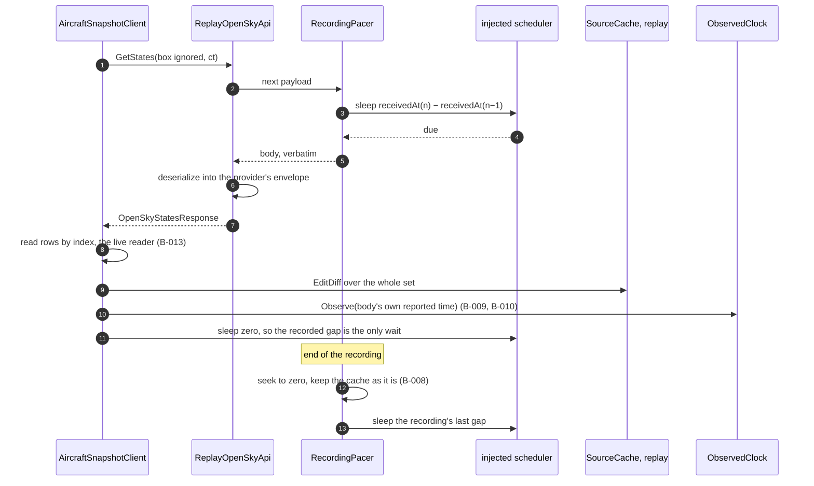

# Specification: Replay source

## 1. Business Goal

<!-- Rules: ../../../.spec/templates/feature.md § 1 -->

The talk's claim is that polled data can still be reactive, and it is proved by a grid filling on stage. That proof currently depends on a venue network and on a provider that blocks hyperscaler IPs, rate-limits by credit, and hands out tokens that expire in thirty minutes — so the demo's headline mechanism and the venue wifi share a single point of failure. This feature removes it by recording what a live provider actually sent during rehearsal and feeding those payloads back at their original spacing through the same `ITrackerSource` seam and the same selector the live sources use. The outcome is a fallback the presenter can reach with the control they already have, for aircraft and for vessels both, and a second thing for free: because nothing downstream can tell a recording from a live feed, replay _is_ the demonstration that the pipeline does not care where the data comes from. The failure state removed is a demo that only works on a good network — which, as the [stage-day runbook](../../../docs/runbook.md) puts it, is a gamble, not a demo.

## 2. User Needs

<!-- Rules: ../../../.spec/templates/feature.md § 2 -->

| #   | Persona                                                                                  | Need                                                                    | Pain point today                                                                                                                                             |
| --- | ---------------------------------------------------------------------------------------- | ----------------------------------------------------------------------- | ------------------------------------------------------------------------------------------------------------------------------------------------------------ |
| 1   | The presenter running the demo on stage (README.md § "Demo resilience")                  | To finish the talk when the venue network dies mid-sentence             | The only source of data is a provider reached over a network nobody in the room controls, and there is nothing to fall back to                               |
| 2   | The presenter at the closing act (README.md § "Closing act"; docs/runbook.md § "Never")  | The ships ending to survive the same failure as the main demo           | The closing act is the one part with no fallback at all, so the riskiest minute of the talk is also the least protected                                      |
| 3   | Line-of-business .NET developer in the talk audience (README.md § "Audience")            | To see that the pipeline is indifferent to its source, not be told it   | "Swap the source and nothing downstream changes" is an assertion until the audience watches a recording drive the same grid the live feed drove              |
| 4   | The same developer, reading this repository afterwards — the repository is the takeaway  | One switch between sources, not a live path and a separate offline path | Most codebases grow an "offline mode" flag that only runs under pressure, and it is the code least exercised and most likely to be broken when it is needed  |
| 5   | The same developer, whose CI cannot reach the provider                                   | To exercise the pipeline end to end with no network and no credential   | OpenSky blocks hyperscaler IPs (README.md § "Gotchas"), so a build agent can never run the live path, and a test that needs a key passes only on one machine |
| 6   | The presenter rehearsing the day before, inside the credit budget (README.md § "Limits") | To capture rehearsal traffic without paying twice for it                | Credits are the budget; a recorder that polls on its own doubles the spend of every rehearsal it observes                                                    |

## 3. Acceptance Criteria

<!-- Rules: ../../../.spec/templates/feature.md § 3 -->

Twenty-eight claims in six groups: **B-001 – B-006** the recording;
**B-007 – B-014** playback; **B-015 – B-018** selection and swap;
**B-019 – B-021** the vessel half; **B-022 and B-023** the substitution point
of each half, appended as § 11 rows 1 and 2 were answered rather than
renumbered into the groups they belong to — ids here are permanent; and
**B-024 – B-027** which recording a run loads, answered in
[adr/0001](adr/0001-recording-selected-by-configuration.md); and **B-028**, added
on 2026-10-09, which source is live when a run starts — until then decided by
registration order with nothing saying so, and the line a local edit kept
swapping to see a recording on screen.

Claim ids are per-Feature, per spec-and-traceability § "Claims and
traceability". `B-001` here and `B-001` in
[`aircraft-source`](../../../src/Transporter/Integrations/OpenSky/.spec/README.md) are different
claims: an `.issue/` item names its spec, and its `claims:` ids resolve
against that spec.

| ID | Claim | Source |
| ----- | ---------------------------------------------------------------------------------------------------------------------------------------------------------------------------------------------------------------------------------------------------------------------------------------------------------------------------------------------------------------------------------------------------------------------------------------------------------------------------------- | ------------------------------------------------------------------------------------------------------------------------------------------------------------------------------------------------------------------------------------------------------------------------------------------------------------------------------------------------------------------------------------------------------------------------------------------------------------------------------------------------------ | -------- |
| B-001 | For a provider whose JSON payload contains no raw line break, a recording SHALL use the NDJSON format fixed by [ADR-0004](../../../.spec/adr/0004-ndjson-recording-format.md): one line per payload, the payload verbatim beside its arrival instant. A payload containing a raw line break SHALL produce a warning that the recording is outside that format; B-002 still forbids reshaping or omitting it. | ADR-0004 § "Decision"; § 10 delta of 2026-10-06 |
| B-002 | The recorder SHALL NOT reshape, filter, reorder or omit a payload, including an empty or sparse one; what the provider sent SHALL be what the line holds. | ADR-0004 § "Decision" |
| B-003 | Recording SHALL NOT issue a request of its own; it SHALL record what a live source already fetched, so recording costs no additional credit and opens no additional socket. | README.md § "Limits"; § 4 row 10 |
| B-004 | Recording SHALL be observationally transparent: the changesets reaching the fleet SHALL be identical whether recording is on or off. | Decided call — a recorder is a tap, not a second source |
| B-005 | A recording intended for stage use SHALL span at least its source's silence threshold, so appearance, update and that source's silence treatment are reproducible from it. | ADR-0004 § "Decision"; aircraft-source B-051 |
| B-006 | A rehearsal recording SHALL NOT be committed to the repository, and SHALL NOT be used as a test fixture unless it has been scrubbed of real traffic first. | ADR-0004 § "Decision"; § 4 row 7 |
| B-007 | Replay SHALL emit payloads in recorded order at the recorded inter-arrival spacing, derived from the recorded instants, and SHALL NOT substitute a fixed interval. | README.md § "Demo resilience" |
| B-008 | On reaching the end of a recording, replay SHALL continue from its first payload; the stream SHALL NOT complete, fault, or emit a changeset that removes every vehicle at the loop boundary. | README.md § "Demo resilience" |
| B-009 | The observed instant downstream SHALL follow the replayed provider's reported-time policy: aircraft use the envelope instant; vessels accept only later reported instants within one pass and restart that maximum at a genuine recording rewind. An untimed vessel message SHALL leave the instant unchanged. Neither recorded arrival time nor an ambient clock SHALL supply the observed instant. | aircraft-source B-003; ADR-0004 § "Decision" |
| B-010 | The source's silence treatment under replay SHALL be driven by the recording's provider time base: aircraft are marked and kept, and vessels are removed after their source threshold without a stale mark. The clock SHALL be injected, not ambient. | README.md § "Demo resilience"; dynamic-data-pipeline § "Staleness and expiry" |
| B-011 | Replay SHALL make no network request and SHALL require no credential; it SHALL run to completion with the provider unreachable and no secrets configured. | ADR-0002 § "Decision"; § 4 row 2 |
| B-012 | A torn or unparseable final line SHALL be discarded and the stream SHALL continue; a recording truncated mid-write SHALL NOT fault replay. | ADR-0004 § "Decision" |
| B-013 | Replay SHALL produce domain vehicles through the same projection the live strategy uses; there SHALL NOT be a second converter, parser or mapper for recorded payloads. | mapping § "One mapper per boundary"; ADR-0004 § "Decision" |
| B-014 | A recording SHALL remain replayable after a converter fix, with no re-recording — which is what recording the payload raw is for. | ADR-0004 § "Decision"; ADR-0004 § "Decision drivers" |
| B-015 | Replay SHALL be selected through the same mechanism as any live source, and there SHALL be no offline-mode flag, no replay-only selector, and no second selection path. | README.md § "Demo resilience"; hot-swap-source § "Never add" |
| B-016 | No consumer SHALL be able to observe from the seam that replay rather than a live provider is selected. | aircraft-source B-039; hot-swap-source § "Never add" |
| B-017 | Swapping to replay SHALL stop the outgoing live source, so a swapped-out poller stops spending credits and a swapped-out socket stops reading. | aircraft-source B-040; hot-swap-source § "Disposal discipline" |
| B-018 | Swapping to or from replay SHALL NOT rebuild the tracker, its collection, its filters, its sorts, its groups or its bindings. | hot-swap-source § "What must not be rebuilt" |
| B-019 | A vessel recording SHALL use the same format and the same selection path as an aircraft recording, with one line per received message; messages SHALL NOT be batched into poll-shaped snapshots to make a push feed resemble a polled one. | ADR-0002 § "Decision"; § 4 row 5 |
| B-020 | A recorded vessel fallback SHALL exist before the closing act is presented. | docs/runbook.md § "Never" |
| B-021 | Replay SHALL introduce no vehicle, record or snapshot type of its own; it SHALL reproduce whatever the recorded provider's own Feature defines. | aircraft-source § 5 row 3; § 5 row 2 below |
| B-022 | Replay SHALL substitute at the provider's own API contract, handing back recorded envelopes, and SHALL introduce no snapshot client, cache, converter or projection of its own; the live path's snapshot client SHALL be the one constructed over it. | ADR-0002 § "Decision" item 2; § 11 row 1 |
| B-023 | Vessel replay SHALL substitute at the strategy — an `ITrackerSource` fed by a recording — because a push provider has no contract to stand in for; it SHALL reach the seam the same way every other source does. | ADR-0002 § "Consequences"; § 4 row 5 |
| B-024 | The recording each replay source reads SHALL be named in configuration, one key per source, through the same mechanism the interval and the bounding box use; no recording SHALL be compiled in as a default, a source with none named SHALL NOT be registered or selectable, and configuration SHALL NOT determine whether replay is the live source. | adr/0001; aircraft-source B-050 |
| B-025 | A named recording SHALL resolve against one overridable `Recording:Root` used by both rehearsal recording and replay. In the MAUI head its default SHALL be `recordings/` beneath the application-data directory, supplied before packaged settings and user secrets so either can override it; a host supplying no platform default SHALL retain `recordings/` relative to the running application. Neither a committed setting nor a recording name SHALL need an absolute path. | adr/0001 item 2; `0061` decision of 2026-10-09 |
| B-026 | At application startup, including the MAUI head, every named recording SHALL be reported with its source and resolved path as usable, absent, unreadable, containing no readable recorded line, or shorter than that source's silence threshold. An unusable recording SHALL leave its replay source unregistered without preventing application startup; its defect SHALL NOT first be discovered at selection. | adr/0001 item 4; `0061` |
| B-027 | The component that paces a recording SHALL be handed an opened payload stream rather than a path, and SHALL perform no file resolution of its own. | adr/0001; § 4 row 8 |
| B-028 | In a composition registering a live provider, the source selected at startup SHALL be a live provider: replay SHALL register after every live strategy, so the first registered strategy is live. No configuration, environment or launch value SHALL choose the starting source. A replay-only composition with no live provider is permitted by B-011. | `0081`; `0039` decision of 2026-10-07; B-011 |

## 4. Constraints

<!-- Rules: ../../../.spec/templates/feature.md § 4 -->

| #   | Constraint                                                                                                                                                                                | Source                                                                | Impact                                                                                                                                                                                                                                                                                                                                                                      |
| --- | ----------------------------------------------------------------------------------------------------------------------------------------------------------------------------------------- | --------------------------------------------------------------------- | --------------------------------------------------------------------------------------------------------------------------------------------------------------------------------------------------------------------------------------------------------------------------------------------------------------------------------------------------------------------------- |
| 1   | The recording format is fixed repository-wide: NDJSON, one line per payload, payload verbatim beside its arrival instant.                                                                 | ADR-0004                                                              | Rules out choosing a format here, and rules out a per-feed format. An accepted ADR is immutable, so a different format is a new ADR superseding it — not a claim in this section.                                                                                                                                                                                           |
| 2   | OpenSky blocks AWS and other hyperscaler IPs, and the venue network is outside our control.                                                                                               | README.md § "Gotchas"; docs/runbook.md                                | Rules out treating replay as a test convenience: it is the stage contingency and a CI prerequisite. Also rules out any replay path that needs the provider reachable to start.                                                                                                                                                                                              |
| 3   | The observed instant comes from the provider's own envelope, and no consumer reads an ambient clock to supply one.                                                                        | aircraft-source B-003                                                 | Rules out the recorded arrival instant being used as the observed instant. The arrival instant paces playback (B-007) and nothing else — two times on one line, one job each.                                                                                                                                                                                               |
| 4   | The response envelope and the positional row may be referenced only by the class implementing the API contract and by the snapshot client; the snapshot dies at the projection.           | aircraft-source B-045, B-046                                          | Satisfied rather than relaxed. Replay substitutes at the contract and brings no client of its own (B-022), so the envelope and the positional row stay referenced by exactly the two components B-045 names. **B-045 is not widened**, and a replay component that parses a recorded payload itself remains ruled out.                                                      |
| 5   | A contract layer exists only where the provider is request/response shaped; a push provider's strategy has none.                                                                          | aircraft-source B-049; § 4 row 4 of that spec                         | Rules out one uniform substitution point across both feeds. Aircraft replay has a contract it could stand in for; vessel replay has none, so the two halves substitute at different depths — B-022 for aircraft, B-023 for vessels. Both reach the seam, which is the only symmetry a swap target needs.                                                                    |
| 6   | The vessel message, client, cache, projection and tracker source are specified by the vessel Feature.                                                                                     | vessel-source § 3; aircraft-source § 5 row 3                          | Replay reuses the vessel Feature’s message reader, snapshot merge, projection and tracker seam. It does not redefine vessel fields, keys or units.                                                                                                                                                                                                                          |
| 7   | A rehearsal recording is operational data — real callsigns, real positions — and credentials are never committed, logged, or placed in a fixture.                                         | AGENTS.md § "Code Conventions"; § 4 row 7; aircraft-source § 4 row 12 | Rules out committing a recording, shipping one as a fixture, and any test that reads one. `recordings/` is git-ignored (ADR-0004); fixtures stay synthetic and committed beside their tests.                                                                                                                                                                                |
| 8   | No test may touch a network or the wall clock.                                                                                                                                            | AGENTS.md § "Core Principles"; test-from-scenarios                    | Rules out `Thread.Sleep`, a real delay, and a test that replays in real time. Replay's cadence is driven by an injected scheduler, so a test advances time deliberately — in production as well as in tests.                                                                                                                                                                |
| 9   | There is no Gherkin runner in this repository — no Reqnroll, no bindings, no step definitions.                                                                                            | AGENTS.md; spec-and-traceability                                      | Rules out the `.feature` file being the executing artifact, and rules out an `@ignore` tag. A scenario existing never means a claim is covered; the § 9 row pointing at an xUnit test does.                                                                                                                                                                                 |
| 10  | Credits are the budget — a ≤25 sq° box costs 1 credit per poll against 4,000 per day, polled every 15 seconds.                                                                            | README.md § "Limits"; aircraft-source B-050                           | Rules out a recorder that polls independently of the live source (B-003), which would double rehearsal spend. Recording is a tap on traffic already paid for.                                                                                                                                                                                                               |
| 11  | Aircraft past their configurable five-minute staleness threshold are marked and kept; vessels silent past `AisStream:SilentAfter` (default ten minutes) are removed without a stale mark. | aircraft-source B-051                                                 | Each source's own silence threshold fixes its minimum useful recording length (B-005, B-026); five aircraft minutes cannot demonstrate ten vessel minutes of silence.                                                                                                                                                                                                       |
| 12  | Nothing but the swap decorator is registered as `ITrackerSource`; a strategy registers as `ITrackerSourceStrategy`, which is what the decorator is handed as an enumerable.               | ADR-0011 § "Decision"                                                 | Rules out registering replay as `ITrackerSource` itself, which hands replay to consumers in place of the selector and makes the swap do nothing. Replay registers as a strategy, in one line, and the selector finds it there. Decoration no longer depends on registration order; B-028 still requires live strategies before replay so the first selected source is live. |

## 5. Out of Scope

<!-- Rules: ../../../.spec/templates/feature.md § 5 -->

| #   | Item                                                                                           | Exclusion reason                                                                                                                                                                                                                                          |
| --- | ---------------------------------------------------------------------------------------------- | --------------------------------------------------------------------------------------------------------------------------------------------------------------------------------------------------------------------------------------------------------- |
| 1   | The simulated source                                                                           | A separate Feature. It generates movement with no recording, no fixture and no cadence file, so ADR-0004 does not bind it and none of B-001 – B-014 applies. aircraft-source § 5 row 4 groups replay and simulated only because both were excluded there. |
| 2   | The vessel feed itself — `Vessel`, the AISStream client, its cache and its tracker source      | These are specified by vessel-source § 3. B-019 – B-023 describe recording and replay behavior over that feed, not the live feed’s domain or transport design.                                                                                            |
| 3   | Performing the recording                                                                       | An operational task at rehearsal, tracked in README.md § "Open items". B-005 claims what a stage recording must contain; capturing one is not code.                                                                                                       |
| 4   | A scrubbing tool                                                                               | B-006 forbids unscrubbed reuse; it does not commission an automated scrubber. Scrubbing a few minutes of NDJSON by hand is why the format is line-oriented and legible (ADR-0004 § "Consequences").                                                       |
| 5   | A transport control — seek, pause, scrub position, step a frame, change playback speed         | Playback is forward and looping (B-007, B-008). A transport is a media player nobody asked for, and ADR-0004 explicitly buys no index to seek with.                                                                                                       |
| 6   | Compression of recordings                                                                      | ADR-0004 § "Consequences" accepts uncompressed JSON at demo length and defers compression to a later record if it ever matters.                                                                                                                           |
| 7   | The swap control, the stage choreography, and what the audience sees during the gap            | `hot-swap-source` owns them, and the gap is already decided in aircraft-source decisions/0002. This spec claims replay's obligations as a swap target (B-015 – B-018) and stops there.                                                                    |
| 8   | An offline mode, an environment flag, or a "use replay" setting separate from source selection | Forbidden by B-015 and by hot-swap-source § "Never add". Recorded as an exclusion because it is the obvious thing to add under pressure, and the whole point is that there is one switch.                                                                 |
| 9   | Recording the domain side of the seam — changesets, vehicles, or the fleet's contents          | A recording is provider payloads (B-001). Recording after the projection would bake today's projection into the file and foreclose B-014, which is the reason raw was chosen over parsed.                                                                 |
| 10  | A history store, a track per vehicle, or any persistence of domain state                       | Each cache holds current state; aircraft-source § 5 row 14 rules a history collection out. A recording is an input to the pipeline, not an archive of its output.                                                                                         |
| 11  | The pipeline operators, the grid, and every other UI concern                                   | Downstream of the seam and untouched by a swap (B-018). `maui-ui` and `mvvm` own them; no scenario here names a UI mechanic.                                                                                                                              |
| 12  | A Gherkin runner, Reqnroll, step definitions, or bindings                                      | § 4 row 9. Scenarios are documentation; a runner would move the coverage gate off § 9, which is where AGENTS.md puts it.                                                                                                                                  |
| 13  | The `airplanes.live` backup source                                                             | Its access terms are unresolved (README.md § "Backup source"). A second live provider is a different contingency from a recording, and it gets its own contract and strategy if and when the terms clear.                                                 |

| 14 | Replay of provider JSON containing raw line breaks | ADR-0004's NDJSON format requires a newline-free payload. The writer preserves and warns about unsupported multiline input; supporting its replay requires a separate format decision, not minification or silent omission here. |

## 6. Concern Separation

<!-- Rules: ../../../.spec/templates/feature.md § 6 -->

One row per concern, not per claim, with the claim ids each row answers for in
its Notes — so coverage is read down the column rather than counted in rows,
and no claim is copied here to drift from § 3. The rows follow § 3's six
groups.

The judgment this section exists to keep separate is the one § 1 turns on: a
recording exists for a business reason — a venue network this demo does not
control — and the technical shape that follows from it is a second contract
implementation rather than a second client. Those are two readings of one
decision, and the **Both** rows below are where they are written as two.

The classifications are applied as
[`aircraft-source`](../../../src/Transporter/Integrations/OpenSky/.spec/README.md)
§ 6 applies them: **Business** where the shape could have gone either way
technically and a product judgment picked it; **Technical** where a constraint
or a skill decided it and no business party expressed a preference; **Both**
where a technical shape was chosen for a reason § 1 states. This Feature has
more **Both** rows than most, which is a finding rather than an accident —
nearly every technical choice below is downstream of one sentence about a
venue network.

| Item                                                              | Classification | Notes                                                                                                                                                                                                                                                                                                                                              |
| ----------------------------------------------------------------- | -------------- | -------------------------------------------------------------------------------------------------------------------------------------------------------------------------------------------------------------------------------------------------------------------------------------------------------------------------------------------------- |
| A recording holds the provider's bytes, not our reading of them   | Both           | § 1 wants a fallback that outlives a converter fix, which is a business property stated as re-recording nobody has to do. Technically it puts the tap below deserialization, since an envelope that has been through a reader and back is no longer verbatim. B-001, B-002, B-014.                                                                 |
| Recording taps traffic already paid for                           | Both           | § 4 row 10 is the business half — one day's credits, and a rehearsal must not spend the talk's. Technically the tap observes a response that was going to be fetched anyway and issues nothing of its own. B-003.                                                                                                                                  |
| Recording changes nothing the fleet sees                          | Technical      | A tap that perturbs its subject is a second source wearing a tap's name. No product stake; the claim exists because the failure is invisible from downstream. B-004.                                                                                                                                                                               |
| A recording's usefulness is measured in minutes                   | Business       | The threshold is the talk's: staleness is part of the demo, so a recording too short to show it cannot rehearse the segment it exists for. No technical reading picks a length — § 4 row 11 supplies the number. B-005.                                                                                                                            |
| A rehearsal recording is operational data                         | Both           | Technically § 4 row 7 and a git-ignored directory. The business half is that a recording holds real callsigns and real positions and this repository is public. B-006.                                                                                                                                                                             |
| The cadence belongs to the recording, not to the poller           | Both           | § 1's claim is that nothing downstream can tell replay from live, and a recording played at a fixed interval is visibly not the feed it recorded. Technically it moves the wait into the replay transport and takes the live client's own interval to zero — "Where the cadence lives". B-007.                                                     |
| The end of a recording is not the end of the feed                 | Both           | A talk runs longer than a rehearsal capture, which is why looping is claimed rather than left to the operator. The technical half is a rewind, and the hazard is the seam: a grid that empties at the loop boundary reads as the demo dying. B-008.                                                                                                |
| Two times on one line, one job each                               | Technical      | ADR-0004 put both on the line and § 4 row 3 says which does what. Nobody outside the code has a stake in it, and the whole risk is that a reader reaches for the nearer one. B-009, B-010.                                                                                                                                                         |
| Replay owes nothing to the network                                | Both           | § 1: the venue network is the failure being removed, so a fallback that needs the provider reachable removes nothing. Technically it means no socket, no credential, and no startup gate that demands one. B-011.                                                                                                                                  |
| A torn last line costs the line                                   | Technical      | ADR-0004 § "Decision". A recorder stopped with a keystroke is the ordinary case rather than the exception, and the line-oriented format was chosen partly so the damage is bounded to one line. B-012.                                                                                                                                             |
| One projection, whatever fed it                                   | Technical      | `mapping` § "One mapper per boundary". A second converter for recorded payloads is the shape this Feature exists to avoid: it would make the observed instant something two implementations each have to keep honouring. B-013, B-022.                                                                                                             |
| One switch, and replay sits behind it like anything else          | Both           | § 1 names this as the second thing the Feature buys: replay _is_ the proof the pipeline does not care where data comes from, and that proof is false the moment a consumer can tell. ADR-0011 is the technical half. B-015, B-016.                                                                                                                 |
| A swapped-out source stops spending                               | Both           | Credits again, and a poller still running behind a swapped-away source reads as a leak on a projector. The subscription owns the poll, so stopping it is the swap itself rather than a disposal this Feature performs. B-017.                                                                                                                      |
| The pipeline survives the swap                                    | Both           | § 1's closing act. Technically the decorator sits below everything that would be rebuilt, so this row is satisfied by where the seam is rather than by anything replay does. B-018.                                                                                                                                                                |
| Configuration names which recording; the selector names whether   | Both           | `adr/0001`. The business half earns the row: a presenter has exactly one control, and a configuration key that could also turn replay on would be a second control hiding in a file. B-024.                                                                                                                                                        |
| One root, so a rehearsal and the stage mean the same directory    | Technical      | `adr/0001` item 2 — resolution against a configured root rather than an absolute path in a settings file. No product judgment in it. B-025.                                                                                                                                                                                                        |
| A recording that cannot serve is a report, not a refusal to start | Business       | A product call: an unusable recording must not take the live demo down with it, so it is reported at startup and the presenter still has a talk. `aircraft-source` B-029, reworded 2026-10-15, agrees that neither stops the application, though not on when: B-026 reports at startup, B-029 names an absent credential at the first poll. B-026. |
| File resolution happens once, where the source is registered      | Technical      | `adr/0001` item 5. It keeps the component holding the time-base logic free of I/O, which is what lets a test drive it with synthetic lines and no file system. B-027.                                                                                                                                                                              |
| Both feeds record alike and substitute at different depths        | Technical      | § 4 row 5: a contract layer exists only where the provider is request/response shaped. The asymmetry follows from the providers rather than from a choice made here, and the symmetry that matters — both reach the seam — is untouched. B-019, B-023.                                                                                             |
| A recorded fallback exists before the closing act is presented    | Business       | README.md leaves the closing act optional; B-020 makes the fallback mandatory once it is on the agenda. That is a commitment about what gets presented rather than a technical property, which is why it belongs to the person running the talk.                                                                                                   |
| Replay defines no type of its own                                 | Technical      | § 5 row 2 and `aircraft-source` § 5 row 3. Replay reproduces whatever the recorded provider's Feature defines; a replay-flavoured vehicle would be a second domain model to keep in step, and it would make B-016 false by construction. B-021.                                                                                                    |

## 7. Technical Design

<!-- Rules: ../../../.spec/templates/feature.md § 7 -->

Four records settle what this section would otherwise have had to, and it cites
them rather than restating them: the substitution depth of each half in
[ADR-0002](../../../.spec/adr/0002-contract-client-strategy-tracker.md), the
recording format in
[ADR-0004](../../../.spec/adr/0004-ndjson-recording-format.md), what registers
as what in
[ADR-0011](../../../.spec/adr/0011-the-swap-decorator-selects-among-registered-strategies.md),
and which recording a run loads in
[adr/0001](adr/0001-recording-selected-by-configuration.md). What is left is
this Feature's own shape: where the tap sits, how a recording is opened, read
and looped, which component owns the cadence, and how a second chain over the
same classes is constructed and registered.

**Domain model**

**Not applicable — replay introduces no type of its own (B-021).** The vehicles
a recording produces are the recorded provider's: `Aircraft` and its base are
[`aircraft-source`](../../../src/Transporter/Integrations/OpenSky/.spec/README.md)
§ 7's and [ADR-0005](../../../.spec/adr/0005-an-abstract-base-carries-the-tracked-item.md)'s,
and `Vessel` belongs to the vessel Feature (§ 5 row 2). The only shapes below
are transport and configuration ones, and none crosses the projection.

**The recorded line**

ADR-0004 fixes the line; what matters to every component here is that it
carries two instants with one job each, and that mixing them is the failure
B-009 and B-010 are separate claims about.

| Field        | Type                       | Job                                                                                                                                                                              |
| ------------ | -------------------------- | -------------------------------------------------------------------------------------------------------------------------------------------------------------------------------- |
| `receivedAt` | ISO-8601 instant           | **Paces playback, and nothing else.** The gap between consecutive values is the only cadence replay has (B-007). It never reaches the observed clock and never leaves the pacer. |
| `body`       | the provider's JSON, as-is | **Everything downstream.** Deserialized into the provider's own envelope type, whose own reported time becomes the observed instant (B-009) and so the staleness base (B-010).   |

**What this Feature adds**

The recording spine is in `src/Transporter/Recording`; aircraft substitution
registers from OpenSky and vessel substitution from AisStream. The type table
links the components. Both strategies share the recording check and startup
report while retaining their separate provider paths.

| Component                            | Home                                          | Item   | Owns                                                                                                                                                                                                               |
| ------------------------------------ | --------------------------------------------- | ------ | ------------------------------------------------------------------------------------------------------------------------------------------------------------------------------------------------------------------ |
| `RecordingWriter`                    | `src/Transporter/Recording`                   | `0009` | Appends one NDJSON line per observed payload. Knows the format and nothing about who observed it. B-001, B-002.                                                                                                    |
| The tap                              | `src/Transporter/Integrations/OpenSky/Http`   | `0009` | Hands the writer the response body before anything parses it, on traffic the live client already paid for. B-003, B-004.                                                                                           |
| `RecordingPacer`                     | `src/Transporter/Recording`                   | `0010` | Reads an opened stream forward, discards a torn final line, rewinds at the end, and releases each payload when the recorded spacing says it is due. B-007, B-008, B-012, B-027.                                    |
| `ReplayOpenSkyApi`                   | `src/Transporter/Integrations/OpenSky/Replay` | `0011` | `IOpenSkyApi` over a pacer. Deserializes `body` into the provider's envelope and returns it; ignores the box and the extended flag, because a recording was taken with the ones it was taken with. B-013, B-022.   |
| `ReplayOptions` and its registration | `src/Transporter/Recording`                   | `0012` | One key per replay source, the recordings root, resolution to an opened stream, the startup report, and the construction of the second chain. B-024, B-025, B-026, and B-015 – B-018 by registering as a strategy. |
| The vessel replay strategy           | `src/Transporter/Integrations/AisStream`      | `0013` | `ITrackerSourceStrategy` fed by a pacer and the live vessel message reader and projection. B-019 – B-021, B-023.                                                                                                   |

**Where the cadence lives**

B-022 puts the live `AircraftSnapshotClient` over the replay contract, and that
client already owns a loop: it fetches, then sleeps its configured interval on
the injected scheduler. Left alone, a replayed payload would be spaced by the
recorded gap **plus** that interval, and B-007 would be false by exactly the
amount nobody notices on stage.

**The cadence lives in the pacer, and the replay chain's client is given an
interval of zero.** `GetStates` on the replay contract completes when the pacer
says the next payload is due, so the only wait in the loop is the recorded one.
The zero interval is not a global setting: keyed registrations give the
replay chain its own `OpenSkyOptions` instance, leaving the live chain's untouched.

Two consequences are worth stating rather than discovering:

- **A placeholder bounding box is configured on the replay chain's options.**
  The client reads the box before calling the contract and throws without one,
  and no request is made with it. An options value that exists only to satisfy a
  check is a wart; it is preferred to relaxing the live client's guard, which
  exists because a box nobody chose is a demo pointed at open ocean.
- **Rejected: letting the pacer absorb the client's interval** by waiting the
  recorded gap minus whatever already elapsed. It needs no second options
  instance, and it is correct only while the live interval stays shorter than
  the shortest recorded gap — fifteen seconds against a recording taken at
  fifteen seconds. It fails by drifting, which is the failure mode this Feature
  is least able to see.

**A second chain over the same classes**

B-022's "the same client class, not a second one" means a second _instance_,
not a second registration of the same singleton. Three things follow, and all
three are registration-time:

- **The replay chain gets its own `SourceCache<AircraftSnapshot, string>`.**
  Sharing the live cache would leave the outgoing feed's aircraft in the
  collection under the incoming one, which is the failure mode `hot-swap-source`
  lists and which B-016 forbids being visible.
- **The replay chain gets its own per-type seam** — an empty interface beside
  `IAircraftTrackerSource`, declaring nothing for the same reason that one does.
  It is not decoration: `SwappingTrackerSource.Select(Type)` resolves a strategy
  by `Single(type.IsInstanceOfType)`, so two instances of `AircraftTrackerSource`
  with no seam to tell them apart make every swap throw.
- **Registration is a method of its own**, taking configuration the way
  `AddOpenSky` does, so an application and a test compose the same graph and
  differ only in what configuration they supply (`aircraft-source` B-052).

**Opening a recording, and looping it**

Resolution happens once, where the source is registered: the configured name is
combined with the configured root, the file is opened, and the pacer is handed
the stream (B-025, B-027). The pacer reads forward, and at the end seeks to the
beginning of the same stream rather than reopening it — so the stream must be
seekable, which a `FileStream` is and which a test's `MemoryStream` is.

Three rules at the boundary:

- **Nothing is cleared on rewind.** The cache keeps what it holds and the first
  payload is applied as an ordinary differential update, so the boundary emits
  the changes between the last payload and the first and never a removal of
  everything (B-008).
- **The boundary's spacing is the recording's last gap.** There is no recorded
  interval between the final line and the first, and inventing a fixed one is
  what B-007 forbids; the most recent observed cadence is the honest stand-in.
- **Time moves backwards at the boundary, and that is correct.**
  `IObservedClockWriter.Observe` sets rather than taking the later of the two,
  which [ADR-0007](../../../.spec/adr/0007-the-live-source-advances-the-observed-clock.md)
  decided for exactly this case: a looping recording restarts its time base and
  the fleet stops being stale, the same way it did when the recording began.

For vessels, a later provider report may arrive after an earlier one within
the same pass. Only the pacer's actual end-of-file rewind distinguishes a new
pass from such a late message. The pacer exposes a rewind count while keeping
`receivedAt` private to pacing. The vessel replay source resets its own latest
reported instant on that boundary; its next timed message writes the shared
observed clock from `MetaData.time_utc`, never from `receivedAt`. Untimed frames
leave the clock where it is. Within a pass, only a later provider instant moves
the clock forward.

The replay cache is retained across rewinds, as B-008 requires. For each MMSI,
the first **timed** message in a new pass rebases the held snapshot's reported
instant; an untimed message preserves it. Later messages in that pass keep the
snapshot's newest-time guard. A vessel not yet heard from in the new pass keeps
its prior-pass snapshot and may remain visible until its next message or silence
filter decision. Later passes therefore do not promise the first pass's exact
initial membership. Clearing the cache to force that would emit the all-vessel
removal B-008 forbids. Tests cover contact and clock time across multiple passes,
late and untimed messages, and repeated silence removal.

A torn final line is discarded on read and the stream continues to the rewind
(B-012). A line that is complete but unparseable is the same case — the
recording is a log, not a contract, and one bad line costs one payload.

Two failures the pacer refuses rather than carries, both found building `0010`:

- **A stream that cannot seek is refused in the constructor.** The loop seeks to
  the beginning of the stream it was handed rather than reopening a file it never
  opened, so seekability is a precondition — and a precondition checked at the
  loop boundary is one that first fails minutes into a talk.
- **A recording with no readable line throws rather than spinning.** Rewinding a
  recording whose every line is torn would loop without ever releasing a
  payload, so the second rewind inside one call is the end of it. B-026's
  startup report is what keeps this unreachable: a recording that cannot be read
  leaves its source unregistered, so replay is not selectable in the first
  place.

**The tap sits below deserialization**

B-002 requires the line to hold what the provider sent, which rules out
recording a reconstructed envelope: `OpenSkyStatesResponse` round-tripped
through a writer is this repository's reading of the payload, not the payload.
The transport currently reads its body straight into the envelope type, so the
tap belongs where the raw body still exists — in the HTTP pipeline beneath the
contract, observing the response the live poll already made.

Rejected: **a decorator over `IOpenSkyApi`**, which is the obvious shape and
reaches only the deserialized envelope, so it can satisfy B-001's "beside the
instant it arrived" and not B-002's "verbatim". The two claims are separate for
this reason.

The tap is scoped to the states endpoint. The token endpoint is on the same
client cache and must never be recorded — a recording is shared and scrubbed by
hand, and § 4 row 7 puts credentials outside what may be written at all.

**Diagrams**

The constructed chain, with the live one above and the replay one below.
Dashed nodes are outside this Feature.

```mermaid
graph LR
  sky(["OpenSky /states/all"])
  file[("recordings/*.ndjson")]

  subgraph contracts["Integrations/OpenSky/Contracts"]
    api["IOpenSkyApi"]
  end

  subgraph live["the live chain"]
    httpApi["OpenSkyHttpApi"]
    tap["recording tap"]
    liveClient["AircraftSnapshotClient"]
    liveCache[("SourceCache, live")]
    liveStrategy["AircraftTrackerSource<br/>IAircraftTrackerSource"]
  end

  subgraph replay["the replay chain"]
    pacer["RecordingPacer"]
    replayApi["ReplayOpenSkyApi"]
    replayClient["AircraftSnapshotClient<br/>same class, interval zero"]
    replayCache[("SourceCache, replay")]
    replayStrategy["AircraftTrackerSource<br/>its own per-type seam"]
  end

  writer["RecordingWriter"]
  decorator["SwappingTrackerSource"]
  tracker["FleetTracker"]:::out
  clock["ObservedClock"]

  sky -->|"raw body"| tap
  tap --> writer
  writer --> file
  tap --> httpApi
  httpApi -.->|implements| api
  replayApi -.->|implements| api
  file -->|"opened once, at registration"| pacer
  pacer -->|"body, when due"| replayApi
  httpApi --> liveClient
  replayApi --> replayClient
  liveClient --> liveCache
  replayClient --> replayCache
  liveClient -->|"reported time"| clock
  replayClient -->|"recorded reported time"| clock
  liveCache --> liveStrategy
  replayCache --> replayStrategy
  liveStrategy -->|ITrackerSourceStrategy| decorator
  replayStrategy -->|ITrackerSourceStrategy| decorator
  decorator --> tracker

  classDef out stroke-dasharray: 4 3
```

One replayed payload, and the loop boundary. This earns its place because it is
where the two instants separate, and where the only wait in the loop is visible.

**Interface changes**

The tables link the declarations that exist. Types a consumer never names
remain `internal`; registration and the focused startup entry point below
are the public composition surface.

| Type                  | File                                                                                  | Claims it makes visible                                           |
| --------------------- | ------------------------------------------------------------------------------------- | ----------------------------------------------------------------- |
| `IRecordingWriter`    | [`IRecordingWriter.cs`](../../../src/Transporter/Recording/IRecordingWriter.cs)       | B-001's shape, and that a tap never faults into a poll (B-004)    |
| `RecordingWriter`     | [`RecordingWriter.cs`](../../../src/Transporter/Recording/RecordingWriter.cs)         | B-001, B-002                                                      |
| `UnrecordedPayloads`  | [`UnrecordedPayloads.cs`](../../../src/Transporter/Recording/UnrecordedPayloads.cs)   | B-004 — the null object is what makes the tap branch-free         |
| `RecordingOptions`    | [`RecordingOptions.cs`](../../../src/Transporter/Recording/RecordingOptions.cs)       | The one recordings root a rehearsal writes and a replay reads     |
| `IRecordingPacer`     | [`IRecordingPacer.cs`](../../../src/Transporter/Recording/IRecordingPacer.cs)         | B-007's shape, and that a payload leaves still raw (B-014)        |
| `RecordingPacer`      | [`RecordingPacer.cs`](../../../src/Transporter/Recording/RecordingPacer.cs)           | B-007, B-008, B-012, B-027                                        |
| `RecordedLine`        | [`RecordedLine.cs`](../../../src/Transporter/Recording/RecordedLine.cs)               | One reader of ADR-0004's line, for the pacer and the report both  |
| `ReplayOptions`       | [`ReplayOptions.cs`](../../../src/Transporter/Recording/ReplayOptions.cs)             | B-024 — one key per source, and no default to be wrong            |
| `IRecordingLibrary`   | [`IRecordingLibrary.cs`](../../../src/Transporter/Recording/IRecordingLibrary.cs)     | B-025's resolving, as the seam a test supplies recordings through |
| `RecordingLibrary`    | [`RecordingLibrary.cs`](../../../src/Transporter/Recording/RecordingLibrary.cs)       | B-025 — the only file system in the replay half                   |
| `RecordingDefect`     | [`RecordingDefect.cs`](../../../src/Transporter/Recording/RecordingDefect.cs)         | What B-026 reports, named rather than described                   |
| `CheckedRecording`    | [`CheckedRecording.cs`](../../../src/Transporter/Recording/CheckedRecording.cs)       | B-024, B-026 — the check that decides whether a source registers  |
| `ReplayStartupReport` | [`ReplayStartupReport.cs`](../../../src/Transporter/Recording/ReplayStartupReport.cs) | B-026 — a report at startup, and never a refusal                  |

| Type                           | File                                                                                                                   | Claims it makes visible                                            |
| ------------------------------ | ---------------------------------------------------------------------------------------------------------------------- | ------------------------------------------------------------------ |
| `ReplayOpenSkyApi`             | [`ReplayOpenSkyApi.cs`](../../../src/Transporter/Integrations/OpenSky/Replay/ReplayOpenSkyApi.cs)                      | B-007's client half, B-009, B-013, B-014, B-022                    |
| `IAircraftReplayTrackerSource` | [`IAircraftReplayTrackerSource.cs`](../../../src/Transporter/Tracking/Sources/IAircraftReplayTrackerSource.cs)         | The seam the selector tells two instances of one class apart by    |
| `AircraftReplayTrackerSource`  | [`AircraftReplayTrackerSource.cs`](../../../src/Transporter/Tracking/Sources/AircraftReplayTrackerSource.cs)           | B-022 — it delegates `Connect` and projects nothing                |
| `OpenSkyReplayRegistration`    | [`OpenSkyReplayRegistration.cs`](../../../src/Transporter/Integrations/OpenSky/Container/OpenSkyReplayRegistration.cs) | B-007's zero interval, B-015, B-016's separate cache, B-022, B-024 |

Every declaration this section wrote out now has a file, so the table above is
the whole of it. `ReplayOptions` arrived with `0012` carrying exactly the two
keys written here, and the root is not among them.

**The recordings root moved, and the reason is `adr/0001` item 2.** This section
first declared `Root` on `ReplayOptions`, beside the recording names. `0009`
needed the same root to write to, and two types each carrying one would be two
places for one answer — with the second one edited being the one that is wrong
on stage. It lives on
[`RecordingOptions`](../../../src/Transporter/Recording/RecordingOptions.cs)
instead, which `0009` built, and `ReplayOptions` reads it from there. That is
what "a rehearsal writes and a replay reads the same place" requires in code
rather than in prose.

`ReplayOpenSkyApi` implements `IOpenSkyApi` explicitly, as `OpenSkyHttpApi`
does, so the contract's members are reachable only through the contract. It
introduces no envelope type and no row reader: the provider's own
`OpenSkyStatesResponse` is deserialized with the converter already attached to
`OpenSkyStateRow`, which is what keeps B-013's "no second converter" true in
code rather than in prose.

**What `0011` settled in building it**

Three things the section above left to the implementer, and one hazard the zero
interval creates.

- **The replay chain is registered piece by piece under a key**, not built by
  one factory: the pacer, the contract, the cache, the options and the client
  each have their own keyed registration, and the live chain keeps the unkeyed
  ones it already had. "The same class, a second instance" is then something the
  container expresses rather than something a comment claims, and a composition
  test resolves each piece instead of reaching inside an object graph.
- **The strategy under the replay seam delegates to the live one.**
  `AircraftTrackerSource` adheres to `IAircraftTrackerSource`, so two instances
  of it registered as strategies would both answer that seam and
  `SwappingTrackerSource.Select` would throw on every swap. The replay
  registration therefore wraps the live strategy in a type whose only member
  forwards `Connect`. Rejected: making `AircraftTrackerSource` adhere to both
  seams, which leaves the ambiguity where it was; and splitting it into a live
  subclass and a replay subclass, which edits a delivered type of another
  Feature to say what one line of delegation says.
- **A recorded payload that is not a states response is discarded, not thrown.**
  B-012 says a complete line that cannot be read costs one payload, and the
  contract is where a body is read, so this is the contract's discard rather
  than the pacer's. The bound matters more than the discard: this chain's
  interval is zero, so a call that failed would be answered immediately and
  asked again, and the loop would spin a core instead of waiting. A thousand
  unreadable payloads in a row ends the chain, which is a file that is not a
  recording of this provider.
- **A zero interval makes any immediate failure a busy loop**, not just this
  one. The live client answers a failed poll with its configured interval
  (`aircraft-source` B-029), and on this chain that interval is nothing — so
  every failure path above the pacer has to either wait or stop. `0012`'s
  startup report is what keeps most of them unreachable, and this is the reason
  it is a report rather than a nicety.

**The startup report**

B-026 is a report, not a refusal. At startup each named recording is resolved
and read far enough to answer three questions — does it exist, can it be read,
does it span the staleness threshold — and each answer is logged naming the
recording and the defect. A recording that fails any of them leaves its source
unregistered, which is what B-024 already does for a source with no recording
named: the control is absent rather than offering a wrong recording.

An unusable recording affects the fallback, so its report must not stop the
application. Live credential validation remains the live transport's concern;
this repair neither starts that transport nor changes its validation.

**What `0012` settled in building it**

Four things this section left open, and each is a consequence of B-024 rather
than a preference.

- **The check runs at registration and the report runs at startup.** They read
  as one thing above and are two: whether a source is registered at all depends
  on what the check finds, and a registration cannot be withdrawn once the
  container is built — so the check has to run while the collection is still
  open, which is before anything can resolve a logger. What is left for startup
  is saying so, which
  [`ReplayStartupReport`](../../../src/Transporter/Recording/ReplayStartupReport.cs)
  does over rows it did not produce. Its generic-host adapter remains an
  `IHostedService`; the MAUI call is specified below. Rejected: an
  `IValidateOptions<ReplayOptions>`, which runs after the container is closed
  and could only fail the host — the one thing this report must not do.
- **The recordings root is a seam, not a path.** A rehearsal recording is
  operational data that is never a fixture (B-006), so a test of the
  registration has no file to point at; the registration takes an
  `IRecordingLibrary` and the public overload builds the file-backed one from
  configuration. B-025's resolving is then asserted against `RecordingLibrary`
  itself, which is where the combine against the root lives, and the only file
  system in the replay half.
- **The pacer's line reader is now shared, not copied.** Measuring a recording's
  span reads `receivedAt` off every line, which is the pacer's own parse — so it
  moved to `RecordedLine` and both call it. Two parsers of one format is the
  drift ADR-0004 exists to prevent, and the second one written is the one that
  reads a field the recorder stopped writing.
- **The vessel key is checked, reported, and closed.** B-020 expects the closing
  act's recording to be cleared by this report, so the row is produced for a
  configured vessel recording even though nothing can consume one until `0013`.
  Its handle is released rather than held open for a run nobody reads it in.

**`0061`: the head supplies the root and invokes the report**

The root decision of 2026-10-09 is retained. `MauiProgram.Settings` supplies
`Path.Combine(FileSystem.AppDataDirectory, "recordings")` as the lowest-priority
`Recording:Root` value, before `TransporterConfiguration.Compose` layers the
packaged settings and optional secrets. `Compose` accepts an optional default
root argument; existing callers that omit it keep their current relative
root. `RecordingOptions` remains the one option both writer and reader bind.
Only `src/Gui` names `FileSystem`; no MAUI dependency enters `Transporter`.
MAUI maps this Apple-platform API to the Library directory
([platform implementation](https://github.com/dotnet/maui/blob/main/src/Essentials/src/FileSystem/FileSystem.ios.tvos.watchos.macos.cs)).
An explicit root still wins, including one the sandbox cannot open: the
startup diagnostic explains that failure instead of changing configuration.

Registration still resolves, opens and measures recordings before the service
collection closes. Startup reports those same `CheckedRecording` rows and
performs no second file check. `ReplayStartupReport` has an internal
synchronous `Report` operation; its required `IHostedService.StartAsync`
adapter calls that operation and returns a completed task. The existing
singleton registration and hosted-service alias remain the same object.

[`OpenSkyReplayRegistration.ReportReplayStartup`](../../../src/Transporter/Integrations/OpenSky/Container/OpenSkyReplayRegistration.cs)
is the public composition entry point, which resolves
that singleton and calls `Report`. After `builder.Build()`, and before
returning the `MauiApp`, `MauiProgram.CreateMauiApp` calls it on `app.Services`.
Generic hosts continue to reach the same operation through `IHostedService`.
Each composition uses its own startup route; a plain `ServiceCollection`
test calls the explicit route without starting a generic host. The report
resolves no tracker or actor, selects no source, polls nothing, and only logs
the rows registration already produced.

The head adds the existing console logging provider in every build
configuration, before building the app; `AddDebug` alone cannot make startup
output available to a presenter in Release. `Microsoft.Extensions.Logging.Console`
is already available through the head's resolved dependencies. The report's
Information and Warning messages must reach that provider. The runbook gives
a terminal launch using `open -n --stdout <log-file> --stderr <log-file>
<app-bundle>` and steps to read the captured report before a talk. The head
review checks both the explicit invocation and an enabled output sink; a
resolved logger with no sink does not satisfy B-026. No UI notification,
second reporter or file-logging service is introduced.

Rejected: starting every `IHostedService` from the head. That changes the
lifecycle of unrelated services to make one report run and leaves stop
ownership unclear. Rejected: reporting from a view or view model, which makes
B-026 depend on navigation and puts startup work downstream of the seam.
Rejected: a second MAUI-specific reporter, which duplicates the messages the
presenter must understand. This is a focused composition call, not a new
startup framework or service interface.

`RecordingDefect.Unreadable` covers a file that cannot be opened or read, or
whose stream cannot seek. A separate `NoReadableLine` value covers an opened,
seekable stream with no line `RecordedLine` accepts. The check retains
`Absent`, `TooShort`, `Unnamed` and `None`; the report names the source and
resolved path for each named recording, and the measured span for a usable
or too-short one. An I/O or access failure while scanning or rewinding also
becomes `Unreadable`, releases the handle and excludes the source. A rejected
recording holds no stream; a usable aircraft stream is rewound and handed to
the existing pacer. No payload or credential is logged.

[`docs/runbook.md`](../../../docs/runbook.md) gives the Mac container's `Data/Library/recordings/`
location (derived from the head's bundle identifier), the root override, and
steps to inspect startup output before rehearsal or a talk. It must distinguish
that input directory from the ignored `.recordings/` export produced by
`tools/copy-recordings.sh`. That helper now reads the platform default rather
than the old `Data/Documents/recordings/` workaround, so the root repair does
not strand rehearsal exports. Existing files
are not migrated or selected automatically. The sample writer remains `0079`'s and the source
picker remains `0039`'s.

**The vessel half**

B-023 substitutes at the strategy: a vessel replay source implements
`ITrackerSourceStrategy` directly and is fed by a pacer over the same format,
because a push provider has no contract to stand in for (§ 4 row 5). It
registers the same way, is selected the same way, and reaches the same seam —
the asymmetry is the depth and nothing else.

`VesselTrackerSource.FromSubscription` supplies the live vessel projection over
a separate retained replay cache and a playback lifetime; no replay-specific
vehicle, snapshot or mapper is added. The live client and replay each write
their own cache through the provider snapshot's pure per-message merge. The
live client's maximum reported time survives reconnects, while replay's
maximum resets only at the pacer's genuine rewind. A vessel recording is
checked against `AisStream:SilentAfter`, default ten minutes, rather than the
aircraft's five-minute threshold. An unusable vessel file remains a startup
diagnosis and an absent source, just as an unusable aircraft file does.

**Credential validation follows the live source**

No open decisions. The one this section raised — whether an application
composing the OpenSky integration may start with no credential, which B-011
requires and `AddOpenSky`'s `ValidateOnStart` then refused on any host that
started — was answered by the person on 2026-10-06, and § 11 row 4 carries the
options and why this one won. Since 2026-10-15 `aircraft-source` B-029 claims
that an absent credential stops nothing in any composition: the first poll
needing it fails with a warning naming it. Which part registers the credentials
is unchanged by that rewording.

The shape it settles: **credential validation is registered with the live
transport rather than with the integration.** `AddOpenSky` splits into a shared
part and a live part, and the replay registration calls the shared part only.

| Registered by   | What it carries                                                                                                                                 |
| --------------- | ----------------------------------------------------------------------------------------------------------------------------------------------- |
| shared          | `OpenSkyOptions`, the observed clock's three aliases, `AircraftSnapshotMapper`, the scheduler provider.                                         |
| the live part   | `OpenSkyCredentials` and their validation, the token source, the Flurl client cache, `OpenSkyHttpApi`, and the live cache, client and strategy. |
| the replay part | `ReplayOptions` and its report, the pacer, `ReplayOpenSkyApi`, and the replay cache, client and strategy.                                       |

`0012` built it: `AddOpenSky` calls `AddOpenSkyShared` and then registers the
live transport, `AddAircraftReplay` calls the same shared method and then
registers the replay half, and an application calls both. The shared part
returns having done nothing when it has already run, because calling it twice is
what an application that registers both halves does — and the marker it checks
is the observed clock, since one clock object behind three aliases is the
registration two calls would break.

Two things this is **not**. It is not two compositions of one graph: the shared
part is one method both call — `internal` rather than private, because the two
registrations are two classes in one assembly — which is the objection that
ruled out building the replay chain outside `AddOpenSky` altogether. And it is not a
credential becoming optional — a composition that registers the live transport
reads and validates its credentials exactly as one without replay does, so
[`aircraft-source`](../../../src/Transporter/Integrations/OpenSky/.spec/README.md)
B-029 holds for it unchanged. What is new is a composition B-029 never
contemplated: one with no live transport at all, where there is no credential
to be missing.

B-029 is `aircraft-source`'s, and nothing here amends it. That Feature reworded
its first half on 2026-10-15, from its own § 11 row 7: an absent credential is
named at the first poll and stops nothing, and its credentials are validated on
read rather than on start. Neither change touches a composition with no live
transport.

## 8. Testing Strategy

<!-- Rules: ../../../.spec/templates/feature.md § 8 -->

**Testability assessment**

Against § 7's design, not against the claims alone — the assessment of a shape
nobody has committed to is worth nothing.

| Dimension          | Verdict       | Finding                                                                                                                                                                                                                                                                                                                                                                                                                                                                  | Recommendation                                                                                                                                                                                                                                                                                     |
| ------------------ | ------------- | ------------------------------------------------------------------------------------------------------------------------------------------------------------------------------------------------------------------------------------------------------------------------------------------------------------------------------------------------------------------------------------------------------------------------------------------------------------------------ | -------------------------------------------------------------------------------------------------------------------------------------------------------------------------------------------------------------------------------------------------------------------------------------------------- |
| DI seams           | Pass          | The substitution point is already an interface, and `adr/0001` item 5 hands the pacer an opened stream rather than a path — so the one component with time-base logic has no I/O to stub and a `MemoryStream` of synthetic lines reaches it whole. The replay chain is composed through keyed registrations, which is itself the seam a composition test uses.                                                                                                           | —                                                                                                                                                                                                                                                                                                  |
| Behavior isolation | **Qualified** | The cadence lives in the pacer, and the loop that calls it lives in `AircraftSnapshotClient`. B-007 is provable at the pacer in one statement, and a pacer that paces correctly proves nothing about an outer loop that adds its own interval on top — which is the failure § 7 rejected an option to avoid.                                                                                                                                                             | B-007 takes two tests: one at the pacer for the spacing, one through the client for the zero interval. `test-from-scenarios` § "A claim proven only against an inner method" is the rule; § 9 gives B-007 one row and names both.                                                                  |
| Coverage potential | **Qualified** | Most claims are about a value or an observable sequence and take ordinary tests. Five include a review obligation: B-005 is about what a captured recording contains, B-006 about what is committed, B-020 about what exists before a talk is given, and B-021 and half of B-022 about what types a component may introduce. This repository's answer to a structural claim is a compiler diagnostic, and the boundary analyzer carries no rule bearing on any of these. | Four are marked **Review** rather than given a test that reads a declaration ([lesson 0006](../../../.spec/lessons/0006-a-row-is-not-a-reason-to-write-a-test.md)); B-022's other half is an ordinary composition test, so its row names both. B-005's review cannot be performed yet — see below. |
| Fixtures           | **Qualified** | Every fixture is synthetic NDJSON: two or three lines as a `static readonly string`, in a `*Cases.cs` beside the tests, parsed the way production parses it. The hazard is specific to this Feature and stated as a claim: **a rehearsal recording is operational data and is never a fixture** (B-006), so the one artefact that would make these tests easy to write is the one thing they may not read.                                                               | A torn line is a fixture whose last line is cut mid-token, not a file truncated by a test. Keep the loop cases short — three lines is enough for a boundary.                                                                                                                                       |
| Determinism        | Pass          | Nothing here reads the wall clock. Spacing comes from recorded instants advanced on `ISchedulerProvider`, and staleness from the observed clock the replayed envelope writes — so a test advances time deliberately and a recording's whole span passes in microseconds. No test reaches a network, and B-011's own scenario is that none can.                                                                                                                           | —                                                                                                                                                                                                                                                                                                  |

**Two mechanisms, and which proves what**

An **xUnit test** proves a value the code computes or a sequence it emits. A
**review** proves a claim about something the repository does not contain — a
captured recording, a file that must stay uncommitted, a type nobody may
introduce — where there is no value to compute and no declaration worth
asserting over. A review is a mechanism and it can be performed: it records what
was looked at, on which item, and what change re-does it.

There is no third mechanism here. The boundary analyzer
([ADR-0006](../../../.spec/adr/0006-an-analyzer-enforces-the-layer-boundaries.md))
carries no rule bearing on this Feature, and asking for one is
`Transporter.Analyzers`' own Feature rather than a line in this section. A test
over `typeof(...)` is not an option: it executes, so it looks like the first
mechanism, and it asserts a declaration, so it does the second's job badly.

**The stage recording review is now possible.** B-005 has a captured vessel
recording longer than its source's ten-minute threshold. B-026 tests the
threshold mechanically for each source. B-020 remains an operational review:
the built head must report the effective vessel recording usable before the
closing act.

**A finding for `spec-author`: B-011's test is a host test, and `0010` cannot
write it.** B-011 — replay runs with no credential configured — is provable only
against a composed host, and the composition that makes it true is § 11 row 4's
registration split, which is `0012`'s. `0010` holds the claim and delivers
nothing that can move its row. This is the shape
[lesson 0011](../../../.spec/lessons/0011-a-review-nobody-performed-is-not-a-review-nobody-can-perform.md)
names, and the remedy is a claim reassignment in § Tasks rather than a test
`0010` cannot write — not this section's to make.

**The same finding held for B-014 and for half of B-007, and `0011` settled
both.** B-014's row names `ReplayOpenSkyApiTests` and B-007's second test is
`ReplayCadenceTests` over the live client on the replay contract: both types are
`0011`'s, so `0010` built the pacer under them and moved neither row. `0011`
wrote both and both rows read `Verified`, which leaves B-011 alone in the state
this finding describes — a claim `0010` holds and `0012` must prove. The
reassignment is still `spec-author`'s to make, and it is now one row rather than
three; what the outcome shows is that closing the item on what it proved cost
nothing, because the item that could write the tests wrote them next.

**And `0012` settled the last of it.** B-011's row is `Verified` against
`ReplayCompositionTests`, over a host composed of the replay half alone: it
starts with no credential configured, the fleet fills from a recording, and
Flurl's `HttpTest` saw no call at all. So the finding is now about a row that
has moved rather than a row that cannot — three claims an item held and could
not prove, all proved by the items that could. Whether `0010` should still carry
B-011 in § Tasks is `spec-author`'s call and is the only part left of this
finding; nothing is waiting on it.

**What `0012` settled here.** A registration that decides whether a source
exists at all cannot be driven through the file system, because what it reads is
operational data no test may hold (B-006). The seam is the answer: the
registration takes the recordings root, a test supplies one held in memory, and
B-025's resolving is asserted against the real
[`RecordingLibrary`](../../../src/Transporter/Recording/RecordingLibrary.cs)
instead — which is also the only type in the replay half with a file system in
it.

**Scenarios**

Scenarios in [`replay-source.feature`](replay-source.feature) beside this file
carry the `@B-00n` they prove. B-025 and B-026 have additional failure and
composition cases; multiple scenarios may exercise one claim.
Scenarios are documentation; xUnit tests execute. Existing evidence is in § 9;
B-025 and B-026 are verified by `0061`; B-028 by `0081`.

- Happy path → B-001, B-003, B-004, B-007, B-009, B-011, B-013 – B-016, B-018,
  B-019, B-022, B-023, B-025, B-027, B-028
- Failure mode → B-008, B-010, B-012, B-017, B-026
- Validation failure → B-005, B-006, B-020, B-021, B-024
- Data-driven → B-002

Four buckets and one claim in the last, which is the honest count rather than a
spread: B-002 is the only claim whose proof is the same assertion over several
payloads — empty, sparse, and ordinary. Four of the five validation-failure rows
assert an absence rather than a behaviour, and they are exactly the four the next
section marks Review; B-024 is the odd one, a registration a host test observes.

**Startup repair: testable core and head review**

B-025 is held by configuration-composition tests using an invented application-
data root, with no configured root, then with a different packaged override and
a different secret-store override. A check that varies only a path combine
cannot prove configuration precedence. Existing relative-root resolution stays
covered. B-026 is held through the public startup entry point over a plain
service provider as well as the generic-host adapter, with recordings supplied
through `IRecordingLibrary`. These exercise the same checked rows and messages;
no test starts MAUI or reaches a provider. Synthetic opened streams distinguish
an I/O failure from no readable line and a too-short recording; unusable sources
remain absent and their handles are released.

Two head-only expressions require review under ADR-0016: that `Settings` supplies
the platform directory beneath packaged settings and secrets, and that
`CreateMauiApp` invokes the focused report after build and before returning.
The implementation records those reviews and the runbook check in § 9, with
what was inspected and what change re-does each. Passing a generic-host test
alone cannot mark B-026 `Verified`.

**Test infrastructure**

Nothing central. The stack `transporter-conventions` mandates is already
referenced, `Akka.TestKit.Xunit2` arrived with `0006`, and `test/UnitTests`
already stands up the application's own composition in
`TransporterCompositionTests` — which is the shape every host-level row below
reuses rather than assembling a graph by hand.

Five traps are worth carrying, because each cost a cycle in this Feature
specifically or would have:

- **An advance is not a wait, for work that left the scheduler.** Everything
  above the pacer awaits tasks rather than scheduler operations, so a
  continuation resumes on the thread pool and `AdvanceBy` returns before the
  chain has reacted. Worse than the race: the poll loop's next wait is scheduled
  when that late continuation runs, against a clock that has already moved, so
  the loop falls further behind on every advance and reads as a subject that
  stopped. Drive the chain through an awaitable fetch, await it after advancing,
  and hand the strategy a client that polls nothing when the loop is not what is
  being asserted
  ([lesson 0020](../../../.spec/lessons/0020-an-advance-is-not-a-wait-for-work-that-left-the-scheduler.md)).

- **A recorded instant that is not a round number of seconds hangs the run.** A
  test awaits a payload the pacer releases from a `TestScheduler`, so the
  advance has to reach the recorded gap exactly: instants a millisecond apart
  from the round figure — `14:32:11.113` to `14:32:26.118` — make the gap
  15.005 seconds, and an `AdvanceBy` of fifteen never reaches it. The await then
  never completes and the whole run hangs rather than failing, which looks like
  a stuck build and not a wrong fixture. Recorded instants in a fixture carry
  the same milliseconds on every line.
- **A generated fixture names a builder after its parameter's _type_**, so
  `AircraftSnapshotClient`'s two `IOptions<OpenSkyOptions>`-shaped and
  cache-shaped parameters collide the moment the replay chain hands it different
  ones. That type's fixture is hand-written over `AutoFixtureBase<T>`, saying so
  in its remarks.
- **A recording has to outlast the staleness threshold or no source is
  registered over it** (B-026). So the two-polls-fifteen-seconds-apart recording
  that proves B-007 is useless to every selection test: the registration rejects
  it and the composition under test has nothing to select. The recordings
  selection reads span six minutes, and the ninety-second one exists to be
  rejected.
- **The arrangement is not a helper.** A synthetic recording is _data_ and may be
  built by a private method; the stream handed to the pacer, the host, and the
  configuration handed to the registration are the `// Given` and stay in the
  test body ([lesson 0015](../../../.spec/lessons/0015-a-helper-that-builds-the-arrangement-is-the-arrangement.md)).

## 9. Traceability Matrix

<!-- Rules: ../../../.spec/templates/feature.md § 9 -->

**This is the gate: twenty-seven of the twenty-eight rows read `Verified`;
B-020 alone remains `Missing`.** `0061` completes the platform startup evidence
for B-025 and B-026. `0013` supplies vessel recording and replay, and the
captured stage vessel file supplies the B-005 span review. The earlier tests
remain evidence for relative resolution and generic-host reporting alongside
the head repair. Five arrived with `0009`, which built the recorder:
B-001 – B-004 against `RecordingWriterTests` and `RecordingTapTests`, and
B-006 as a review a reader can now perform. Three arrived with `0010`, which
built the pacer: B-008, B-012 and B-027 against `RecordingPacerTests`. Six
arrived with `0011`, which built the replay contract and the second chain over
it: B-009, B-010, B-013 and B-014 against `ReplayOpenSkyApiTests`,
`ReplayStalenessTests` and `ReplayCadenceTests`, B-022 against
`ReplayCompositionTests` and a review this section records, and B-007 completed —
its pacer half passed on `0010` and its client half on `0011`. Eight arrived
with `0012`, which built selection: B-015 against `ReplayCompositionTests`,
B-016 – B-018 against `ReplaySwapTests`, B-024 and B-025 against
`ReplayRegistrationTests`, B-026 against `ReplayStartupReportTests`, and B-011 —
the row `0010` held and could not move — against a host composed of the replay
half alone.

The vessel feed is now specified and the `0013` implementation covers its replay
claims. The remaining stage review is B-020: the effective head configuration must
name the captured vessel file and report it usable before the closing act.

A row's Status becomes `Verified` when every mechanism it names passes in a run,
and a review becomes `Verified` when it is performed and recorded. A scenario
existing is never coverage; this section is the only place a claim's build state
is written.

Two kinds of entry appear in Test, and § 8 says which proves what. An **xUnit
test** proves a value or a sequence. A **Review** proves a claim about something
the repository does not contain, such as the stage recording or replay type
inventory. B-020 remains a pending operational review of effective configuration.

The Scenario column carries the `@B-00n` tag rather than a scenario title, so a
retitled scenario does not silently orphan a row. Each claim has one matrix row; its tag may anchor several scenarios.

| Claim ID | Scenario | Test                                                                                                                                                                                                                                                                                                                                                                                                                                                                                                                                                                                                                                                                  | Status   |
| -------- | -------- | --------------------------------------------------------------------------------------------------------------------------------------------------------------------------------------------------------------------------------------------------------------------------------------------------------------------------------------------------------------------------------------------------------------------------------------------------------------------------------------------------------------------------------------------------------------------------------------------------------------------------------------------------------------------- | -------- |
| B-001    | `@B-001` | `RecordingWriterTests.GivenAPayloadAndTheInstantItArrived_WhenTheLineIsWritten_ThenItHoldsBothInTheFormatADR0004Fixes`, with `GivenAnArrivalInstantOffFromUtc_...ThenTheInstantIsWrittenAsUtc` and `GivenThreePayloads_WhenEachIsRecorded_ThenThereIsOneLinePerPayload` and `GivenAPayloadCarryingALineBreak_WhenItIsRecorded_ThenItIsWrittenAndTheBrokenShapeIsLogged` for the unsupported-input warning — `0009`                                                                                                                                                                                                                                                    | Verified |
| B-002    | `@B-002` | `RecordingWriterTests.GivenAPayloadTheProviderSent_WhenItIsRecorded_ThenTheLineHoldsThoseBytesUnchanged`, over `RecordingWriterCases` — `0009`                                                                                                                                                                                                                                                                                                                                                                                                                                                                                                                        | Verified |
| B-003    | `@B-003` | `RecordingTapTests.GivenRecordingIsOn_WhenOnePollCompletes_ThenOnlyThePollsOwnRequestWasMade`, asserting the calls Flurl's `HttpTest` saw rather than counting in the tap — `0009`                                                                                                                                                                                                                                                                                                                                                                                                                                                                                    | Verified |
| B-004    | `@B-004` | `RecordingTapTests.GivenOnePayloadPolledWithRecordingOnAndOff_WhenEachEnvelopeIsRead_ThenTheyAreIdenticalAndSoAreTheRequests`, with `RecordingWriterTests.GivenADestinationThatThrows_...ThenTheTaskCompletesAndTheFailureIsLogged` for the failing-write half — `0009`                                                                                                                                                                                                                                                                                                                                                                                               | Verified |
| B-005    | `@B-005` | **Review** — the captured vessel rehearsal file spans 11.0066 minutes and includes timed appearance, update, and contacts silent longer than the default ten-minute vessel threshold. Aircraft stage recording review remains with `0009`; the vessel check is re-done for a changed stage file — `0013`                                                                                                                                                                                                                                                                                                                                                              | Verified |
| B-006    | `@B-006` | **Review**, done on `0009` and re-done on `0081`: `.gitignore` line 364 is `recordings/`, no tracked file carries an `.ndjson` extension, and no test reads a recording — every payload a test uses is a synthetic `static readonly` in `OpenSkyPayloads`, and the recorder's own tests write to a `StringWriter`. `0081`'s `TransporterCompositionTests` is the one test pointed at a file: it writes the synthetic `ReplayRecordingCases.SpanningSixMinutes` to a temporary root it creates and deletes, so no real traffic is read and nothing is committed. Re-done by any change that commits a recording, adds an `.ndjson` fixture, or points a test at a file | Verified |
| B-007    | `@B-007` | Two tests, per § 8's behaviour-isolation finding: `RecordingPacerTests.GivenThreePayloadsFifteenSecondsApart_WhenTheRecordingIsReplayed_ThenEachIsReleasedAtTheRecordedSpacing` for the spacing, and `ReplayCadenceTests.GivenTheLiveClientOverTheReplayContract_WhenPayloadsArrive_ThenNoIntervalOfItsOwnIsAdded` for the interval — the first passed on `0010`, the second on `0011`, where it reads the interval the client answers with rather than inferring it from timing ([lesson 0020](../../../.spec/lessons/0020-an-advance-is-not-a-wait-for-work-that-left-the-scheduler.md))                                                                            | Verified |
| B-008    | `@B-008` | `RecordingPacerTests.GivenTheRecordingIsReplayedPastItsEnd_WhenTheBoundaryIsCrossed_ThenTheFirstPayloadFollowsTheLastAndNoChangesetRemovesEveryAircraft` — `0010`; `VesselReplayPlaybackTests.GivenTwoPassesWithLateAndUntimedFrames_WhenReplayLoops_ThenClockAndContactsRebaseWithoutEmptyingTheFleet` and `GivenOneVesselAtBothEnds_WhenReplayRewinds_ThenNoBoundChangeRemovesIt` check retained vessel membership and no intermediate removal at the boundary — `0013`                                                                                                                                                                                             | Verified |
| B-009    | `@B-009` | `ReplayOpenSkyApiTests.GivenALineWhosePayloadReportsOneInstantAndArrivedAtAnother_WhenItIsReplayed_ThenTheReportedOneIsTheObservedInstant` — `0011`; `VesselReplayMergeTests.GivenAHeldContact_WhenANewPassStarts_ThenUntimedFramesKeepItAndTheFirstTimedFrameRebasesIt` and `VesselReplayPlaybackTests.GivenTwoPassesWithLateAndUntimedFrames_WhenReplayLoops_ThenClockAndContactsRebaseWithoutEmptyingTheFleet` check vessel time and rewinds — `0013`                                                                                                                                                                                                              | Verified |
| B-010    | `@B-010` | `ReplayStalenessTests.GivenAnAircraftLastReportedSixMinutesBeforeTheRecordingEnds_WhenTheRecordingIsReplayed_ThenItIsMarkedStaleAtThatPointAndKept` — `0011`; `VesselReplayPlaybackTests.GivenTwoPassesWithLateAndUntimedFrames_WhenReplayLoops_ThenClockAndContactsRebaseWithoutEmptyingTheFleet` checks vessel removal after ten provider minutes without a stale mark — `0013`                                                                                                                                                                                                                                                                                     | Verified |
| B-011    | `@B-011` | `ReplayCompositionTests.GivenNoCredentialConfiguredAndNoReachableProvider_WhenTheHostStartsAndReplayRuns_ThenTheFleetFillsAndNoRequestIsMade` — a host composed of the replay half alone, which starts because credential validation moved to the live transport (§ 11 row 4); the fleet fills from the recording and Flurl's `HttpTest` saw no call. `0010` holds the claim and **`0012` built the test**                                                                                                                                                                                                                                                            | Verified |
| B-012    | `@B-012` | `RecordingPacerTests.GivenARecordingWhoseFinalLineIsCutMidToken_WhenItIsReplayed_ThenEveryCompleteLineIsReplayedAndTheStreamDoesNotFault` — `0010`                                                                                                                                                                                                                                                                                                                                                                                                                                                                                                                    | Verified |
| B-013    | `@B-013` | `ReplayOpenSkyApiTests.GivenAPayloadThatProducedAnAircraftLive_WhenTheSamePayloadIsReplayed_ThenTheAircraftIsIdenticalAndTheLiveProjectionBuiltIt`, asserting the snapshots and the projected vehicles both — `0011`                                                                                                                                                                                                                                                                                                                                                                                                                                                  | Verified |
| B-014    | `@B-014` | `ReplayOpenSkyApiTests.GivenARecordingTakenBeforeAConverterFix_WhenItIsReplayedAfterTheFix_ThenTheCorrectedValuesAreObservedWithNoRecapture` — `0011` built the test, so the row moves: the recording still holds the padded callsign and the quoted squawk the provider sent, and the values observed are the ones today's reader produces from those bytes. `0010` delivered the half it could, the pacer answering the payload as text and never deserializing it                                                                                                                                                                                                  | Verified |
| B-015    | `@B-015` | `ReplayCompositionTests.GivenBothSourcesRegistered_WhenReplayIsSelected_ThenItIsSelectedThroughTheOneDecoratorAndNothingElseSelectsIt` — one registration answers the seam a consumer holds, both sources answer the one the selector reads, and selecting replay through it is what fills the fleet from the recording — `0012`                                                                                                                                                                                                                                                                                                                                      | Verified |
| B-016    | `@B-016` | `ReplaySwapTests.GivenTheFleetIsObserved_WhenTheSourceSwapsToReplay_ThenNoMarkerCompletionOrErrorReachesTheSeam` — the stream neither completes nor errors across the swap, and every change in it is an ordinary cache change about a vehicle — `0012`                                                                                                                                                                                                                                                                                                                                                                                                               | Verified |
| B-017    | `@B-017` | `ReplaySwapTests.GivenALivePollerIsRunning_WhenReplayBecomesTheLiveSource_ThenTheOutgoingPollStops` — `0012`; `VesselReplayPlaybackTests.GivenReplayWaitingForItsNextFrame_WhenItsStrategyIsUnsubscribed_ThenPlaybackIsCancelled` and `GivenAPacerReturnsAfterCancellation_WhenNextCompletes_ThenNoStateChanges` check vessel replay disposal; `VesselRecordingTests.GivenAWriteFinishesAfterTheSocketIsSwappedOut_WhenItCompletes_ThenTheFrameIsNotApplied` checks the live recorder handoff — `0013`                                                                                                                                                                | Verified |
| B-018    | `@B-018` | `ReplaySwapTests.GivenAFilterASortAndAGroupInPlace_WhenTheSourceSwapsToReplay_ThenNoneIsRebuiltAndTheBindingSurvives` — the bound collection is the same instance after the swap, the predicate set against the live feed still excludes the recording's aircraft reporting no position, the groups re-formed, and the live client was polled exactly once — `0012`                                                                                                                                                                                                                                                                                                   | Verified |
| B-019    | `@B-019` | `VesselRecordingTests.GivenThreeReceivedMessages_WhenRecorded_ThenThereIsOneLinePerMessageAndEightSecondsOfArrivalSpacing` checks one raw NDJSON line per pushed message, using the live client and one socket — `0013`                                                                                                                                                                                                                                                                                                                                                                                                                                               | Verified |
| B-020    | `@B-020` | **Review pending after integration** — name the captured vessel recording in effective `Replay:Vessels`, then run the built head and verify the startup report calls that exact path usable before presenting the closing act. Re-do for a changed stage file or startup configuration — `0013`                                                                                                                                                                                                                                                                                                                                                                       | Missing  |
| B-021    | `@B-021` | **Review**, performed on `0013`: the added replay classes are `VesselReplayPlayback`, `AisStreamReplayRegistration`, and shared `ReplaySourceRegistration`; no new vehicle, record, or snapshot type exists under replay code. Re-do when a replay namespace gains a type — `0013`                                                                                                                                                                                                                                                                                                                                                                                    | Verified |
| B-022    | `@B-022` | Both halves: `ReplayCompositionTests.GivenTheReplayChainIsRegistered_WhenItIsResolved_ThenTheClientIsTheLiveClassOverTheReplayContract`, with `GivenBothChainsAreRegistered_WhenEachIsResolved_ThenTheReplayChainHasItsOwnCacheAndAnIntervalOfZero` for the second instance; and a **Review**, performed on `0011`: `Integrations/OpenSky/Replay/` declares one type, `ReplayOpenSkyApi`, and the chain's only other additions are a seam interface and a strategy that delegates `Connect` — no client, cache, converter or projection in either. Re-done by any type added under the replay namespaces — `0011`                                                     | Verified |
| B-023    | `@B-023` | `VesselReplayRegistrationTests.GivenARecordedVessel_WhenReplayIsSelected_ThenTheOneSelectorPublishesAVesselWithoutASocket` checks the normal selector and shared seam through `VesselTrackerSource` with a synthetic recording and no socket — `0013`                                                                                                                                                                                                                                                                                                                                                                                                                 | Verified |
| B-024    | `@B-024` | `ReplayRegistrationTests.GivenAnAircraftRecordingNamedAndNoVesselOne_WhenTheHostStarts_ThenOnlyTheAircraftReplaySourceIsSelectableAndTheLiveSourceIsStillSelected` — two strategies, one of them replay, and the vessel key reported as unnamed rather than registered — `0012`                                                                                                                                                                                                                                                                                                                                                                                       | Verified |
| B-025    | `@B-025` | `RecordingRootTests.GivenAPlatformRootAndOptionalOverrides_WhenConfigurationIsComposed_ThenTheHighestPriorityRootIsShared` and `GivenNoPlatformRoot_WhenConfigurationIsComposed_ThenTheRelativeDefaultIsRetained`, plus the existing `ReplayRegistrationTests` relative-resolution case. **Review**, performed on `0061`: `MauiProgram.Settings` supplies `FileSystem.AppDataDirectory/recordings` beneath packaged settings and secrets; both reader and writer consume `Recording:Root`. The built Mac Catalyst head resolved a synthetic recording under `Data/Library/recordings/`. Repeat when head settings composition or recordings-root binding changes.     | Verified |
| B-026    | `@B-026` | `ReplayHeadStartupTests` and `ReplayStartupReportTests` check shared startup diagnostics — `0061`; `VesselReplayRegistrationTests.GivenAVesselRecordingLongerThanItsSilenceThreshold_WhenComposed_ThenItIsAReportedSelectableStrategy`, `GivenAVesselRecordingShorterThanTenMinutes_WhenComposed_ThenTheReportExcludesItsStrategy`, and `GivenATwentyMinuteVesselThreshold_WhenATwelveMinuteRecordingIsNamed_ThenItIsTooShort` check vessel-specific thresholds — `0013`                                                                                                                                                                                              | Verified |
| B-027    | `@B-027` | `RecordingPacerTests.GivenSyntheticLinesInAMemoryStream_WhenThePacerIsDriven_ThenItReplaysThemWithNoFileSystemAndReadsNoConfiguration` — proven by a test that has no file system rather than by reading the constructor — `0010`, with `GivenAStreamThatCannotSeek_WhenThePacerIsConstructed_ThenItSaysSoRatherThanFailingAtTheLoopBoundary` for the precondition the handover carries                                                                                                                                                                                                                                                                               | Verified |
| B-028    | `@B-028` | `TransporterCompositionTests.GivenARecordingIsNamed_WhenTheApplicationIsComposed_ThenTheLiveSourceIsSelectedAndTheRecordingFollowsIt` and `TransporterCompositionTests.GivenWhateverConfigurationNames_WhenTheApplicationIsComposed_ThenTheSourceARunStartsOnIsLive`, over the application's own `AddTransporter` with a synthetic recording in a temporary root; swapping `AddOpenSky` and `AddAircraftReplay` turns both red — `0081`                                                                                                                                                                                                                               | Verified |

**What the matrix says about the items.** The vessel replay tests and structural
review now cover B-019, B-021 and B-023. The captured vessel recording covers
the vessel span in B-005. B-020 remains `Missing` until the effective head
configuration names that file and the built head reports it usable. This is the
remaining gate for presenting the vessel closing act.

**`0010` is closed on all six of its claims, across three items.** B-008, B-012
and B-027 were `Verified` against `RecordingPacerTests` when the pacer landed;
B-007's client half and B-014 moved on `0011`, against the replay-contract tests
`0010` could not write; B-011 moved on `0012`, against a host over the
registration split. Closing `0010` on what it proved rather than holding it open
is what let `0011` and then `0012` run, and both moved the rows — which is the
case § 8's findings make, now with the whole outcome attached rather than only
the argument.

**`0012` closed on all seven of its own claims and one it did not hold.** B-015
– B-018 are selection and the swap, B-024 – B-026 are which recording a run
loads, and B-011 is the row this item existed to make provable. `0013` now
extends that selection path to vessels and keeps B-020 open for the stage-head
review.

**`0009` remains closed.** The captured vessel recording now meets its source's
ten-minute span in B-005; the aircraft stage file and rehearsal choice remain
operational data under § 5 row 3.

## 10. Lessons / Spec Deltas

<!-- Rules: ../../../.spec/templates/feature.md § 10 -->

**Spec delta, 2026-10-06, from `0012`: `adr/0001` item 4 reads as one step and is
two.** The record says a defective recording "is reported when the application
starts", and B-026 repeats it. What `0012` found is that the _check_ cannot wait
for startup: item 1 of the same record makes an unusable recording leave its
source unregistered, and a registration cannot be withdrawn once the container
is built — so the recording is resolved, opened and measured while the service
collection is still open, and startup is where the finding is said out loud. The
claim's wording is unamended, because what a presenter observes is exactly what
it promises; the record's item 4 would read truer as "reported no later than
startup, and decided before the container closes". That is `spec-author`'s call
and nothing waits on it.

**Spec delta, 2026-10-06, from `0009`: ADR-0004's two requirements cannot both
hold for a payload containing a line break.** The record fixes one JSON object
per line _and_ the provider's payload verbatim, and a payload with a raw
newline in it satisfies the second only by breaking the first. Nothing had
noticed, because OpenSky sends compact JSON and the question only arises for a
provider that pretty-prints — but this Feature's own test fixtures are
pretty-printed, so the recorder met the case on its first run.

What `0009` built: the payload is written **verbatim** and a warning is logged
naming the broken shape. Verbatim wins because B-002 forbids omitting or
reshaping a payload outright, where the one-line shape is ADR-0004's and the
record is still `proposed`. Minifying the body was rejected — it parses what
the record says is unparsed, and `1250.0` coming back as `1250` would make
"verbatim" untrue in a way no test would catch.

The delta is ADR-0004's to absorb: its decision should say that `body` must be
newline-free and that a provider which pretty-prints needs a superseding
record. Not amended here, because an ADR binds more than this Feature and
`0009` is not the change that decides for the repository.

**Spec delta, 2026-10-06, from `0011`: a boundary rule read a folder where its
claim named a contract.** The replay contract did not compile: `TRN0002`
reported it for naming the envelope its own signature returns, because the rule
allowed the transport namespace and a `Client` name suffix rather than asking
what a class implements. `aircraft-source` B-045 names "the class implementing
the API contract", and B-022 is what makes a second one of those ordinary — so
the rule was stricter than any claim, which is
[the analyzer Feature's lesson 0002](../../../src/Transporter.Analyzers/.spec/lessons/0002-a-rule-that-reads-a-folder.md)
and item
[`0053`](../../../src/Transporter.Analyzers/.issue/0053-contract-implementation-read-from-its-folder.yml).
Nothing here changed: § 4 row 4 still reads "satisfied rather than relaxed",
and it is now true in the analyzer as well as in prose.

- [Lesson 0001 — The head must run its startup report](lessons/0001-the-head-must-run-its-startup-report.md) — 2026-10-14, `0061`.

Two repository-wide lessons bear on this document:
[lesson 0020](../../../.spec/lessons/0020-an-advance-is-not-a-wait-for-work-that-left-the-scheduler.md),
which § 8 carries as this Feature's fourth trap and which cost `0011` the same
kind of cycle [lesson 0019](../../../.spec/lessons/0019-an-advance-that-stops-short-hangs-instead-of-failing.md)
cost `0010`; and
[lesson 0002](../../../.spec/lessons/0002-metadata-about-a-rule-drifts-too.md),
which is why § 3 keeps no build state § 9 owns, and why §§ 6 – 9 said in words
that they were unwritten rather than carrying a template row until the design
and coverage passes wrote them. All four are written now; a `Missing` row in
§ 9 is the only place this Feature's build state is recorded.

**Spec delta prepared 2026-10-14, `0061`.** B-025 now names the head's
application-data default and configuration precedence; B-026 covers the MAUI
startup path and separates an unreadable file from an opened one with no readable
recorded line. Existing evidence for both rows is retained, with their status
reopened to `Missing`. The implementation now records the sandbox and unstarted-hosted-service
symptoms and the tests proving the repair in Feature lesson 0001, indexed above.
The preparation itself changed no runtime code.

**Agreement corrections, 2026-10-14, independent review of `0061` preparation.**
B-001 and proposed root ADR-0004 now make the existing newline-free input
boundary explicit; the writer's existing multiline warning test proves the
unsupported case. The 2026-10-06 delta above is resolved as a format
precondition, not a new encoding or a changed writer. B-028 is qualified to
compositions with a live provider, as its scenario already was; B-011's
credential-free replay-only composition remains valid. B-026's startup design
also names an enabled console sink in every head build configuration and a
runbook capture route. These corrections change no runtime code.

## 11. Open Questions

<!-- Rules: ../../../.spec/templates/feature.md § 11 -->

None. The four original questions and the startup repair below are answered and are
recorded below rather than deleted — an answered question is a record of what
was asked. A question arriving later is added here as a row — `#`, Question,
Owner, Target date — rather than settled in conversation.

**Row 1 — answered: replay substitutes at the API contract, and selection stays
at the seam.** A replay implementation of the provider's contract hands back
recorded envelopes, and the live path's own snapshot client and cache are
constructed over it — the same client class, not a second one. That whole chain
registers as another `ITrackerSourceStrategy`, so replay is a swap target like
any live strategy and B-015 – B-018 hold as written. The claim is B-022.

The seam it registers as was `ITrackerSource` when this row was first answered,
and ADR-0011 changed it after `0049` ran ADR-0003's library: only the decorator
registers as `ITrackerSource` now, and a strategy that did would reach consumers
in place of the selector. § 4 row 12 carries the rule; the sentence above is
corrected rather than left as the answer that was written.

Two consequences worth keeping visible. **aircraft-source B-045 is not
widened**: replay introduces no client, so the envelope and the positional row
stay restricted to the two components that claim names (§ 4 row 4). And the
reason this reading won is that the recorded envelope carries the provider's own
reported time, so B-009's observed instant and B-010's staleness come free, with
no second implementation to re-derive them — where a replay client of its own
would have meant a second positional-row reader to keep correct and a second
place B-003 had to be honoured. A boundary rule honoured in two implementations
is one that drifts.

The decision binds any provider's contract rather than this Feature alone, so it
is recorded in [ADR-0002](../../../.spec/adr/0002-contract-client-strategy-tracker.md)
— amended there rather than given a record of its own, because that ADR's
subject already is the layering and where each thing substitutes in it.

**Row 2 — answered: vessel replay substitutes at the strategy.** It cannot
mirror row 1, because there is no vessel contract to stand in for (§ 4 row 5),
so the two halves substitute at different depths: aircraft replay below the
snapshot client, vessel replay at the strategy itself. B-023 claims it, and
ADR-0002 § "Consequences" accepts the asymmetry as following from its own
reading rather than from anything about the vessel feed. Both halves still reach
`ITrackerSource`, so the symmetry a swap target actually needs is untouched —
what makes something selectable is the seam it lands on, not the depth it
substitutes at.

**Row 3 — answered: configuration names the recording, and the pacer is handed
a stream.** ADR-0004 fixed the format and said nothing about which recording a
run loads; [adr/0001](adr/0001-recording-selected-by-configuration.md) answers
it, scoped to this Feature because nothing outside it is bound. One key per
replay source names the recording, through the same configuration mechanism the
interval and the bounding box use, with **no default compiled in** — a source
with no recording named is not registered and so is not selectable, which is a
visible absence rather than a wrong recording. Paths resolve against one
configured recordings root; B-025 now specifies the MAUI platform default
without changing a plain host's relative default. Configuration never decides _whether_ replay is live; the selector
does (B-015), and a recording named but never selected is normal. B-024 – B-027
carry it.

The alternative worth naming is newest-wins — order by the UTC instant already
in the filename and take the most recent, so a rehearsal needs no configuration
edit. It was rejected because a thirty-second test capture taken after the real
rehearsal silently becomes the stage recording, and B-005 then fails invisibly
at the one moment it matters. The cost of the chosen answer is one configuration
edit per rehearsal, and B-026 is what makes a forgotten edit visible at startup
rather than at the swap.

**Row 4 — answered: credential validation is registered with the live transport,
not with the integration.** Raised by the design pass and answered by the person
the same day. B-011 claims replay runs with no credential configured, and
`AddOpenSky` registers `OpenSkyCredentials` with `ValidateOnStart`, so an
application composing the OpenSky integration refuses to start without them —
which left B-011 unprovable above the unit level and left a recordings-only
laptop unable to start the demo at all, the exact situation this Feature exists
for.

`AddOpenSky` splits into a shared part and a live part, and the credentials and
their validation move to the live part. A composition that registers the live
transport validates exactly as it does today; one that registers only replay has
no credential to be missing. § 7 § "Credential validation follows the live
source" carries which registration holds what.

Two alternatives were named and rejected. **Leave the gate as it is** and prove
B-011 at the chain rather than at the host: no change to a delivered claim and
the least work, but it answers the Feature's own scenario by narrowing it to
what a unit test can reach, and a venue with no network and a laptop with no
secrets still cannot start the application. **Build the replay chain outside
`AddOpenSky` entirely**, constructing the contract-side graph itself: both
claims hold untouched, at the cost of a second composition of one graph — which
is what `AddOpenSky`'s own remarks argue against, and the first production
scenario it drifts from passes in a test.

What the answer costs: `aircraft-source` B-029 says a missing credential fails
at application startup, with no clause about which sources are registered. It
stays true for every composition it was written against, and the new case is one
it never contemplated. The claim is not amended here — it is another Feature's,
delivered, with a § 9 row and a test behind it — so whether its wording should
say so out loud is `aircraft-source`'s `spec-author`'s call.

_2026-10-15: `aircraft-source` B-029 was reworded — an absent credential no
longer stops the application; the first poll that needs it fails with a warning
naming it. Row 4 above, this paragraph included, states the behaviour as it
stood when the question was answered._

**Row 5 — resolved in `0061` preparation, 2026-10-14: the MAUI head supplies
the platform root and invokes the existing report explicitly.** The root keeps
the person's 2026-10-09 decision: application data by default, with packaged
settings and secrets able to override it. MAUI does not start the report's
generic-host adapter, so § 7 gives the head a focused composition call to the
same reporter after build. It starts no unrelated hosted service and requires
no UI or second reporter. The unreadable-file diagnosis is separated from an
opened file with no readable recorded line. B-025 and B-026 and their scenarios
carry the obligations; `adr/0001` remains proposed and is updated with the
options and costs. Independent sign-off remains § 12's.

## 12. Sign-off

<!-- Rules: ../../../.spec/templates/feature.md § 12 -->

| Sections | Owner       | Status      |
| -------- | ----------- | ----------- |
| §§ 1-5   | spec-author | 🟢 Approved |
| §§ 6-7   | implementer | 🟢 Approved |
| §§ 8-9   | test-writer | 🟢 Approved |

**§§ 6-7 lowered 2026-10-15, by `aircraft-source`'s B-029 rewording.** Its
§ 6 row "A recording that cannot serve is a report" and § 7's paragraphs on the
shared registration stated the withdrawn behaviour — an absent credential
stopping the application — as current; an independent read of `aircraft-source`
the same day found them (its § 12 finding 3). Both are amended to the reworded
claim. Owed: a read of the two edits by a reader who wrote neither, then the
person's agreement. Until then no item of this Feature moves to `in-progress`.

**Read 2026-10-15 by an independent `spec-reviewer` — §§ 6-7 recommended 🟢
once R1 is fixed.** The § 6 row and § 7's paragraphs are correct against
`OpenSkyReplayRegistration`, which calls only the shared registration, and
against `aircraft-source` B-029 as reworded. Three findings:

- **R1 — § 7 still says `AddOpenSky`'s `ValidateOnStart` "refuses" — blocking
  the 🟢, `implementer`.** The withdrawn behaviour in the present tense, in the
  subsection the note above says was amended.
- R2 — § 11 row 4's answer still states the old behaviour in the present tense;
  a dated line saying B-029 was reworded on 2026-10-15 closes it.
- R3 — § 6's "the two no longer depart" overstates it: B-026 reports at
  startup, B-029 at the first poll; they agree only that neither stops the
  application.

**R1-R3 answered 2026-10-15, `implementer`.** R1: § 7 puts `ValidateOnStart`'s
refusal in the past and states B-029 as reworded. R2: § 11 row 4 carries the
dated line. R3: § 6's row says the two claims agree on not stopping and differ
on when. Owed: a read of the three edits by a reader who wrote none of them,
then the person's agreement; the row stays 🟡 until both.

**Answers re-read 2026-10-15 by a `spec-reviewer` who wrote none of them —
§§ 6-7 recommended 🟢.** Read: commit `5e53f2e` (§ 6's B-026 row, § 7's
"Credential validation follows the live source", § 11 row 4's dated line)
against `aircraft-source` B-029's § 3 row, its § 7 and its 2026-10-15 delta,
and against `OpenSkyRegistration.AddOpenSky`, which still registers the
credentials with `ValidateOnStart`, and `MauiProgram.CreateMauiApp`, which
builds the app and starts no generic host. R1 is closed: the refusal is past
and confined to a host that starts, and the reworded B-029 is stated as
claimed. R3 is closed: the row says the two agree on not stopping and differ
on when. R2 is closed for the paragraph the dated line follows; R4 below is
the one it does not reach. §§ 6-7 were swept for any other present-tense statement of the
withdrawn behaviour, and none remains. § 7's "validated on read rather than on
start" is `aircraft-source` § 7's design, not yet the code; that gap is
`aircraft-source`'s B-029 `Missing` row, not a finding here. One finding,
outside §§ 6-7, so it does not hold the row:

- R4 — § 11 row 4's "What the answer costs" paragraph still says B-029
  "says a missing credential fails at application startup", in the present
  tense, and the dated line R2 added covers only "the paragraph above" it.
  The dated line moved below that paragraph, or naming it, closes it.

**R4 answered 2026-10-15, `implementer`:** the dated line now sits after
"What the answer costs" and names all of row 4.

**§§ 6-7 approved 2026-10-15.** R1-R4 are closed, and the person agreed: "I
agree: flip replay-source §§ 6-7 to 🟢 Approved and set spec_status to
approved." Every row is 🟢, so `spec_status` is `approved`, and no item of this
Feature is held by § 12. `0081` may move to `in-progress`.

**Independent agreement review, 2026-10-14.** A second reader, who authored
none of §§ 1-9, reviewed the complete replay agreement, scenarios, replay
items, Feature ADR-0001 and the applicable root architecture records. No
blocking specification findings remain. The shared platform default, override
precedence, focused startup route, console sink, recording diagnoses and stream
release are specified. The newline-free format boundary and replay-only
composition exception resolve the wider agreement inconsistencies found in
that review.

**Independent implementation review, 2026-10-14, `0061`.** The complete
implementation, new tests, § 7 updates, § 9 evidence, Feature lesson and runbook
were reviewed against B-025 and B-026. No blocking findings remain. The head
supplies the platform root beneath both settings sources, calls the shared
report after build, and enables console output outside `DEBUG`. The reporter
starts no source or hosted service; rejected recordings are diagnosed and
released. Eighteen focused configuration, startup and registration tests passed
in an independent rerun. The delivering build passed 318 tests; recorded
built-head smoke evidence confirms the Library path and usable/empty-recording
output through the documented capture route. The export helper's Library root
and shell syntax were checked.

The matrix has twenty-eight unique claim rows, each anchored to scenarios:
twenty-two are `Verified` and six remain `Missing`. B-025 and B-026 have their
implementation evidence. Vessel replay remains conditional on its provider
specification; `0013` stays blocked. This approval supplies neither that
provider nor a stage recording, and does not clear the remaining ship gates.

What `approved` requires, and why a `Missing` row in § 9 does not hold it
back, is [the template's § 12](../../../.spec/templates/feature.md).
**Scoped item `0013` review, 2026-10-21 — independent `spec-reviewer`.** This
reviewer authored none of the reviewed claims, design, tests or implementation.
The vessel recording and replay implementation is approved within its recorded
scope. It reuses the provider reader, pure snapshot merge and vessel projection,
keeps live and replay caches separate, and selects replay through the existing
seam. Arrival instants pace payloads only. Genuine EOF resets provider time;
untimed frames retain contact, and later messages preserve the within-pass
maximum. The rewind transition moves the observed clock before rebasing contact,
so the single-vessel bound-fleet regression sees no intermediate removal.
The multipass test proves return and a second silence removal. Released paced
frames and held recording writes check cancellation before shared-state writes.
Startup checks use the configured vessel threshold and retain the existing
registration and handle boundary. No actionable implementation findings remain.

The restored § 3 contains 28 standalone normative claims; only B-005, B-009,
B-010 and B-026 have the reviewed source-specific wording changes. The updated
agreement, design and evidence sections are approved. The matrix has 27 Verified
rows and B-020 remains Missing: the captured vessel file must still be named in
effective `Replay:Vessels` and reported usable by the built head before the
closing act. This review supplies no such operational evidence and does not
complete item `0013` or its parent.

The inspected final build log records successful Clean, Format, Compile and
Test with 577 tests passed, none failed or skipped. NugetRestore was skipped
because an earlier restore had completed; Format reported a workspace-loading
warning. The parent reports the 37 focused cases independently passed. This
review contacted no live provider and performed no UI action.

## Decisions

<!-- Rules: ../../../.spec/templates/feature.md § Decisions -->

None yet.

One record of this Feature's own:
[adr/0001](adr/0001-recording-selected-by-configuration.md) — which recording a
run loads, named in configuration rather than discovered. It is scoped here
because nothing outside this Feature is bound by it; the two records below bind
every Feature and sit at the root.

The recording format this specification is written against binds both replay
feeds rather than this Feature alone, so it is recorded in the
repository-wide [ADR-0004](../../../.spec/adr/0004-ndjson-recording-format.md),
as the layering and each half's
substitution point are in [ADR-0002](../../../.spec/adr/0002-contract-client-strategy-tracker.md) —
neither here nor in this Feature's `adr/`. The scope call that this Feature
covers both replay feeds while the simulated source becomes its own is recorded
as § 5 row 1 rather than as a `decisions/` file, because it is a boundary of
this specification rather than a call made and reversed inside it.

## Tasks

<!-- Rules: ../../../.spec/templates/feature.md § Tasks -->

| Item                                                                           | Claims                                          |
| ------------------------------------------------------------------------------ | ----------------------------------------------- |
| [`0008`](../.issue/0008-replay-source.yml)                                     | all 28 — the parent; its children hold the work |
| [`0009`](../.issue/0009-recording-tap.yml)                                     | B-001 – B-006                                   |
| [`0010`](../.issue/0010-playback-pacer.yml)                                    | B-007, B-008, B-011, B-012, B-014, B-027        |
| [`0011`](../.issue/0011-aircraft-replay-contract.yml)                          | B-009, B-010, B-013, B-022                      |
| [`0012`](../.issue/0012-replay-selection.yml)                                  | B-015 – B-018, B-024 – B-026                    |
| [`0013`](../.issue/0013-vessel-replay-strategy.yml)                            | B-019 – B-021, B-023                            |
| [`0061`](../.issue/0061-recordings-root-unreachable-in-the-sandboxed-head.yml) | B-025, B-026 — platform startup repair          |
| [`0081`](../.issue/0081-startup-source-is-live.yml)                            | B-028                                           |

The original delivery cut assigns each claim to one child, and `0008` carries
all of them because the children are slices of it. `0061` reopens B-025 and
B-026 after `0012` exposed the platform startup gap; its evidence replaces
those rows' narrower coverage rather than adding duplicate matrix rows. The cut
follows the component boundaries § 3 is grouped by, with one departure:
playback splits from the substitution point, so `0010` holds the claims about
reading a recording and pacing it — true wherever replay stands in — while
`0011` holds the ones B-022 fixes to the contract.

`0013` depended on the vessel Feature, which now specifies its message, client,
cache, vessel and tracker source. Its replay strategy is implemented over those
shapes. Its remaining stage requirement is B-020's effective configuration and
startup review.

Three of these items also have prerequisites in the aircraft Feature — the
recorder taps a live client, the contract substitution needs a live projection
to run above it, and selection needs the decorator. Those dependencies are
recorded in the items, where `depends_on` is authoritative, and are deliberately
not restated here as ids.

B-024 – B-027 arrived after these items were cut, when § 11 row 3 was answered,
and the items were amended to carry them: naming, root resolution and the
startup report to `0012`, where a run's recording surfaces, and the stream the
pacer is handed to `0010`, whose own open question the answer closed. The
invariant above holds across all 27 again.

B-028 was cut into `0081` on 2026-10-09, a test over a registration `0012`
already made; the invariant holds across all 28.

## Scoring

<!-- Rules: ../../../.spec/templates/feature.md § Scoring -->

| Date       | Item   | Field | Rationale                                                                                                                                                                                                                                                                                                                                                                                                                                                      |
| ---------- | ------ | ----- | -------------------------------------------------------------------------------------------------------------------------------------------------------------------------------------------------------------------------------------------------------------------------------------------------------------------------------------------------------------------------------------------------------------------------------------------------------------- |
| 2026-10-04 | `0008` | value | § 1 names one outcome — a fallback the presenter can reach with the control they already have — and the demo survives a dead venue network only if it lands whole.                                                                                                                                                                                                                                                                                             |
| 2026-10-04 | `0013` | value | README makes the closing act optional, while B-020 makes a fallback mandatory _once it is presented_. Conditional on the act happening, so below the parent rather than dropped.                                                                                                                                                                                                                                                                               |
| 2026-10-04 | `0008` | risk  | Spans recording, playback, selection and both feeds, and crosses two boundaries it is forbidden to duplicate — the provider's contract and the seam.                                                                                                                                                                                                                                                                                                           |
| 2026-10-04 | `0009` | risk  | B-004 makes transparency the claim: a tap that perturbs what the fleet sees fails in a way nothing downstream reports, and B-003 forbids buying correctness with a second poll.                                                                                                                                                                                                                                                                                |
| 2026-10-04 | `0010` | risk  | Time-base work throughout — pacing from recorded instants on an injected scheduler, the loop boundary, the torn final line — with § 11 row 3 bearing on it only as stream-or-path.                                                                                                                                                                                                                                                                             |
| 2026-10-04 | `0011` | risk  | Substitutes below a client it must not duplicate (B-022) while carrying the two claims most easily confused with each other: the reported time against the arrival instant (B-009, B-010).                                                                                                                                                                                                                                                                     |
| 2026-10-04 | `0012` | risk  | § 4 row 12 is the hazard: a strategy registered after Scrutor's `Decorate<>` resolves raw and silently, so the failure appears on stage rather than in a build.                                                                                                                                                                                                                                                                                                |
| 2026-10-04 | `0013` | risk  | Claims behaviour over a feed no specification defines yet (§ 5 row 2), and substitutes at a depth nothing else in this Feature uses (B-023).                                                                                                                                                                                                                                                                                                                   |
| 2026-10-04 | `0012` | risk  | Two registration-time hazards now stack here and neither shows at runtime: a strategy registered after Scrutor's `Decorate<>` resolves raw, so the swap silently does nothing; and a recording named but absent or shorter than the staleness threshold is a stage failure unless B-026's startup report catches it first.                                                                                                                                     |
| 2026-10-06 | `0012` | risk  | 4 → 3. One of those two stacked hazards is gone rather than mitigated: ADR-0003 is superseded by ADR-0011 after `0049` ran the library it named, and the decorator is handed its strategies by the container with no ordering to get wrong. What is left is the recording hazard — named but absent, unreadable or too short, answered by B-026's startup report — and the narrower registration trap § 4 row 12 now states, which a composition test can see. |

`0013` is the one child carrying a `value` of its own; the rest omit it to
inherit `0008`'s. `risk` is never inherited, and it moves when a claim lands on
an item: `0012` rose when B-024 – B-026 added the no-default rule and the
startup report, while `0010` held, having lost an open question and gained no
work.
