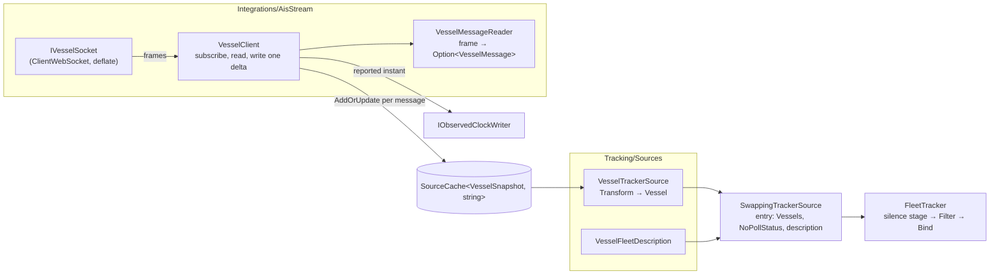
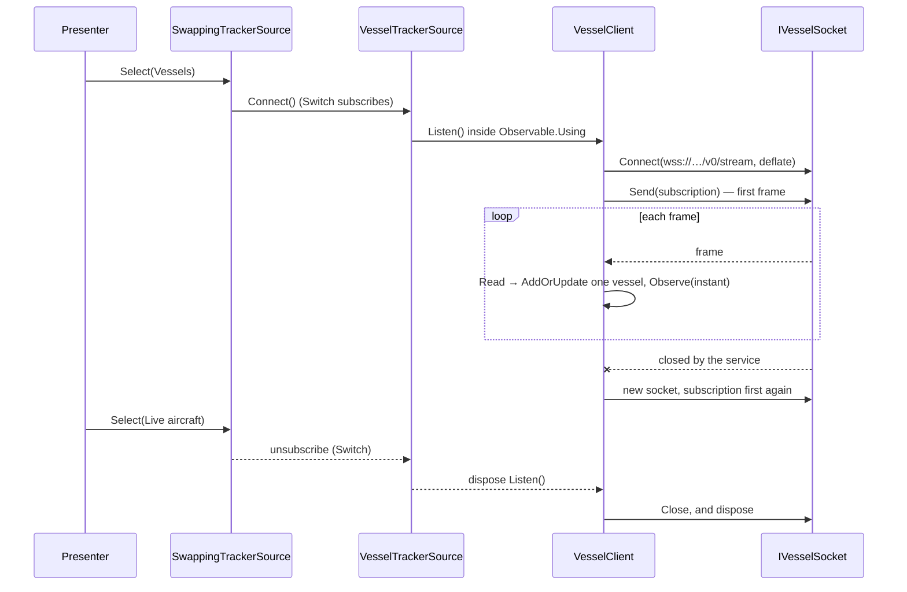

# Specification: Vessel source

## 1. Business Goal

<!-- Rules: ../../../.spec/templates/feature.md § 1 -->

The talk ends on a promise: replace the polled source with a push source, and
everything downstream of the seam stays the same (README.md § "Closing act").
The person chose ships on 2026-10-15. Until a second source exists, the promise
is only something the presenter says, and the audience has to take it on trust.
This feature builds that source. AISStream's WebSocket feed of vessel positions
over the same Houston box the aircraft use is held in a cache that the push
client writes for itself, projected into vessels by a strategy of its own, and
selected with the control the presenter already has. The feature also gives the
audience the treatment the aircraft deliberately lack. A vessel that goes silent
is gone rather than quiet, so it is removed — by a `Filter` re-evaluated on the
observed clock rather than `ExpireAfter`, which reads a scheduler's (§ 7,
README.md § "DynamicData operators"). The failure state removed is a
closing act with nothing behind it: "swap the source and nothing downstream
changes" stated, not shown.

## 2. User Needs

<!-- Rules: ../../../.spec/templates/feature.md § 2 -->

| #   | Persona                                                                                                                   | Need                                                                                              | Pain point today                                                                                                                                                                |
| --- | ------------------------------------------------------------------------------------------------------------------------- | ------------------------------------------------------------------------------------------------- | ------------------------------------------------------------------------------------------------------------------------------------------------------------------------------- |
| 1   | Line-of-business .NET developer in the talk audience, whose data arrives by request and response (README.md § "Audience") | To watch a push feed drive the grid a poll drove a minute earlier, with nothing downstream edited | Every claim that the pipeline does not care about its source has so far been made with one source. A second source of the same shape would prove nothing                        |
| 2   | The presenter at the closing act (README.md § "Closing act")                                                              | One tap from aircraft to ships over the same water, and one tap back                              | There is nothing to swap to. A closing act that needs a restart, a second build or a different box is a different demo, not a swap                                              |
| 3   | The same developer, reading this repository afterwards (the repository is the takeaway)                                   | A push strategy beside a polled one, visibly different in shape and equal at the seam             | The aircraft path has a contract, a positional-row reader and a differ, and a reader can mistake all three for what makes a source swappable (ADR-0002 § "Consequences")        |
| 4   | The same developer, whose items do not depart but stop reporting                                                          | To see removal on silence as a decision a source makes, beside the stale marker aircraft get      | Only one staleness treatment has been shown. The other, removal on silence, is listed in README.md as an operator to demonstrate, and nothing in the repository demonstrates it |

## 3. Acceptance Criteria

<!-- Rules: ../../../.spec/templates/feature.md § 3 -->

Twenty-six claims in six groups. **B-001 – B-007** cover the connection,
**B-008 – B-013** the messages and the cache they are written to, **B-014 –
B-015** time, **B-016 – B-020** the vessel and its description, **B-021 – B-023**
silence, and **B-024 – B-026** the seam and the swap.

Throughout, the _vessel client_ is what holds the socket and writes the cache,
and the _vessel strategy_ is what projects that cache into vessels on
`ITrackerSource`. Both are names for responsibilities ADR-0002 items 4-6 already
assign. They are not types this section declares.

| ID    | Claim                                                                                                                                                                                                                                                                                        | Source                                                                                                      |
| ----- | -------------------------------------------------------------------------------------------------------------------------------------------------------------------------------------------------------------------------------------------------------------------------------------------- | ----------------------------------------------------------------------------------------------------------- |
| B-001 | The vessel client SHALL subscribe to exactly one bounding box: the one configured for the aircraft source, read from the same setting. No box SHALL be compiled in, and none SHALL be configured for vessels separately.                                                                     | `aircraft-source` decisions/0001; README.md § "The app"                                                     |
| B-002 | The vessel client SHALL send its subscription as the first frame on every connection it opens, before it reads anything, and SHALL send no subscription again on that connection.                                                                                                            | § 4 rows 2 and 4                                                                                            |
| B-003 | The AISStream API key SHALL reach the vessel client only from the developer's user-secrets store layered over the packaged settings, and SHALL NOT appear in the repository, a packaged setting, a log line, a recording or anything bound to a view.                                        | § 4 row 3; `aircraft-source` B-058; docs/runbook.md § "Never"                                               |
| B-004 | With no API key configured, selecting the vessel strategy SHALL open no connection and SHALL report the absent key as a failure a consumer can read. The application SHALL keep running, and selecting another strategy SHALL still work.                                                    | § 4 row 3                                                                                                   |
| B-005 | A connection SHALL be open only while the vessel strategy is the live one. Selecting another strategy SHALL close it, selecting the vessel strategy again SHALL open a new one, and any number of swaps in either direction SHALL leave at most one vessel connection open.                  | `aircraft-source` B-040; § 4 row 5; hot-swap-source § "Disposal discipline"                                 |
| B-006 | A connection the service closes or loses while the vessel strategy is live SHALL be reopened and resubscribed by the vessel client, without rebuilding the tracker, the cache or the strategy, and the vessels already held SHALL stay held. Silence alone decides whether they go (B-021).  | § 4 row 6; `aircraft-source` B-042                                                                          |
| B-007 | The vessel client SHALL request compressed transport on every connection it opens.                                                                                                                                                                                                           | § 4 row 7                                                                                                   |
| B-008 | A vessel SHALL be keyed by its MMSI, held as the nine-digit string the feed reports, and the key SHALL never change for the life of the vessel.                                                                                                                                              | ADR-0005 item 3; README.md § "Closing act"                                                                  |
| B-009 | A position report SHALL add that vessel to the vessel client's cache or update it there, one message at a time. The client SHALL NOT assemble a full set from the messages it holds, and SHALL NOT diff one set against another, to write the cache.                                         | ADR-0002 item 5 ("the writer owns the write"); § 5 row 2                                                    |
| B-010 | A static-data message SHALL set the ship name and ship type of the vessel it names. For a vessel not yet held, it SHALL add one with no position.                                                                                                                                            | § 4 row 2                                                                                                   |
| B-011 | The vessel client SHALL ask the feed for position reports and static data only, and SHALL ignore any other message type it receives.                                                                                                                                                         | § 5 row 4                                                                                                   |
| B-012 | A message that cannot be read SHALL be skipped. The vessel already held for it, if any, SHALL be unchanged, and the stream SHALL NOT end or fault because of it.                                                                                                                             | `aircraft-source` § 4 row 4                                                                                 |
| B-013 | The AIS "not available" values (latitude 91, longitude 181, true heading 511, speed over ground 102.3 knots, course over ground 360°) SHALL become an absent value, never a number. A position missing either coordinate SHALL be no position, never a position at `0,0` or at the sentinel. | § 4 row 8; ADR-0005 § "The members" (`Position`)                                                            |
| B-014 | A vessel's last contact SHALL be the instant the feed reports for the message that last updated it, and SHALL NOT be read from a clock by the client, the cache or the strategy.                                                                                                             | ADR-0007; dynamic-data-pipeline § "Staleness and expiry"; § 11 row 6                                        |
| B-015 | Each message carrying a reported instant SHALL advance the observed clock to that instant, as the aircraft envelope's time does. A message carrying none SHALL leave the clock where it is.                                                                                                  | ADR-0007 § "Consequences"; `fleet-pipeline` B-031; § 11 row 6                                               |
| B-016 | A vessel SHALL derive directly from `TransportVehicle`, one level below it, and the vessel strategy SHALL be the only place one is built.                                                                                                                                                    | ADR-0005 item 4; ADR-0002 item 6                                                                            |
| B-017 | A vessel's label SHALL be its ship name trimmed of surrounding whitespace, or its MMSI while that name is absent or blank.                                                                                                                                                                   | ADR-0005 item 2                                                                                             |
| B-018 | Speed over ground SHALL be held in knots, and course over ground and true heading in degrees from north, as the feed reports them. A converted value SHALL NOT replace a canonical one.                                                                                                      | ADR-0005 item 7; § 4 row 8                                                                                  |
| B-019 | The vessel description SHALL name its columns, comparers, filter choices and detail lines, and two grouping keys: ship type and flag state. Every one of them SHALL be a selector over `TransportVehicle`, and only that description SHALL name the vessel type.                             | `fleet-pipeline` B-020, B-022, B-043                                                                        |
| B-020 | Ship type SHALL group as `Unknown` until a static-data message has reported one. Flag state SHALL be the state the MMSI's leading three digits allocate (its MID), and SHALL group as `Unknown` for an MMSI whose MID the table does not hold.                                               | § 4 row 9; § 11 row 5                                                                                       |
| B-021 | A vessel silent for longer than the vessel silence threshold SHALL be removed from the fleet, and from every collection bound from it. A vessel that reports again after it was removed SHALL return as a new arrival under the same key.                                                    | README.md § "DynamicData operators"; dynamic-data-pipeline § "Staleness and expiry"; § 4 row 10; § 11 row 1 |
| B-022 | Silence SHALL be measured against the observed clock and re-evaluated as it advances, so a vessel is removed with no message arriving for it and no wall clock read.                                                                                                                         | `fleet-pipeline` B-018; ADR-0010                                                                            |
| B-023 | The vessel silence threshold SHALL be configurable, SHALL be distinct from the aircraft staleness threshold, and SHALL be applied to vessels only. An aircraft SHALL still never be removed for silence.                                                                                     | `fleet-pipeline` B-016, B-017, B-019; § 11 rows 1 and 3                                                     |
| B-024 | The vessel strategy SHALL reach the seam the way every strategy does, as a registered strategy behind the swap decorator, under the name `Vessels` for the swap control, with no contract layer beneath it and no member added to the seam.                                                  | ADR-0002 item 2; ADR-0011; `aircraft-source` B-037, B-049, B-057                                            |
| B-025 | The vessel strategy SHALL be registered with no poll status, so while vessels are live the tracker publishes none.                                                                                                                                                                           | ADR-0013; `fleet-pipeline` B-040; `aircraft-source` B-056                                                   |
| B-026 | Swapping between aircraft and vessels in either direction SHALL change the live description and the vehicles in the fleet, and SHALL NOT rebuild or edit the tracker's pipeline, a comparer, a predicate, a grouping key or a binding.                                                       | `fleet-pipeline` B-021; `aircraft-source` B-039, B-042                                                      |

## 4. Constraints

<!-- Rules: ../../../.spec/templates/feature.md § 4 -->

AISStream's facts below were read from <https://aisstream.io/documentation> on
2026-10-15. They are the provider's, not this project's to simplify, and the
page is the authority when the two disagree.

| #   | Constraint                                                                                                                                                                                                                                                                | Source                                                                          | Impact                                                                                                                                                                                                                                         |
| --- | ------------------------------------------------------------------------------------------------------------------------------------------------------------------------------------------------------------------------------------------------------------------------- | ------------------------------------------------------------------------------- | ---------------------------------------------------------------------------------------------------------------------------------------------------------------------------------------------------------------------------------------------- |
| 1   | AISStream is push: one WebSocket at `wss://stream.aisstream.io/v0/stream`, a subscription frame sent by the client, then a stream of messages it never asked for one at a time.                                                                                           | aisstream.io documentation; README.md § "Closing act"                           | There is no request with a response, so there is no contract layer, no `Task<T>` per endpoint, and no fake one (`aircraft-source` B-049, § 4 row 4). Aircraft replay's way of substituting is closed to vessels, which is replay-source B-023. |
| 2   | The subscription is one JSON frame: `APIKey`, `BoundingBoxes` as `[[lat, lon], [lat, lon]]` corners with latitude first, and optionally `FiltersShipMMSI` and `FilterMessageTypes`. Every message arrives as `MessageType`, `MetaData` and a `Message` keyed by its type. | aisstream.io documentation                                                      | The configured box is converted to that corner order in one place. Latitude first is the reverse of a GeoJSON habit, and a swapped pair subscribes to empty ocean. B-001, B-010, B-011.                                                        |
| 3   | The API key is a credential. The service forbids direct browser use and keeps it server-side. The repository never holds a key.                                                                                                                                           | aisstream.io documentation; docs/runbook.md § "Never"; README.md § "Open items" | Rules out a key in `appsettings`, a test fixture, a log or a recording. It reaches the client the way the OpenSky secret does, and its absence is a reported failure rather than a crash. B-003, B-004.                                        |
| 4   | The subscription must arrive within three seconds of connecting or the service closes the socket. Resending replaces the subscription and is limited to one per second per connection. A rejected subscription gets no `SubscriptionConfirmation`.                        | aisstream.io documentation                                                      | Rules out connecting ahead of time and subscribing later, and changing the subscription on a live socket. One subscription per connection, sent first. B-002.                                                                                  |
| 5   | At most three subscribed connections per account and three open connections per originating IP. A fourth is rejected.                                                                                                                                                     | aisstream.io documentation                                                      | Rehearsing on one laptop while another runs the demo already spends two. A swapped-out or reconnecting client that leaks its old socket spends the rest. B-005.                                                                                |
| 6   | The service makes no uptime guarantee and replays nothing. It drops messages for a client that falls behind, and may close a slow connection.                                                                                                                             | aisstream.io documentation                                                      | A gap in the feed is lost, not recovered. A reconnect starts from now (B-006), and a vessel that goes unheard through a long gap is removed like any other silent vessel (B-021).                                                              |
| 7   | From September 2026, uncompressed connections are subject to per-user bandwidth limits, and messages over the limit are dropped. Compression is `permessage-deflate`, confirmed by `SubscriptionConfirmation.Message.CompressionEnabled`.                                 | aisstream.io documentation                                                      | Rules out a client that cannot negotiate `permessage-deflate`. This bears on § 11 row 2, the library choice. B-007.                                                                                                                            |
| 8   | AIS reports speed in knots and course and heading in degrees. It encodes "not available" as in-range-looking numbers (latitude 91, longitude 181, heading 511, speed 102.3, course 360).                                                                                  | ITU-R M.1371                                                                    | The values are canonical as reported (ADR-0005 item 7), and the sentinels must become absent before anything compares, sorts or plots them. A sentinel position plotted on the detail map draws a ship off the Arctic. B-013, B-018.           |
| 9   | An MMSI's first three digits are its Maritime Identification Digits, allocated to a flag state by the ITU.                                                                                                                                                                | ITU Maritime Identification Digits table                                        | Flag state is known from the first message, with no static data needed. It needs the full ITU allocation table, compiled in (§ 11 row 5). B-020.                                                                                               |
| 10  | `fleet-pipeline` B-019, amended 2026-10-15, treats silence per source: marking and keeping by default, and removal after a source's own threshold where that source's specification claims it.                                                                            | `fleet-pipeline` B-016, B-019, § 4 row 6, § 5 row 2, § 11 row 9                 | B-021 – B-023 are that claim's removal for vessels, and B-023's vessel threshold is the source's own threshold it names. Where the removal runs is `fleet-pipeline` § 11 row 9, still open. Nothing here edits another Feature's claims.       |
| 11  | The clock belongs to the tracker. No client, cache or strategy reads one.                                                                                                                                                                                                 | dynamic-data-pipeline § "Staleness and expiry"; ADR-0007; ADR-0010              | Rules out stamping a message with the arrival time read in the client. A vessel's time is what the feed reports (B-014), and silence is measured where staleness already is (B-022).                                                           |
| 12  | Package versions are central, and the WebSocket client is `ClientWebSocket` (ADR-0017, 2026-10-16).                                                                                                                                                                       | `Directory.Packages.props`; README.md § "Open items"                            | No claim here names a library. A package, if one is chosen, joins `Directory.Packages.props`, and the choice is an ADR (§ 11 row 2).                                                                                                           |

## 5. Out of Scope

<!-- Rules: ../../../.spec/templates/feature.md § 5 -->

| #   | Item                                                                                                                                                                      | Exclusion reason                                                                                                                                                              |
| --- | ------------------------------------------------------------------------------------------------------------------------------------------------------------------------- | ----------------------------------------------------------------------------------------------------------------------------------------------------------------------------- |
| 1   | A contract layer for AISStream, or one invented so the two strategies diagram alike                                                                                       | `aircraft-source` B-049 and ADR-0002 § "Consequences" forbid it. It would buy symmetry on a slide and a lie in the code.                                                      |
| 2   | `EditDiff`, or any full-set assembly, on the vessel path                                                                                                                  | A push client already knows its deltas (ADR-0002 item 5). Assembling a set so a differ can run is the shape this Feature exists to contrast with. B-009.                      |
| 3   | Vessel replay, the vessel recording format, and the recording tap on the vessel client                                                                                    | `replay-source` B-019 – B-021 and B-023, delivered by `features/replay-source/.issue/0013-vessel-replay-strategy.yml`. This Feature defines the vessel; replay reproduces it. |
| 4   | AIS message types other than position reports and static data: class B reports, aids to navigation, base stations, search-and-rescue aircraft, safety and binary messages | A closing act needs ships moving and named. Every other type is a second projection with no audience. B-011.                                                                  |
| 5   | Performing the rehearsal recording of the feed                                                                                                                            | README.md § "Open items" and docs/runbook.md: a rehearsal task, not a build. B-020 in `replay-source` is the obligation.                                                      |
| 6   | Coinbase, or a simulated push source                                                                                                                                      | The closing act is ships (2026-10-15). README.md § "Closing act" lists the others as the options not taken.                                                                   |
| 7   | More than one bounding box, a box for vessels alone, or a global subscription                                                                                             | One geography serves both fleets (`aircraft-source` decisions/0001). B-001.                                                                                                   |
| 8   | Holding vessels across runs, or a vessel's history beyond what the pipeline already keeps                                                                                 | Nothing in the talk needs it, and the service replays nothing to fill one (§ 4 row 6).                                                                                        |
| 9   | How the grid, the detail pane, the map or the swap control show a vessel                                                                                                  | `fleet-dashboard`'s. This Feature supplies the description (B-019) and claims nothing about a view.                                                                           |
| 10  | Choosing between `ClientWebSocket` and `AISStream.NET`                                                                                                                    | A technology choice is an ADR (§ 11 row 2), not a claim.                                                                                                                      |
| 11  | A stale marker on vessels before removal                                                                                                                                  | Each source gets one treatment (dynamic-data-pipeline § "Staleness and expiry"), and the person chose removal for vessels on 2026-10-15.                                      |

## 6. Concern Separation

<!-- Rules: ../../../.spec/templates/feature.md § 6 -->

| Item                                                 | Classification | Notes                                                                                                                                 |
| ---------------------------------------------------- | -------------- | ------------------------------------------------------------------------------------------------------------------------------------- |
| One box for both fleets (B-001)                      | Business       | The person's geography (`aircraft-source` decisions/0001). Reading it from the aircraft's setting is the technical half.              |
| Subscription first, compressed, two message types    | Technical      | The provider's protocol (§ 4 rows 2, 4, 7). B-002, B-007, B-011.                                                                      |
| The API key's home and its absence (B-003, B-004)    | Both           | Never on screen or in the repository is the runbook's rule. Reading it from user secrets is the same mechanism as the OpenSky secret. |
| One connection, and reconnecting (B-005, B-006)      | Technical      | The provider's three-connection limit and its dropped sockets.                                                                        |
| The client writes its own deltas (B-009)             | Both           | The talk's contrast with `EditDiff`, and ADR-0002 item 5's ownership rule.                                                            |
| Sentinels become absent (B-013)                      | Technical      | ITU-R M.1371's encoding, read once at the boundary.                                                                                   |
| Time from the feed (B-014, B-015)                    | Technical      | ADR-0007. Which field carries it is § 11 row 6.                                                                                       |
| Ship type and flag state as groupings (B-019, B-020) | Business       | The person's call of 2026-10-15. The MID table's provenance is § 11 row 5, answered.                                                  |
| A silent vessel is removed, after 10 minutes         | Business       | The person's calls of 2026-10-15 and 2026-10-16. Where the removal runs is `fleet-pipeline` § 11 row 9 (A).                           |
| `Vessels` on the swap control, and nothing rebuilt   | Both           | The closing act's one tap is the presenter's. The seam and the decorator are ADR-0002 and ADR-0011.                                   |

## 7. Technical Design

<!-- Rules: ../../../.spec/templates/feature.md § 7 -->

Written 2026-10-16, against §§ 1-5 as they stood at that time, which were still
🟡 in § 12. The person's four answers of that day are folded in. Two choices
below change another Feature's boundary. The person took recommendation A on
both the same day, and they stand under **Decisions taken**.

The aircraft path is the template wherever a vessel can follow it, and the
places it cannot are the point. Aircraft have a contract, a positional-row
reader, a polled client and a differ. Vessels have a socket, a message reader,
and a client that writes one delta per message. Both meet at a plain
`SourceCache` and a strategy that projects it onto `ITrackerSource`.

**Where it lives**

Integration code does not live under `Features/` (AGENTS.md). The socket, the
message records, the reader and the client are AISStream's, under
`src/Transporter/Integrations/AisStream/`. The vessel and the MID table are the
domain's, under `src/Transporter/Model/`. The strategy, its mapper and its
description sit beside the aircraft's in `src/Transporter/Tracking/Sources/`.

**Domain model**

| Field                     | Type                    | Notes                                                                                                                              |
| ------------------------- | ----------------------- | ---------------------------------------------------------------------------------------------------------------------------------- |
| `Vessel.Key`              | `string`                | The MMSI as the nine-digit string the feed reports (B-008). Never parsed to a number, so a leading zero survives.                  |
| `Vessel.Name`             | `Option<string>`        | Trimmed. Absent until static data reports one, and absent when it reports only spaces or `@` padding (B-017).                      |
| `Vessel.ShipType`         | `Option<int>`           | The AIS type code from static data (B-010). Absent until reported.                                                                 |
| `Vessel.ShipTypeName`     | `string`                | Derived: the code's AIS category (Cargo, Tanker, Passenger, Tug, …), or `Unknown` while the code is absent or unallocated (B-020). |
| `Vessel.FlagState`        | `string`                | Derived from the key's first three digits through `MaritimeIdentificationDigits`, or `Unknown` (B-020).                            |
| `Vessel.SpeedOverGround`  | `Option<double>`        | Knots, as reported. 102.3 is absent (B-013, B-018).                                                                                |
| `Vessel.CourseOverGround` | `Option<double>`        | Degrees from north, as reported. 360 is absent.                                                                                    |
| `Vessel.TrueHeading`      | `Option<double>`        | Degrees from north, as reported. 511 is absent.                                                                                    |
| `Vessel.Position`         | `Option<GeoPosition>`   | Inherited. Absent when either coordinate is missing or a sentinel (latitude 91, longitude 181). Never `0,0` (B-013).               |
| `Vessel.LastContact`      | `DateTimeOffset`        | Inherited. The reported instant of the message that last updated it (B-014). § 11 row 6 decides which field that is.               |
| `Vessel.Label`            | `string`                | `Name`, or the key while the name is absent (B-017).                                                                               |
| `Vessel.GroupKey`         | `string`                | `ShipTypeName`, the first of the description's two groupings (B-019).                                                              |
| `VesselSnapshot`          | record, keyed by `Mmsi` | What the client holds: every field above that a message reports, before projection, plus `Reported` (`Option<DateTimeOffset>`).    |

**Diagrams**





**Interface changes**

None of these files exists yet, so the declarations are written out here
(spec-and-traceability § "A declaration belongs to the file that compiles").

| Type                           | File                                                        | Claims it makes visible     |
| ------------------------------ | ----------------------------------------------------------- | --------------------------- |
| `AisStreamOptions`             | `Integrations/AisStream/Configuration/AisStreamOptions.cs`  | B-003, B-004                |
| `IVesselSocket`                | `Integrations/AisStream/IVesselSocket.cs`                   | B-002, B-005, B-007         |
| `VesselSubscription`           | `Integrations/AisStream/Messages/VesselSubscription.cs`     | B-001, B-002, B-011         |
| `VesselMessageReader`          | `Integrations/AisStream/Messages/VesselMessageReader.cs`    | B-010 – B-013, B-014        |
| `VesselClient`                 | `Integrations/AisStream/VesselClient.cs`                    | B-002 – B-006, B-009, B-015 |
| `Vessel`                       | `Model/Vessel.cs`                                           | B-008, B-016 – B-018, B-020 |
| `MaritimeIdentificationDigits` | `Model/MaritimeIdentificationDigits.cs`                     | B-020                       |
| `VesselTrackerSource`          | `Tracking/Sources/VesselTrackerSource.cs`                   | B-016, B-024                |
| `VesselFleetDescription`       | `Tracking/Sources/VesselFleetDescription.cs`                | B-019, B-021, B-023         |
| `AisStreamRegistration`        | `Integrations/AisStream/Container/AisStreamRegistration.cs` | B-001, B-003, B-024, B-025  |

```csharp
// Bound from "AisStream". The key comes from the user-secrets store layered over
// the packaged settings, never from a packaged value (B-003).
public sealed class AisStreamOptions
{
    public const string Section = "AisStream";
    public Uri Endpoint { get; init; } = new("wss://stream.aisstream.io/v0/stream");
    public Option<string> ApiKey { get; init; }
    public TimeSpan SilentAfter { get; init; } = TimeSpan.FromMinutes(10); // § 11 row 3, B-023
    public TimeSpan ReconnectAfter { get; init; } = TimeSpan.FromSeconds(5);
}

// One connection. A new instance per connection, so a reconnect never reuses a
// closed socket (B-005, B-006). The test double scripts frames; nothing here names
// a provider operation, so it is not a contract layer (§ 5 row 1, ADR-0017).
internal interface IVesselSocket : IAsyncDisposable
{
    Task Open(Uri endpoint, CancellationToken cancellation);      // requests permessage-deflate (B-007)
    Task Send(string frame, CancellationToken cancellation);
    IAsyncEnumerable<string> Frames(CancellationToken cancellation); // ends when the service closes it
}

// Reads one frame. Unreadable, unasked-for and unknown types are None (B-011, B-012);
// sentinels are absent before the message leaves (B-013).
internal static class VesselMessageReader
{
    public static Option<VesselMessage> Read(string frame);
}

// Owns the socket and writes the cache. Listen() is what the strategy's
// subscription owns, as AircraftSnapshotClient.Poll() is for aircraft.
internal sealed class VesselClient
{
    public VesselClient(
        Func<IVesselSocket> sockets,
        SourceCache<VesselSnapshot, string> vessels,
        IObservedClockWriter clock,
        IOptions<AisStreamOptions> options,
        IOptions<OpenSkyOptions> box,          // the one box, from the aircraft's setting (B-001)
        ISchedulerProvider schedulers,
        ILogger<VesselClient> logger);

    public IDisposable Listen();
}

public sealed class Vessel : TransportVehicle
{
    public Vessel(string mmsi, DateTimeOffset lastContact);
    public Option<string> Name { get; set; }
    public Option<int> ShipType { get; set; }
    public Option<double> SpeedOverGround { get; set; }
    public Option<double> CourseOverGround { get; set; }
    public Option<double> TrueHeading { get; set; }
    public string ShipTypeName { get; }
    public string FlagState { get; }
    public override string Label { get; }
    public override string GroupKey { get; }
}
```

How the parts behave:

- **Connecting.** `Listen()` returns at once. On the background scheduler it
  takes the key, and with none it logs an error naming `AisStream:ApiKey`,
  opens nothing, and returns. The strategy's stream stays open and empty, so
  the swap control still works (B-004, the same shape as `aircraft-source`
  B-029's absent credential). With a key it creates a socket, opens it, and
  sends `VesselSubscription` before it reads a frame (B-002). The subscription
  converts `OpenSkyOptions.Box` to `[[[latMin, lonMin], [latMax, lonMax]]]` in
  one place, latitude first (§ 4 row 2), and asks for `PositionReport` and
  `ShipStaticData` only (B-011).
- **Compression.** `ClientWebSocketOptions.DangerousDeflateOptions` is set
  before the socket opens (ADR-0017). The client reads
  `SubscriptionConfirmation.Message.CompressionEnabled` and logs a warning when
  it is false. It does not end the stream, because a slow feed is still a feed
  (B-007).
- **Writing.** Each readable message is one `vessels.Edit` call. The client
  looks the MMSI up, merges the message's fields into the snapshot held for it
  (a new one if there is none), and calls `AddOrUpdate` with the result. A
  position report touches position, speed, course, heading and `Reported`. A
  static-data message touches name and type (B-009, B-010). The client never
  builds a set and never calls `EditDiff`.
- **Time.** When the message carries a reported instant, the client calls
  `clock.Observe(instant)` after the cache write, as the aircraft client does
  after a poll (B-015). Which field that is waits on § 11 row 6, and `0099`
  holds the claims until it is answered.
- **Reconnecting.** When `Frames` ends or throws while `Listen()` is still
  held, the client disposes that socket, waits `ReconnectAfter` on the
  background scheduler, and starts again from **Connecting**. The cache is left
  alone, so vessels already held stay held (B-006).
- **Closing.** Disposing what `Listen()` returned cancels the loop and disposes
  the socket, and it is the only thing that does. The strategy holds it in
  `Observable.Using`, and `SwappingTrackerSource`'s `Switch` unsubscribes on a
  swap, so one live strategy means at most one socket (B-005).
- **The strategy.** `VesselTrackerSource.Connect()` is
  `Observable.Using(() => client.Listen(), _ => vessels.Connect().Transform(mapper.Project).ChangeKey(v => v.Key))`,
  the aircraft strategy's shape. `VesselSnapshotMapper` is the only place a
  `Vessel` is built (B-016). The cache outlives a swap, as the aircraft cache
  does, so swapping back shows the vessels last held, and silence removes
  those that went quiet in the meantime (B-021).
- **Registration.** `AddAisStream(configuration)` registers the socket factory,
  the cache, the client, the strategy as `ITrackerSourceStrategy` (never as
  `ITrackerSource`, ADR-0011), and a `TrackerSourceEntry` named `Vessels` with
  `NoPollStatus` (B-024, B-025). The head calls it after `AddOpenSky`, so live
  aircraft stays the first entry and the startup source (`replay-source`
  B-028).
- **Silence.** `VesselFleetDescription` names the silence treatment `Remove`
  after `AisStreamOptions.SilentAfter`, and the aircraft description names
  `Mark`. The tracker runs one stage for both and reads the treatment from the
  live description. That stage is `fleet-pipeline`'s to claim and build
  (§ 11 row 9 there, answered (A)). This Feature claims only that vessels are
  removed (B-021 – B-023) and supplies the description that says so.

**Decisions taken**

Two parts of this design change another Feature's boundary. The person
settled both on 2026-10-16 and took recommendation A each time.

1. **The live description swaps with the source (B-026).** Today the
   description is a `BehaviorSubject` that the OpenSky registration fills once
   with the aircraft's, and nothing swaps it. `TrackerSourceEntry` gains a
   `Description`. `SwappingTrackerSource` publishes the selected entry's
   description, switched like its `Status`. One switch decides both the
   vehicles and their description, so the two cannot disagree. The
   description's registration moves from OpenSky to tracking.
   [ADR-0018](../../../.spec/adr/0018-a-registered-entry-carries-its-fleet-description.md)
   records it and supersedes ADR-0015. Rejected: a second subject the swap actor writes on
   each swap. It leaves two things to keep in step, and a window in which they
   disagree.
2. **Silence removal is a `Filter`, not `ExpireAfter`.** `ExpireAfter`
   measures against a scheduler's clock, and B-022 forbids any clock but the
   observed one. The design uses a dynamic `Filter` over
   `IsStale(clock.Current, silentAfter)`, re-evaluated on each observed tick,
   applied where the description says `Remove`. That is the operator the
   pipeline already uses for staleness. README.md § "DynamicData operators"
   and § "Data sources" are amended to say the talk shows removal with
   `Filter`. Rejected: `ExpireAfter` on a scheduler whose `Now` is the
   observed clock. It shows the named operator, but it adds a hand-written
   scheduler that must be correct for every operator that ever runs on it.

## 8. Testing Strategy

<!-- Rules: ../../../.spec/templates/feature.md § 8 -->

**Testability assessment**

| Dimension          | Verdict | Finding                                                                                                                                                                                                        | Recommendation                                                                                                                   |
| ------------------ | ------- | -------------------------------------------------------------------------------------------------------------------------------------------------------------------------------------------------------------- | -------------------------------------------------------------------------------------------------------------------------------- |
| DI seams           | Pass    | The socket is a factory of `IVesselSocket`, so a test scripts frames, sees every sent frame in order, and counts open sockets. The clock writer, the schedulers and the options are injected.                  | A scripted socket that throws on an unscripted call, as `aircraft-source` B-010's fake does, so a test cannot pass on a default. |
| Behavior isolation | Pass    | The reader is a static function of a string, and the mapper of a snapshot. The client is tested over a real `SourceCache`, and the strategy through `SwappingTrackerSource` with a `TestScheduler`.            | —                                                                                                                                |
| Coverage potential | Partial | B-003's "never in a log, a recording or a view" is a review over the code, not a test. B-007's grant is the service's, so a test proves the request and the confirmation's reading, and the grant is a review. | Name both as reviews in § 9 and say what re-does them.                                                                           |

**Scenarios**

Full Gherkin is in [`vessel-source.feature`](vessel-source.feature), one
scenario per claim. Every value is synthetic: invented MMSIs and names inside
the Houston box, and no key.

- Happy path → B-001, B-002, B-008 – B-010, B-014 – B-020, B-024 – B-026
- Failure mode → B-004 – B-006, B-012, B-021, B-022
- Validation failure → B-003, B-011, B-013
- Data-driven → B-013 (each sentinel), B-017 (blank and padded names), B-020 (allocated and unallocated MIDs)

Tests sit in `test/UnitTests`, under folders that mirror the files they cover,
and build their subjects through generated fixtures (`transporter-conventions`
§ testing). The silence tests drive the observed clock, never a wall clock or a
`TestScheduler`'s `Now` (B-022).

## 9. Traceability Matrix

<!-- Rules: ../../../.spec/templates/feature.md § 9 -->

Every row reads `Missing`: nothing is built. Each names the item that holds the
claim and the test or review that will prove it.

| Claim ID | Scenario | Test                                                                                                                                                                                                                                                                                                                           | Status  |
| -------- | -------- | ------------------------------------------------------------------------------------------------------------------------------------------------------------------------------------------------------------------------------------------------------------------------------------------------------------------------------ | ------- |
| B-001    | `@B-001` | `0097` — planned: `VesselSubscriptionTests.GivenTheAircraftBox_WhenTheSubscriptionIsWritten_ThenItNamesThatOneBoxLatitudeFirst`                                                                                                                                                                                                | Missing |
| B-002    | `@B-002` | `0097` — planned: `VesselClientTests.GivenAKey_WhenAConnectionOpens_ThenTheSubscriptionIsTheFirstFrameAndTheOnlyOne`, over two connections                                                                                                                                                                                     | Missing |
| B-003    | `@B-003` | `0097` — planned: `AisStreamRegistrationTests.GivenAKeyInUserSecrets_WhenTheOptionsAreComposed_ThenTheKeyIsTheStores`; plus a **review** that no log line, recording, packaged setting or binding names the key. Re-done by any change that logs or binds the options                                                          | Missing |
| B-004    | `@B-004` | `0097` — planned: `VesselClientTests.GivenNoKey_WhenTheVesselStrategyIsSelected_ThenNoSocketOpensTheFailureNamesTheKeyAndAnotherStrategyStillSwapsIn`                                                                                                                                                                          | Missing |
| B-005    | `@B-005` | `0097` — planned: `VesselClientTests.GivenRepeatedSwaps_WhenEachCompletes_ThenAtMostOneSocketIsOpenAndTheOutgoingOneIsClosed`                                                                                                                                                                                                  | Missing |
| B-006    | `@B-006` | `0097` — planned: `VesselClientTests.GivenTheServiceClosesTheSocket_WhenTheClientReconnects_ThenItResubscribesAndTheHeldVesselsStay`                                                                                                                                                                                           | Missing |
| B-007    | `@B-007` | `0097` — planned: `VesselClientTests.GivenAnyConnection_WhenItOpens_ThenCompressionIsRequested`, and `GivenAConfirmationWithoutCompression_WhenItArrives_ThenAWarningIsLoggedAndTheStreamContinues`; a **review** against the live service that `CompressionEnabled` reads true, performed before the closing act is rehearsed | Missing |
| B-008    | `@B-008` | `0098` — planned: `VesselClientTests.GivenAnMmsiWithALeadingZero_WhenItsMessagesArrive_ThenOneVesselIsKeyedByTheNineDigitString`                                                                                                                                                                                               | Missing |
| B-009    | `@B-009` | `0098` — planned: `VesselClientTests.GivenSuccessivePositionReports_WhenEachArrives_ThenEachIsOneAddOrUpdateAndNoSetIsAssembled`                                                                                                                                                                                               | Missing |
| B-010    | `@B-010` | `0098` — planned: `VesselClientTests.GivenStaticDataForAnUnheldVessel_WhenItArrives_ThenAVesselWithANameATypeAndNoPositionIsAdded`                                                                                                                                                                                             | Missing |
| B-011    | `@B-011` | `0097` — planned: `VesselSubscriptionTests.GivenTheSubscription_WhenItIsWritten_ThenItFiltersToPositionReportsAndStaticData`; `0098` — `VesselMessageReaderTests.GivenAnotherMessageType_WhenItIsRead_ThenNothingIsRead`                                                                                                       | Missing |
| B-012    | `@B-012` | `0098` — planned: `VesselClientTests.GivenAnUnreadableFrame_WhenItArrives_ThenItIsSkippedTheHeldVesselIsUnchangedAndTheStreamContinues`                                                                                                                                                                                        | Missing |
| B-013    | `@B-013` | `0098` — planned: `VesselMessageReaderTests.GivenASentinel_WhenItIsRead_ThenTheValueIsAbsent`, a theory over each sentinel, with half a position read as no position                                                                                                                                                           | Missing |
| B-014    | `@B-014` | `0099` — waiting on § 11 row 6. Planned: `VesselClientTests.GivenAReportedInstant_WhenTheVesselIsProjected_ThenItsLastContactIsThatInstant`                                                                                                                                                                                    | Missing |
| B-015    | `@B-015` | `0099` — waiting on § 11 row 6. Planned: `VesselClientTests.GivenMessagesWithAndWithoutAnInstant_WhenTheyArrive_ThenOnlyTheFormerAdvanceTheClock`                                                                                                                                                                              | Missing |
| B-016    | `@B-016` | `0100` — planned: `VesselTrackerSourceTests.GivenACachedVessel_WhenItIsProjected_ThenItIsAVesselDirectlyBelowTransportVehicle`; plus a **review** that only `VesselSnapshotMapper` constructs one                                                                                                                              | Missing |
| B-017    | `@B-017` | `0100` — planned: `VesselTests.GivenAName_WhenTheLabelIsRead_ThenItIsTheTrimmedNameOrTheMmsi`, a theory over padded, blank and absent names                                                                                                                                                                                    | Missing |
| B-018    | `@B-018` | `0100` — planned: `VesselSnapshotMapperTests.GivenReportedSpeedCourseAndHeading_WhenProjected_ThenTheyAreHeldAsReported`                                                                                                                                                                                                       | Missing |
| B-019    | `@B-019` | `0100` — planned: `VesselFleetDescriptionTests.GivenTheDescription_WhenItIsRead_ThenItGroupsByShipTypeAndFlagStateWithSelectorsOverTheBase`                                                                                                                                                                                    | Missing |
| B-020    | `@B-020` | `0100` — planned: `VesselTests.GivenAnMmsi_WhenTheFlagStateIsRead_ThenItIsTheMidsStateOrUnknown`, and `GivenNoStaticData_WhenTheShipTypeIsRead_ThenItIsUnknown`                                                                                                                                                                | Missing |
| B-021    | `@B-021` | `0101` — planned: `FleetTrackerSilenceTests.GivenAVesselSilentPastTheThreshold_WhenTheClockAdvances_ThenItIsRemovedAndReturnsAsAnArrivalWhenItReports`                                                                                                                                                                         | Missing |
| B-022    | `@B-022` | `0101` — planned: `FleetTrackerSilenceTests.GivenNoMessageForAVessel_WhenOnlyTheObservedClockAdvances_ThenItIsRemoved`, run on a scheduler whose `Now` never moves                                                                                                                                                             | Missing |
| B-023    | `@B-023` | `0101` — planned: `FleetTrackerSilenceTests.GivenAnAircraftAndAVesselEquallySilent_WhenBothThresholdsPass_ThenOnlyTheVesselIsRemoved`                                                                                                                                                                                          | Missing |
| B-024    | `@B-024` | `0102` — planned: `AisStreamRegistrationTests.GivenTheApplicationsGraph_WhenTheEntriesAreRead_ThenVesselsIsAStrategyBehindTheDecoratorAndNotTheSeam`                                                                                                                                                                           | Missing |
| B-025    | `@B-025` | `0102` — planned: `AisStreamRegistrationTests.GivenTheVesselsEntry_WhenItIsLive_ThenNoPollStatusIsPublished`                                                                                                                                                                                                                   | Missing |
| B-026    | `@B-026` | `0102` — planned: `FleetSwapCompositionTests.GivenTheApplicationsGraph_WhenThePickerSwapsToVesselsAndBack_ThenTheDescriptionAndVehiclesChangeAndTheTrackerAndCollectionRemain`                                                                                                                                                 | Missing |

## 10. Lessons / Spec Deltas

<!-- Rules: ../../../.spec/templates/feature.md § 10 -->

None yet.

## 11. Open Questions

<!-- Rules: ../../../.spec/templates/feature.md § 11 -->

| #   | Question                                                                                                                                                                                                                                                                                                                                                                                                                                                                                                                                                                                                                   | Owner                                                                      | Target date                            |
| --- | -------------------------------------------------------------------------------------------------------------------------------------------------------------------------------------------------------------------------------------------------------------------------------------------------------------------------------------------------------------------------------------------------------------------------------------------------------------------------------------------------------------------------------------------------------------------------------------------------------------------------- | -------------------------------------------------------------------------- | -------------------------------------- |
| 1   | **Answered 2026-10-15 — `fleet-pipeline` B-019 amended.** Silence is treated per source there: aircraft stay marked and kept (`fleet-pipeline` B-016, B-017), and a source whose specification claims removal, as B-021 – B-023 do, has its vehicles removed after its own threshold on the observed clock; `fleet-pipeline` B-016 now yields to that removal. Where the removal runs — a pipeline stage driven by the description, or this strategy emitting the removes below the seam — is not decided there either: `fleet-pipeline` § 11 row 9, answered 2026-10-16: (A), a pipeline stage driven by the description. | the person                                                                 | Closed                                 |
| 2   | **Answered 2026-10-16 — `ClientWebSocket`**, negotiating `permessage-deflate` itself ([ADR-0017](../../../.spec/adr/0017-the-vessel-client-uses-clientwebsocket.md)). The question was: `ClientWebSocket` or `AISStream.NET`? Either must negotiate `permessage-deflate` (§ 4 row 7) and expose the subscription as the first frame (B-002). Recorded as an ADR.                                                                                                                                                                                                                                                           | the person                                                                 | Closed                                 |
| 3   | **Answered 2026-10-16 — 10 minutes**, above both the three-minute at-anchor cadence and the six-minute static-data cadence. The question was the vessel silence threshold's default. Class A ships report positions every few seconds under way and every three minutes at anchor, and static data every six minutes. A default under three minutes would remove anchored ships that are still reporting.                                                                                                                                                                                                                  | the person                                                                 | Closed                                 |
| 4   | What does the refresh control do while vessels are live? It `Tell`s `DemandPoll`, and a push source has nothing to poll. Disabled, hidden, or a no-op?                                                                                                                                                                                                                                                                                                                                                                                                                                                                     | `fleet-dashboard`                                                          | Before the closing act is rehearsed    |
| 5   | **Answered 2026-10-16 — the full ITU allocation, compiled in**, so a ship from any flag entering the box is named. The question was: where does the MID → flag-state table come from, and how much of it does the Houston box need? The ITU publishes the whole allocation, and a box over Galveston Bay sees a small part of it.                                                                                                                                                                                                                                                                                          | the person, or `implementer` with § 7                                      | Closed                                 |
| 6   | Which reported instant is a message's time? The documentation shows no full timestamp in `MetaData`, and `PositionReport.Timestamp` is a UTC second (0-59), not an instant. If the feed carries a full UTC time in an undocumented `MetaData` field, B-014 and B-015 use it. If it does not, a static-data or position message reports no instant, B-015 leaves the clock alone, and B-022 never fires. Then the arrival instant needs a home that is not the client (§ 4 row 11), which would amend ADR-0007. Answered by reading a captured message, not by assuming.                                                    | `implementer`, with a captured message; the person if ADR-0007 must change | Before the vessel client's item starts |

## 12. Sign-off

<!-- Rules: ../../../.spec/templates/feature.md § 12 -->

| Sections | Owner       | Status   |
| -------- | ----------- | -------- |
| §§ 1-5   | spec-author | 🟡 Draft |
| §§ 6-7   | implementer | 🟡 Draft |
| §§ 8-9   | test-writer | 🟡 Draft |

What `approved` requires, and why a `Missing` row in § 9 does not hold it
back, is [the template's § 12](../../../.spec/templates/feature.md).

**Reviewed 2026-10-16 — all three rows stay 🟡.** The review was done by a
`spec-reviewer` with a fresh context, which wrote none of these sections. It
read §§ 1-9, [`vessel-source.feature`](vessel-source.feature), items
`0096` – `0102` and `replay-source` `0013`, root ADRs 0002, 0005, 0006, 0011,
0015 and 0017, the `fleet-pipeline` and `aircraft-source` claims this spec
cites, and the code § 7 says exists today.

Every one of § 7's statements about existing code is true. Rows 4 and 6 of
§ 11, and the `fleet-pipeline` removal-stage claim, are known gates. They are
not counted below except where the spec mishandles them.

**§§ 1-5 — spec-author:**

1. **F2 — removal on silence: two records disagree.**
    - § 5 row 11 says a vessel gets no stale marker before removal.
      `fleet-pipeline` B-016 says it does, because it marks every vehicle
      silent past five minutes.
    - The B-023 scenario checks only that the vessel is still in the fleet, so
      it cannot tell the two apart.
    - Fix: the `fleet-pipeline` claim owed for the removal stage also says
      that a removing source's vehicles are not marked.
    - Fix: B-019 or B-023 says that the vessel description names `Remove`
      after the vessel threshold.
2. **F3 — B-023 does not state the ten-minute default.** It also names no
   surface where the threshold is configured. Every scenario gives ten
   minutes, so a hard-coded constant passes. Add the default (source: § 11
   row 3), the surface, and a non-default example.
3. **F4 — B-020 does not require the full ITU MID table that § 11 row 5
   chose.** A one-entry table passes it.
    - No claim and no § 4 source (ITU-R M.1371) covers the rule that turns a
      ship-type code into a category name.
    - The scenario expects "United States", which is not the ITU's wording.
4. **F5 — B-017 trims whitespace only, but § 7 also treats `@` padding as
   absent.** The claim should state the `@` rule, and a scenario should
   include an `@` example.
5. **F6 — B-015 does not say whether a message carrying an earlier instant
   moves the clock backwards.** AIS messages arrive out of order, and a clock
   moved back would bring a removed vessel back.
6. **F7 — B-014 and B-010 leave last contact undefined for a vessel known
   only from static data that reports no instant.** `LastContact` is not
   optional. This is needed whatever § 11 row 6 answers. § 7 owes the
   matching mapper rule.
7. **F8 — B-005 covers swaps only.** § 4 row 5 also names a reconnecting
   client leaking its old socket. Say "at most one socket at any moment,
   across swaps and reconnects", and add a scenario that swaps during a
   pending reconnect.
8. **F9 — B-007 claims only the compression request.** Yet § 7, § 8, the
   `0097` scoring and ADR-0017 all read the `CompressionEnabled` confirmation.
   Extend the claim to cover the confirmation, or drop the reading.
9. **F10 — B-004's "a failure a consumer can read" names no surface.**
10. **F11 — B-008 assumes the MMSI arrives as a nine-digit string.**
    - AISStream's published examples carry it as a JSON number, which loses
      leading zeros and with them B-020's MID.
    - Record the wire type in a § 4 row. Plausible either way; confirm
      against the captured message § 11 row 6 needs.
11. **F12 — B-019 leaves out description members that `fleet-pipeline`
    requires.** Those are the trail measure (B-037) and the card roles
    (B-036). It also names no comparer set within `fleet-pipeline` B-010,
    which allows only `TransportVehicle` members.
12. **F13 — § 4 row 10 still calls `fleet-pipeline` § 11 row 9 open.** That
    row was answered (A) on 2026-10-16.
13. **F20 — B-013's examples are all sentinels.** None has a coordinate field
    missing, which is the case a default-`double` reader gets wrong.
14. **F22 — the items disagree with the spec.**
    - `0096`'s summary says §§ 6-9 are unwritten.
    - § 11 row 6 says it must be answered before the client item, `0097`,
      starts, and `0097` is `blocked` on it. Yet § 7 puts the claims that
      row decides in `0099`.
    - `replay-source` `0013`'s summary still says it is blocked and that
      nothing is cut.
    - `0013`'s `depends_on` leaves out `0097`, the tap, and `0099`.

**§§ 6-7 — implementer:**

1. **F1 — an accepted ADR was amended in place.** Answered in this change.
   [ADR-0018](../../../.spec/adr/0018-a-registered-entry-carries-its-fleet-description.md)
   records the call and supersedes ADR-0015, and ADR-0015's body is restored.
   The answer needs a reviewer's read.
2. **F7 — § 7 gives no mapper rule** for last contact when no instant is
   reported.
3. **F14 — the registration contradicts accepted records.**
    - ADR-0011, ADR-0015 and ADR-0002 item 6 keep a per-type seam,
      `IVesselTrackerSource`, which § 7 does not declare.
    - `AddAisStream` must also come before replay's registration
      (`replay-source` B-028).
4. **F15 — the description swap obligates `aircraft-source`.** Its B-057
   claims only the name beside each strategy. It must also claim the
   description, and its § 12 row reopens. That claim is `aircraft-source`'s
   to write.
5. **F16 — § 7 neither carries a "Decision required" block nor says "No open
   decisions"** about the instant field that § 11 row 6 leaves pending.
6. **F23 — another role annotated § 12.** Answered in this change: the
   annotations are dropped.

**§§ 8-9 — test-writer:**

1. **F17 — § 8's category list leaves out B-007 and B-023.**
2. **F18 — § 8 plans tests for clauses only a review or an analyzer can
   prove.** Those are the "nothing else" clauses of B-009, B-014, B-016,
   B-019 and B-024. Name the mechanism for each, and what re-does it.
3. **F19 — § 8 forbids advancing the `TestScheduler`.** B-022's falsifying
   case needs exactly that: the scheduler advances while the observed clock
   holds. Without it, an `ExpireAfter`-on-scheduler build passes.
4. **F21 — § 9 was not written.** Answered in this change: 26 rows, all
   `Missing`. They need a reviewer's read.

**Complete for one item, though each row stays 🟡:**

- §§ 1-5 cover `0102` (B-024 – B-026) in full.
- §§ 6-7 cover `0097`, `0100` and `0101` in full.
- §§ 8-9 cover no item in full.

`spec_status` stays `draft`.

## Decisions

<!-- Rules: ../../../.spec/templates/feature.md § Decisions -->

None yet. Three calls the person made on 2026-10-15 shaped §§ 1-5. Ships are the
closing act (README.md § "Open items"). A silent vessel is removed, not marked
(B-021, § 5 row 11). Vessels group by ship type and by flag state (B-019, B-020).
None of the three needed a record of its own beyond the claim it produced.

The person made four more calls on 2026-10-16, answering § 11:

- The vessel client uses `ClientWebSocket`. This is a cross-cutting technology
  choice, so it is recorded repository-wide as
  [ADR-0017](../../../.spec/adr/0017-the-vessel-client-uses-clientwebsocket.md)
  (row 2).
- The vessel silence threshold defaults to 10 minutes (row 3).
- Flag state comes from the full ITU allocation, compiled in (row 5).
- Removal runs as a pipeline stage the description drives (`fleet-pipeline`
  § 11 row 9, option A).

The last three are answers to their rows and need no record beyond them.

Two more calls that day settled § 7's open choices, each recommendation A:

- The description swaps with the source through `TrackerSourceEntry`, which
  is recorded as
  [ADR-0018](../../../.spec/adr/0018-a-registered-entry-carries-its-fleet-description.md).
- Silence removal is a dynamic `Filter` on the observed clock, not
  `ExpireAfter`, which amends README.md.

## Tasks

<!-- Rules: ../../../.spec/templates/feature.md § Tasks -->

Cut 2026-10-16, before §§ 6-9 were written, so that the person's decisions
above had items to land on. None of them moves to `in-progress` while § 12's
rows are 🟡.

| Item                                                        | Claims                                          |
| ----------------------------------------------------------- | ----------------------------------------------- |
| [`0096`](../.issue/0096-vessel-source.yml)                  | all 26 — the parent; its children hold the work |
| [`0097`](../.issue/0097-vessel-client-connection.yml)       | B-001 – B-007, B-011                            |
| [`0098`](../.issue/0098-vessel-messages-into-the-cache.yml) | B-008 – B-010, B-012, B-013                     |
| [`0099`](../.issue/0099-vessel-reported-time.yml)           | B-014, B-015                                    |
| [`0100`](../.issue/0100-vessel-and-its-description.yml)     | B-016 – B-020                                   |
| [`0101`](../.issue/0101-remove-a-silent-vessel.yml)         | B-021 – B-023                                   |
| [`0102`](../.issue/0102-vessel-strategy-on-the-seam.yml)    | B-024 – B-026                                   |

## Scoring

<!-- Rules: ../../../.spec/templates/feature.md § Scoring -->

| Date       | Item   | Field | Rationale                                                                                                                                                                                                 |
| ---------- | ------ | ----- | --------------------------------------------------------------------------------------------------------------------------------------------------------------------------------------------------------- |
| 2026-10-16 | `0096` | value | The closing act is the talk's proof that the pipeline does not care about its source (§ 1). Without it, the claim is only said.                                                                           |
| 2026-10-16 | `0096` | risk  | A provider nobody has seen on stage, a push shape the repository has not built, and one open question (§ 11 row 6) that may amend ADR-0007.                                                               |
| 2026-10-16 | `0097` | risk  | Two silent failures. A leaked socket spends the three-connection limit, and an uncompressed one drops ships. Aim at B-005 with repeated swaps, and at B-007 with the confirmation rather than the option. |
| 2026-10-16 | `0099` | risk  | If the feed carries no full instant, vessels never advance the clock and never go silent. Nothing errors; the ships simply stay.                                                                          |
| 2026-10-16 | `0101` | risk  | Removal must touch vessels only. An aircraft removed for silence breaks `fleet-pipeline` B-016 with nothing failing on screen.                                                                            |
