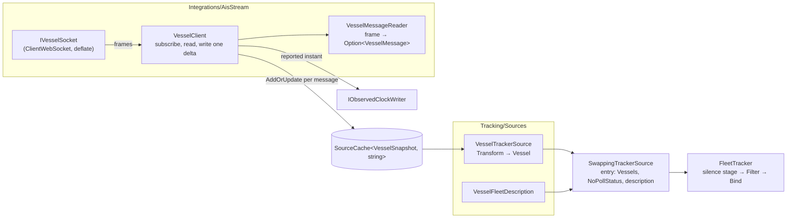
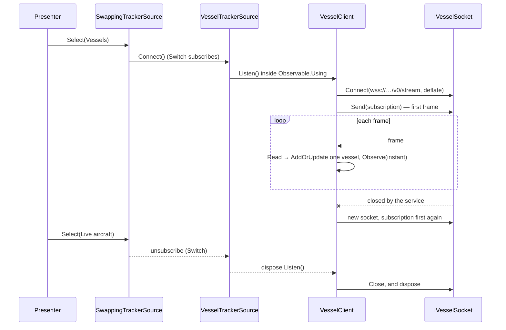

# Specification: Vessel source

## 1. Business Goal

<!-- Rules: ../../../../../.spec/templates/feature.md § 1 -->

The talk ends on a promise: replace the polled source with a push source, and
everything downstream of the seam stays the same (README.md § "Closing act").
The person chose ships on 2026-10-15. Until a second source exists, the promise
is only something the presenter says, and the audience has to take it on trust.
This feature builds that source. AISStream's WebSocket feed of vessel positions
over the same Houston box the aircraft use is held in a cache that the push
client writes for itself, projected into vessels by a strategy of its own, and
selected with the control the presenter already has. The feature also gives the
audience the treatment the aircraft deliberately lack. A vessel that goes silent
is gone rather than quiet, so it is removed — by a `Filter` re-evaluated on the
observed clock rather than `ExpireAfter`, which reads a scheduler's (§ 7,
README.md § "DynamicData operators"). The failure state removed is a
closing act with nothing behind it: "swap the source and nothing downstream
changes" stated, not shown.

## 2. User Needs

<!-- Rules: ../../../../../.spec/templates/feature.md § 2 -->

| #   | Persona                                                                                                                   | Need                                                                                              | Pain point today                                                                                                                                                                |
| --- | ------------------------------------------------------------------------------------------------------------------------- | ------------------------------------------------------------------------------------------------- | ------------------------------------------------------------------------------------------------------------------------------------------------------------------------------- |
| 1   | Line-of-business .NET developer in the talk audience, whose data arrives by request and response (README.md § "Audience") | To watch a push feed drive the grid a poll drove a minute earlier, with nothing downstream edited | Every claim that the pipeline does not care about its source has so far been made with one source. A second source of the same shape would prove nothing                        |
| 2   | The presenter at the closing act (README.md § "Closing act")                                                              | One tap from aircraft to ships over the same water, and one tap back                              | There is nothing to swap to. A closing act that needs a restart, a second build or a different box is a different demo, not a swap                                              |
| 3   | The same developer, reading this repository afterwards (the repository is the takeaway)                                   | A push strategy beside a polled one, visibly different in shape and equal at the seam             | The aircraft path has a contract, a positional-row reader and a differ, and a reader can mistake all three for what makes a source swappable (ADR-0002 § "Consequences")        |
| 4   | The same developer, whose items do not depart but stop reporting                                                          | To see removal on silence as a decision a source makes, beside the stale marker aircraft get      | Only one staleness treatment has been shown. The other, removal on silence, is listed in README.md as an operator to demonstrate, and nothing in the repository demonstrates it |

## 3. Acceptance Criteria

<!-- Rules: ../../../../../.spec/templates/feature.md § 3 -->

Twenty-six claims in six groups. **B-001 – B-007** cover the connection,
**B-008 – B-013** the messages and the cache they are written to, **B-014 –
B-015** time, **B-016 – B-020** the vessel and its description, **B-021 – B-023**
silence, and **B-024 – B-026** the seam and the swap.

Throughout, the _vessel client_ is what holds the socket and writes the cache,
and the _vessel strategy_ is what projects that cache into vessels on
`ITrackerSource`. Both are names for responsibilities ADR-0002 items 4-6 already
assign. They are not types this section declares.

| ID    | Claim                                                                                                                                                                                                                                                                                                                                                                                                                                                                                                                                                                                                                                                                                           | Source                                                                                                      |
| ----- | ----------------------------------------------------------------------------------------------------------------------------------------------------------------------------------------------------------------------------------------------------------------------------------------------------------------------------------------------------------------------------------------------------------------------------------------------------------------------------------------------------------------------------------------------------------------------------------------------------------------------------------------------------------------------------------------------- | ----------------------------------------------------------------------------------------------------------- |
| B-001 | The vessel client SHALL subscribe to exactly one bounding box: the one configured for the aircraft source, read from the same setting. No box SHALL be compiled in, and none SHALL be configured for vessels separately.                                                                                                                                                                                                                                                                                                                                                                                                                                                                        | `aircraft-source` decisions/0001; README.md § "The app"                                                     |
| B-002 | The vessel client SHALL send its subscription as the first frame on every connection it opens, before it reads anything, and SHALL send no subscription again on that connection.                                                                                                                                                                                                                                                                                                                                                                                                                                                                                                               | § 4 rows 2 and 4                                                                                            |
| B-003 | The AISStream API key SHALL reach the vessel client only from the developer's user-secrets store layered over the packaged settings, and SHALL NOT appear in the repository, a packaged setting, a log line, a recording or anything bound to a view.                                                                                                                                                                                                                                                                                                                                                                                                                                           | § 4 row 3; `aircraft-source` B-058; docs/runbook.md § "Never"                                               |
| B-004 | With no API key configured, selecting the vessel strategy SHALL open no connection and SHALL report the absent key as an error-level log entry naming the setting `AisStream:ApiKey`, and never a value. The application SHALL keep running, and selecting another strategy SHALL still work.                                                                                                                                                                                                                                                                                                                                                                                                   | § 4 row 3                                                                                                   |
| B-005 | A connection SHALL be open only while the vessel strategy is the live one. Selecting another strategy SHALL close it, selecting the vessel strategy again SHALL open a new one, and at no moment SHALL more than one vessel connection be open, across any number of swaps and reconnects: a reconnect SHALL close the old connection before it opens a new one, and a swap away during a pending reconnect SHALL leave none open.                                                                                                                                                                                                                                                              | `aircraft-source` B-040; § 4 row 5; hot-swap-source § "Disposal discipline"                                 |
| B-006 | A connection the service closes or loses while the vessel strategy is live SHALL be reopened and resubscribed by the vessel client, without rebuilding the tracker, the cache or the strategy, and the vessels already held SHALL stay held. Silence alone decides whether they go (B-021).                                                                                                                                                                                                                                                                                                                                                                                                     | § 4 row 6; `aircraft-source` B-042                                                                          |
| B-007 | The vessel client SHALL request compressed transport on every connection it opens. When the service's subscription confirmation reports compression not granted, the client SHALL log a warning saying so and SHALL keep the stream open.                                                                                                                                                                                                                                                                                                                                                                                                                                                       | § 4 row 7                                                                                                   |
| B-008 | A vessel SHALL be keyed by its MMSI, held as a nine-digit string, zero-padded on the left when the feed reports it as a number of fewer digits (§ 4 row 13), and the key SHALL never change for the life of the vessel.                                                                                                                                                                                                                                                                                                                                                                                                                                                                         | ADR-0005 item 3; README.md § "Closing act"                                                                  |
| B-009 | A position report SHALL add that vessel to the vessel client's cache or update it there, one message at a time. The client SHALL NOT assemble a full set from the messages it holds, and SHALL NOT diff one set against another, to write the cache.                                                                                                                                                                                                                                                                                                                                                                                                                                            | ADR-0002 item 5 ("the writer owns the write"); § 5 row 2                                                    |
| B-010 | A static-data message SHALL set the ship name and ship type of the vessel it names. For a vessel not yet held, it SHALL add one to the vessel cache with no position. A vessel SHALL reach the fleet only once a message for it has reported an instant (B-014).                                                                                                                                                                                                                                                                                                                                                                                                                                | § 4 row 2                                                                                                   |
| B-011 | The vessel client SHALL ask the feed for position reports and static data only, and SHALL ignore any other message type it receives.                                                                                                                                                                                                                                                                                                                                                                                                                                                                                                                                                            | § 5 row 4                                                                                                   |
| B-012 | A message that cannot be read SHALL be skipped. The vessel already held for it, if any, SHALL be unchanged, and the stream SHALL NOT end or fault because of it.                                                                                                                                                                                                                                                                                                                                                                                                                                                                                                                                | `aircraft-source` § 4 row 4                                                                                 |
| B-013 | The AIS "not available" values (latitude 91, longitude 181, true heading 511, speed over ground 102.3 knots, course over ground 360°) SHALL become an absent value, never a number. A position missing either coordinate SHALL be no position, never a position at `0,0` or at the sentinel.                                                                                                                                                                                                                                                                                                                                                                                                    | § 4 row 8; ADR-0005 § "The members" (`Position`)                                                            |
| B-014 | A vessel's last contact SHALL be the latest instant the feed has reported in a message for it; a message reporting none SHALL leave it unchanged. It SHALL NOT be read from a clock by the client, the cache or the strategy.                                                                                                                                                                                                                                                                                                                                                                                                                                                                   | ADR-0007; dynamic-data-pipeline § "Staleness and expiry"; § 11 row 6                                        |
| B-015 | Each message carrying a reported instant SHALL advance the observed clock to that instant, as the aircraft envelope's time does. A message carrying none, or an instant no later than the latest the vessel client has already reported, SHALL leave the clock where it is: AIS messages arrive out of order, and a late one SHALL NOT move the clock back past the latest instant the vessel client has reported. The clock is shared, and what another writer observes is not the vessel client's to guard.                                                                                                                                                                                   | ADR-0007 § "Consequences"; `fleet-pipeline` B-031; § 11 row 6                                               |
| B-016 | A vessel SHALL derive directly from `TransportVehicle`, one level below it, and the vessel strategy SHALL be the only place one is built.                                                                                                                                                                                                                                                                                                                                                                                                                                                                                                                                                       | ADR-0005 item 4; ADR-0002 item 6                                                                            |
| B-017 | A vessel's label SHALL be its ship name trimmed of surrounding whitespace and of trailing `@`, the padding AIS fills a name with, or its MMSI while that name is absent or nothing remains.                                                                                                                                                                                                                                                                                                                                                                                                                                                                                                     | ADR-0005 item 2                                                                                             |
| B-018 | Speed over ground SHALL be held in knots, and course over ground and true heading in degrees from north, as the feed reports them. A converted value SHALL NOT replace a canonical one.                                                                                                                                                                                                                                                                                                                                                                                                                                                                                                         | ADR-0005 item 7; § 4 row 8                                                                                  |
| B-019 | The vessel description SHALL name its columns, filter choices and detail lines, and two grouping keys: ship type and flag state. Its comparers SHALL read only `TransportVehicle` members: label, last contact and group key (`fleet-pipeline` B-010). Its card SHALL fill the title with the label, the subtitle with the ship type, and the readouts with speed over ground and course over ground. Its trail measure SHALL be speed over ground in knots, over a ramp from 0 to 30 knots. Its silence treatment SHALL be removal after the vessel silence threshold (B-023). Every member SHALL be a selector over `TransportVehicle`, and only that description SHALL name the vessel type. | `fleet-pipeline` B-010, B-020, B-022, B-036, B-037, B-043, B-044                                            |
| B-020 | Ship type SHALL be the category § 4 row 14 names for the reported type code, spelled as that row spells it, and SHALL group as `Unknown` until a static-data message has reported one and for a code the standard does not allocate. Flag state SHALL be the state the MMSI's leading three digits allocate (its MID), named as the ITU's MID table names it, and SHALL group as `Unknown` for a MID the table does not allocate. Both tables SHALL be compiled into the application whole, and resolving either SHALL read no file, resource or network.                                                                                                                                       | § 4 rows 9 and 14; § 11 row 5                                                                               |
| B-021 | A vessel silent for longer than the vessel silence threshold SHALL be removed from the fleet, and from every collection bound from it. A vessel that reports again after it was removed SHALL return as a new arrival under the same key.                                                                                                                                                                                                                                                                                                                                                                                                                                                       | README.md § "DynamicData operators"; dynamic-data-pipeline § "Staleness and expiry"; § 4 row 10; § 11 row 1 |
| B-022 | Silence SHALL be measured against the observed clock and re-evaluated as it advances, so a vessel is removed with no message arriving for it and no wall clock read.                                                                                                                                                                                                                                                                                                                                                                                                                                                                                                                            | `fleet-pipeline` B-018; ADR-0010                                                                            |
| B-023 | The vessel silence threshold SHALL default to ten minutes, SHALL be configurable as `AisStream:SilentAfter`, SHALL be distinct from the aircraft staleness threshold, and SHALL be applied to vessels only. A vessel SHALL NOT be marked stale before it is removed. An aircraft SHALL still never be removed for silence.                                                                                                                                                                                                                                                                                                                                                                      | `fleet-pipeline` B-016, B-017, B-019; § 11 rows 1 and 3                                                     |
| B-024 | The vessel strategy SHALL reach the seam the way every strategy does, as a registered strategy behind the swap decorator, under the name `Vessels` for the swap control, with no contract layer beneath it and no member added to the seam.                                                                                                                                                                                                                                                                                                                                                                                                                                                     | ADR-0002 item 2; ADR-0011; `aircraft-source` B-037, B-049, B-057                                            |
| B-025 | The vessel strategy SHALL be registered with no poll status, so while vessels are live the tracker publishes none.                                                                                                                                                                                                                                                                                                                                                                                                                                                                                                                                                                              | ADR-0013; `fleet-pipeline` B-040; `aircraft-source` B-056                                                   |
| B-026 | Swapping between aircraft and vessels in either direction SHALL change the live description and the vehicles in the fleet, and SHALL NOT rebuild or edit the tracker's pipeline, a comparer, a predicate, a grouping key or a binding.                                                                                                                                                                                                                                                                                                                                                                                                                                                          | `fleet-pipeline` B-021; `aircraft-source` B-039, B-042                                                      |

## 4. Constraints

<!-- Rules: ../../../../../.spec/templates/feature.md § 4 -->

AISStream's facts below were read from <https://aisstream.io/documentation> on
2026-10-15. They are the provider's, not this project's to simplify, and the
page is the authority when the two disagree.

| #   | Constraint                                                                                                                                                                                                                                                                                                                                                                                                                                                                                                                                                                     | Source                                                                                                       | Impact                                                                                                                                                                                                                                                                                                                        |
| --- | ------------------------------------------------------------------------------------------------------------------------------------------------------------------------------------------------------------------------------------------------------------------------------------------------------------------------------------------------------------------------------------------------------------------------------------------------------------------------------------------------------------------------------------------------------------------------------ | ------------------------------------------------------------------------------------------------------------ | ----------------------------------------------------------------------------------------------------------------------------------------------------------------------------------------------------------------------------------------------------------------------------------------------------------------------------- |
| 1   | AISStream is push: one WebSocket at `wss://stream.aisstream.io/v0/stream`, a subscription frame sent by the client, then a stream of messages it never asked for one at a time.                                                                                                                                                                                                                                                                                                                                                                                                | aisstream.io documentation; README.md § "Closing act"                                                        | There is no request with a response, so there is no contract layer, no `Task<T>` per endpoint, and no fake one (`aircraft-source` B-049, § 4 row 4). Aircraft replay's way of substituting is closed to vessels, which is replay-source B-023.                                                                                |
| 2   | The subscription is one JSON frame: `APIKey`, `BoundingBoxes` as `[[lat, lon], [lat, lon]]` corners with latitude first, and optionally `FiltersShipMMSI` and `FilterMessageTypes`. Every message arrives as `MessageType`, `MetaData` and a `Message` keyed by its type.                                                                                                                                                                                                                                                                                                      | aisstream.io documentation                                                                                   | The configured box is converted to that corner order in one place. Latitude first is the reverse of a GeoJSON habit, and a swapped pair subscribes to empty ocean. B-001, B-010, B-011.                                                                                                                                       |
| 3   | The API key is a credential. The service forbids direct browser use and keeps it server-side. The repository never holds a key.                                                                                                                                                                                                                                                                                                                                                                                                                                                | aisstream.io documentation; docs/runbook.md § "Never"; README.md § "Open items"                              | Rules out a key in `appsettings`, a test fixture, a log or a recording. It reaches the client the way the OpenSky secret does, and its absence is a reported failure rather than a crash. B-003, B-004.                                                                                                                       |
| 4   | The subscription must arrive within three seconds of connecting or the service closes the socket. Resending replaces the subscription and is limited to one per second per connection. A rejected subscription gets no `SubscriptionConfirmation`.                                                                                                                                                                                                                                                                                                                             | aisstream.io documentation                                                                                   | Rules out connecting ahead of time and subscribing later, and changing the subscription on a live socket. One subscription per connection, sent first. B-002.                                                                                                                                                                 |
| 5   | At most three subscribed connections per account and three open connections per originating IP. A fourth is rejected.                                                                                                                                                                                                                                                                                                                                                                                                                                                          | aisstream.io documentation                                                                                   | Rehearsing on one laptop while another runs the demo already spends two. A swapped-out or reconnecting client that leaks its old socket spends the rest. B-005.                                                                                                                                                               |
| 6   | The service makes no uptime guarantee and replays nothing. It drops messages for a client that falls behind, and may close a slow connection.                                                                                                                                                                                                                                                                                                                                                                                                                                  | aisstream.io documentation                                                                                   | A gap in the feed is lost, not recovered. A reconnect starts from now (B-006), and a vessel that goes unheard through a long gap is removed like any other silent vessel (B-021).                                                                                                                                             |
| 7   | From September 2026, uncompressed connections are subject to per-user bandwidth limits, and messages over the limit are dropped. Compression is `permessage-deflate`, confirmed by `SubscriptionConfirmation.Message.CompressionEnabled`.                                                                                                                                                                                                                                                                                                                                      | aisstream.io documentation                                                                                   | Rules out a client that cannot negotiate `permessage-deflate`. This bears on § 11 row 2, the library choice. B-007.                                                                                                                                                                                                           |
| 8   | AIS reports speed in knots and course and heading in degrees. It encodes "not available" as in-range-looking numbers (latitude 91, longitude 181, heading 511, speed 102.3, course 360).                                                                                                                                                                                                                                                                                                                                                                                       | ITU-R M.1371                                                                                                 | The values are canonical as reported (ADR-0005 item 7), and the sentinels must become absent before anything compares, sorts or plots them. A sentinel position plotted on the detail map draws a ship off the Arctic. B-013, B-018.                                                                                          |
| 9   | An MMSI's first three digits are its Maritime Identification Digits, allocated to a flag state by the ITU.                                                                                                                                                                                                                                                                                                                                                                                                                                                                     | ITU Maritime Identification Digits table                                                                     | Flag state is known from the first message, with no static data needed. It needs the full ITU allocation table, compiled in (§ 11 row 5). B-020.                                                                                                                                                                              |
| 10  | `fleet-pipeline` B-019, amended 2026-10-15, treats silence per source: marking and keeping by default, and removal after a source's own threshold where that source's specification claims it.                                                                                                                                                                                                                                                                                                                                                                                 | `fleet-pipeline` B-016, B-019, § 4 row 6, § 5 row 2, § 11 row 9                                              | B-021 – B-023 are that claim's removal for vessels, and B-023's vessel threshold is the source's own threshold it names. The removal runs as a stage of that pipeline, driven by the description (`fleet-pipeline` § 11 row 9, answered (A) 2026-10-16; `fleet-pipeline` B-044). Nothing here edits another Feature's claims. |
| 11  | The clock belongs to the tracker. No client, cache or strategy reads one.                                                                                                                                                                                                                                                                                                                                                                                                                                                                                                      | dynamic-data-pipeline § "Staleness and expiry"; ADR-0007; ADR-0010                                           | Rules out stamping a message with the arrival time read in the client. A vessel's time is what the feed reports (B-014), and silence is measured where staleness already is (B-022).                                                                                                                                          |
| 12  | Package versions are central, and the WebSocket client is `ClientWebSocket` (ADR-0017, 2026-10-16).                                                                                                                                                                                                                                                                                                                                                                                                                                                                            | `Directory.Packages.props`; README.md § "Open items"                                                         | No claim here names a library. A package, if one is chosen, joins `Directory.Packages.props`, and the choice is an ADR (§ 11 row 2).                                                                                                                                                                                          |
| 13  | AISStream's documented examples carry the MMSI (`MetaData.MMSI`, and `UserID` in each message) as a JSON number, not a string.                                                                                                                                                                                                                                                                                                                                                                                                                                                 | aisstream.io documentation                                                                                   | A number loses an MMSI's leading zeros, and with them the MID. The key is zero-padded to nine digits where it is read (B-008, B-020). A captured message (§ 11 row 6) confirms the type.                                                                                                                                      |
| 14  | AIS reports ship type as a code from 0 to 99, which ITU-R M.1371 groups into categories: 20 – 29 `Wing in ground`, 30 `Fishing`, 31 – 32 `Towing`, 33 `Dredging`, 34 `Diving`, 35 `Military`, 36 `Sailing`, 37 `Pleasure craft`, 40 – 49 `High-speed craft`, 50 `Pilot`, 51 `Search and rescue`, 52 `Tug`, 53 `Port tender`, 54 `Anti-pollution`, 55 `Law enforcement`, 58 `Medical transport`, 59 `Noncombatant`, 60 – 69 `Passenger`, 70 – 79 `Cargo`, 80 – 89 `Tanker`, 90 – 99 `Other`. 0 is not available, and 1 – 19, 38 – 39 and 56 – 57 are reserved or for local use. | ITU-R M.1371, ship type table                                                                                | The category, not the code, is what a grouping shows, spelled as above. A code the standard leaves unallocated, reserved or local groups as `Unknown`, like an absent one (B-020).                                                                                                                                            |
| 15  | The service sends binary WebSocket frames containing UTF-8 JSON.                                                                                                                                                                                                                                                                                                                                                                                                                                                                                                               | [AISStream documentation, FAQ "What WebSocket framing should I expect?"](https://aisstream.io/documentation) | Rules out a receive adapter that accepts only text frames: binary payloads must reach the JSON reader after decoding. A compression-denial confirmation cannot warn if the adapter drops it. B-007.                                                                                                                           |

## 5. Out of Scope

<!-- Rules: ../../../../../.spec/templates/feature.md § 5 -->

| #   | Item                                                                                                                                                                      | Exclusion reason                                                                                                                                                              |
| --- | ------------------------------------------------------------------------------------------------------------------------------------------------------------------------- | ----------------------------------------------------------------------------------------------------------------------------------------------------------------------------- |
| 1   | A contract layer for AISStream, or one invented so the two strategies diagram alike                                                                                       | `aircraft-source` B-049 and ADR-0002 § "Consequences" forbid it. It would buy symmetry on a slide and a lie in the code.                                                      |
| 2   | `EditDiff`, or any full-set assembly, on the vessel path                                                                                                                  | A push client already knows its deltas (ADR-0002 item 5). Assembling a set so a differ can run is the shape this Feature exists to contrast with. B-009.                      |
| 3   | Vessel replay, the vessel recording format, and the recording tap on the vessel client                                                                                    | `replay-source` B-019 – B-021 and B-023, delivered by `features/replay-source/.issue/0013-vessel-replay-strategy.yml`. This Feature defines the vessel; replay reproduces it. |
| 4   | AIS message types other than position reports and static data: class B reports, aids to navigation, base stations, search-and-rescue aircraft, safety and binary messages | A closing act needs ships moving and named. Every other type is a second projection with no audience. B-011.                                                                  |
| 5   | Performing the rehearsal recording of the feed                                                                                                                            | README.md § "Open items" and docs/runbook.md: a rehearsal task, not a build. B-020 in `replay-source` is the obligation.                                                      |
| 6   | Coinbase, or a simulated push source                                                                                                                                      | The closing act is ships (2026-10-15). README.md § "Closing act" lists the others as the options not taken.                                                                   |
| 7   | More than one bounding box, a box for vessels alone, or a global subscription                                                                                             | One geography serves both fleets (`aircraft-source` decisions/0001). B-001.                                                                                                   |
| 8   | Holding vessels across runs, or a vessel's history beyond what the pipeline already keeps                                                                                 | Nothing in the talk needs it, and the service replays nothing to fill one (§ 4 row 6).                                                                                        |
| 9   | How the grid, the detail pane, the map or the swap control show a vessel                                                                                                  | `fleet-dashboard`'s. This Feature supplies the description (B-019) and claims nothing about a view.                                                                           |
| 10  | Choosing between `ClientWebSocket` and `AISStream.NET`                                                                                                                    | A technology choice is an ADR (§ 11 row 2), not a claim.                                                                                                                      |
| 11  | A stale marker on vessels before removal                                                                                                                                  | Each source gets one treatment (dynamic-data-pipeline § "Staleness and expiry"), and the person chose removal for vessels on 2026-10-15.                                      |

## 6. Concern Separation

<!-- Rules: ../../../../../.spec/templates/feature.md § 6 -->

| Item                                                 | Classification | Notes                                                                                                                                 |
| ---------------------------------------------------- | -------------- | ------------------------------------------------------------------------------------------------------------------------------------- |
| One box for both fleets (B-001)                      | Business       | The person's geography (`aircraft-source` decisions/0001). Reading it from the aircraft's setting is the technical half.              |
| Subscription first, compressed, two message types    | Technical      | The provider's protocol (§ 4 rows 2, 4, 7). B-002, B-007, B-011.                                                                      |
| The API key's home and its absence (B-003, B-004)    | Both           | Never on screen or in the repository is the runbook's rule. Reading it from user secrets is the same mechanism as the OpenSky secret. |
| One connection, and reconnecting (B-005, B-006)      | Technical      | The provider's three-connection limit and its dropped sockets.                                                                        |
| The client writes its own deltas (B-009)             | Both           | The talk's contrast with `EditDiff`, and ADR-0002 item 5's ownership rule.                                                            |
| Sentinels become absent (B-013)                      | Technical      | ITU-R M.1371's encoding, read once at the boundary.                                                                                   |
| Time from the feed (B-014, B-015)                    | Technical      | ADR-0007. Which field carries it is § 11 row 6.                                                                                       |
| Ship type and flag state as groupings (B-019, B-020) | Business       | The person's call of 2026-10-15. The MID table's provenance is § 11 row 5, answered.                                                  |
| A silent vessel is removed, after 10 minutes         | Business       | The person's calls of 2026-10-15 and 2026-10-16. Where the removal runs is `fleet-pipeline` § 11 row 9 (A).                           |
| `Vessels` on the swap control, and nothing rebuilt   | Both           | The closing act's one tap is the presenter's. The seam and the decorator are ADR-0002 and ADR-0011.                                   |

## 7. Technical Design

<!-- Rules: ../../../../../.spec/templates/feature.md § 7 -->

Written 2026-10-16, against §§ 1-5 as they stood at that time, which were still
🟡 in § 12. The person's four answers of that day are folded in. Two choices
below change another Feature's boundary. The person took recommendation A on
both the same day, and they stand under **Decisions taken**.

The aircraft path is the template wherever a vessel can follow it, and the
places it cannot are the point. Aircraft have a contract, a positional-row
reader, a polled client and a differ. Vessels have a socket, a message reader,
and a client that writes one delta per message. Both meet at a plain
`SourceCache` and a strategy that projects it onto `ITrackerSource`.

**Where it lives**

Integration code does not live under `Features/` (AGENTS.md). The socket, the
message records, the reader and the client are AISStream's, under
`src/Transporter/Integrations/AisStream/`. The vessel and the MID table are the
domain's, under `src/Transporter/Model/`. The strategy, its mapper and its
description sit beside the aircraft's in `src/Transporter/Tracking/Sources/`.

**Domain model**

| Field                     | Type                    | Notes                                                                                                                                                                                                                                                 |
| ------------------------- | ----------------------- | ----------------------------------------------------------------------------------------------------------------------------------------------------------------------------------------------------------------------------------------------------- |
| `Vessel.Key`              | `string`                | The MMSI as nine digits (B-008). The reader zero-pads a numeric MMSI on the left (§ 4 row 13) and never parses the key back to a number, so a leading zero survives.                                                                                  |
| `Vessel.Name`             | `Option<string>`        | Trimmed of surrounding whitespace and trailing `@`. Absent until static data reports one, and absent when nothing remains (B-017).                                                                                                                    |
| `Vessel.ShipType`         | `Option<int>`           | The AIS type code from static data (B-010). Absent until reported.                                                                                                                                                                                    |
| `Vessel.ShipTypeName`     | `string`                | Derived through `ShipTypes`: the code's ITU-R M.1371 category (§ 4 row 14), or `Unknown` while the code is absent or unallocated (B-020).                                                                                                             |
| `Vessel.FlagState`        | `string`                | Derived from the key's first three digits through `MaritimeIdentificationDigits`, named as the ITU table names the state, or `Unknown` (B-020).                                                                                                       |
| `Vessel.SpeedOverGround`  | `Option<double>`        | Knots, as reported. 102.3 is absent (B-013, B-018).                                                                                                                                                                                                   |
| `Vessel.CourseOverGround` | `Option<double>`        | Degrees from north, as reported. 360 is absent.                                                                                                                                                                                                       |
| `Vessel.TrueHeading`      | `Option<double>`        | Degrees from north, as reported. 511 is absent.                                                                                                                                                                                                       |
| `Vessel.Position`         | `Option<GeoPosition>`   | Inherited. Absent when either coordinate is missing or a sentinel (latitude 91, longitude 181). Never `0,0` (B-013).                                                                                                                                  |
| `Vessel.LastContact`      | `DateTimeOffset`        | Inherited. The latest instant reported in any message for the vessel (B-014). A message reporting none leaves it. `MetaData.time_utc` supplies the instant (§ 11 row 6).                                                                              |
| `Vessel.Label`            | `string`                | `Name`, or the key while the name is absent (B-017).                                                                                                                                                                                                  |
| `Vessel.GroupKey`         | `string`                | `ShipTypeName`, the first of the description's two groupings (B-019).                                                                                                                                                                                 |
| `VesselSnapshot`          | record, keyed by `Mmsi` | What the client holds: every field above that a message reports, before projection, plus `Reported` (`Option<DateTimeOffset>`), the latest instant reported for it. The strategy projects only a snapshot whose `Reported` is present (B-010, B-014). |

**Diagrams**





**Interface changes**

Implemented types link to their compiling declarations below. The code block
contains only declarations whose files do not exist yet
(spec-and-traceability § "A declaration belongs to the file that compiles").

| Type                           | File                                                                          | Claims it makes visible            |
| ------------------------------ | ----------------------------------------------------------------------------- | ---------------------------------- |
| `AisStreamOptions`             | [`Configuration/AisStreamOptions.cs`](../Configuration/AisStreamOptions.cs)   | B-003, B-004                       |
| `IVesselSocket`                | [`IVesselSocket.cs`](../IVesselSocket.cs)                                     | B-002, B-005, B-007                |
| `VesselSubscription`           | [`Messages/VesselSubscription.cs`](../Messages/VesselSubscription.cs)         | B-001, B-002, B-011                |
| `VesselMessageReader`          | [`Messages/VesselMessageReader.cs`](../Messages/VesselMessageReader.cs)       | B-008, B-010 – B-014               |
| `VesselMessage`                | [`Messages/VesselMessage.cs`](../Messages/VesselMessage.cs)                   | B-009, B-010, B-014                |
| `VesselSnapshot`               | [`VesselSnapshot.cs`](../VesselSnapshot.cs)                                   | B-008 – B-010, B-013, B-014        |
| `VesselClient`                 | [`VesselClient.cs`](../VesselClient.cs)                                       | B-002 – B-007, B-009, B-014, B-015 |
| `Vessel`                       | `Model/Vessel.cs`                                                             | B-008, B-016 – B-018, B-020        |
| `MaritimeIdentificationDigits` | `Model/MaritimeIdentificationDigits.cs`                                       | B-020                              |
| `ShipTypes`                    | `Model/ShipTypes.cs`                                                          | B-020                              |
| `IVesselTrackerSource`         | `Tracking/Sources/IVesselTrackerSource.cs`                                    | B-024                              |
| `VesselTrackerSource`          | `Tracking/Sources/VesselTrackerSource.cs`                                     | B-010, B-016, B-024                |
| `VesselFleetDescription`       | `Tracking/Sources/VesselFleetDescription.cs`                                  | B-019, B-021, B-023                |
| `AisStreamRegistration`        | [`Container/AisStreamRegistration.cs`](../Container/AisStreamRegistration.cs) | B-001, B-003, B-024, B-025         |

`0097` also introduces the socket adapter
[`ClientVesselSocket`](../ClientVesselSocket.cs) and the cache's keyed
[`VesselSnapshot`](../VesselSnapshot.cs). The snapshot initially carries its
MMSI only; `0098` adds message fields and `0099` adds reported time. Options
remain internal to the integration, like `OpenSkyOptions`. `0101` adds
`SilentAfter`, defaulting to ten minutes and bound from `AisStream:SilentAfter`.
The clock constructor parameter is the write-only `IObservedClockWriter`;
the client retains its own latest reported instant and never reads the clock.

The socket adapter's default constructor creates `ClientWebSocket`. Its
second constructor accepts the framework's `WebSocket` at the receive boundary
so local tests run the real frame decoder over a preopened socket. Opening a
production connection still requires `ClientWebSocket`, sets deflate options
and then connects; the injected socket adds no second connection path. The
adapter assembles complete UTF-8 JSON payloads from either binary or text
messages, joining bytes before decoding so a character split between frames
survives (§ 4 row 15).

`AddAisStream` initially registers options, the socket factory, the cache and
client. It consumes the shared aircraft box, clock writer and schedulers
already registered by the composition. `0102` adds the strategy and registered
entry and calls the extension from the application composition.

```csharp
// The per-type seam ADR-0002 item 6 names, empty like IAircraftTrackerSource.
// Registration resolves the strategy by it to pair it with its entry (ADR-0011,
// ADR-0015's consequences, which ADR-0018 keeps).
internal interface IVesselTrackerSource : ITrackerSourceStrategy;

// Both tables are source, compiled whole; resolving reads no file, resource or
// network (B-020, § 4 rows 9 and 14).
internal static class MaritimeIdentificationDigits
{
    public static Option<string> State(string mmsi);
}

internal static class ShipTypes
{
    public static Option<string> Category(int code);
}

public sealed class Vessel : TransportVehicle
{
    public Vessel(string mmsi, DateTimeOffset lastContact);
    public Option<string> Name { get; set; }
    public Option<int> ShipType { get; set; }
    public Option<double> SpeedOverGround { get; set; }
    public Option<double> CourseOverGround { get; set; }
    public Option<double> TrueHeading { get; set; }
    public string ShipTypeName { get; }
    public string FlagState { get; }
    public override string Label { get; }
    public override string GroupKey { get; }
}
```

How the parts behave:

- **Connecting.** `Listen()` returns at once. On the background scheduler it
  takes the key, and with none it logs an error naming `AisStream:ApiKey`,
  opens nothing, and returns. The strategy's stream stays open and empty, so
  the swap control still works (B-004, the same shape as `aircraft-source`
  B-029's absent credential). The entry names the setting and never a value
  (B-003). With a key it creates a socket, opens it, and
  sends `VesselSubscription` before it reads a frame (B-002). The subscription
  converts `OpenSkyOptions.Box` to `[[[latMin, lonMin], [latMax, lonMax]]]` in
  one place, latitude first (§ 4 row 2), and asks for `PositionReport` and
  `ShipStaticData` only (B-011).
- **Compression.** `ClientWebSocketOptions.DangerousDeflateOptions` is set
  before the socket opens (ADR-0017). The client reads
  `SubscriptionConfirmation.Message.CompressionEnabled` and logs a warning when
  it is false. It does not end the stream, because a slow feed is still a feed
  (B-007, both halves).
- **Writing.** Each readable message is one `vessels.Edit` call. The client
  looks the MMSI up, merges the message's fields into the snapshot held for it
  (a new one if there is none), and calls `AddOrUpdate` with the result. A
  position report touches position, speed, course, heading and `Reported`. A
  static-data message touches name and type (B-009, B-010). The client never
  builds a set and never calls `EditDiff`.
- **Time.** A position report or static data carrying a reported instant
  sets the snapshot's `Reported` to the later of the two, so a late message
  never moves a vessel's last contact back (B-014). Static data with no
  instant leaves `Reported` as it was. The client keeps the latest instant it
  has observed in a field of its own, and calls `clock.Observe(instant)` after
  the cache write only for an instant later than that one, as the aircraft
  client does after a poll (B-015). The field is the client's own record, not
  a clock read. The reported field is `MetaData.time_utc` (§ 11 row 6).
- **Reconnecting.** When `Frames` ends or throws while `Listen()` is still
  held, the client disposes that socket and awaits its close before anything
  else, then waits `ReconnectAfter` on the background scheduler, and starts
  again from **Connecting**. The wait is scheduled under the same
  disposable `Listen()` returned, so a swap during it cancels the wait and no
  socket is created (B-005). The cache is left
  alone, so vessels already held stay held (B-006).
- **Closing.** Disposing what `Listen()` returned cancels the loop and disposes
  the socket, and it is the only thing that does. A client-owned asynchronous
  gate serializes whole listen loops through socket close; a new subscription
  cannot open until the prior subscription has finished its asynchronous close. The strategy holds it in
  `Observable.Using`, and `SwappingTrackerSource`'s `Switch` unsubscribes on a
  swap, so one live strategy means at most one socket (B-005).
- **The strategy.** `VesselTrackerSource.Connect()` is
  `Observable.Using(() => client.Listen(), _ => vessels.Connect().Filter(s => s.Reported.IsSome).Transform(mapper.Project))`,
  the aircraft strategy's shape plus one filter. A vessel known only from
  static data with no instant stays in the cache and out of the fleet until a
  message times it (B-010, B-014). The mapper sets `LastContact` from
  `Reported`, which the filter guarantees present. `VesselSnapshotMapper` is the only place a
  `Vessel` is built (B-016). The cache outlives a swap, as the aircraft cache
  does, so swapping back shows the vessels last held, and silence removes
  those that went quiet in the meantime (B-021).
- **Registration.** `AddAisStream(configuration)` registers the socket factory,
  the cache, the client, the strategy as `IVesselTrackerSource` aliased to
  `ITrackerSourceStrategy` (never as `ITrackerSource`, ADR-0011), and a
  `TrackerSourceEntry` named `Vessels` with `NoPollStatus` and the vessel
  description (B-024, B-025, ADR-0018). The head calls it after `AddOpenSky`,
  so live aircraft stays the first entry and the startup source, and before
  the replay registration, which `replay-source` B-028 places after every live
  strategy.
- **The description.** `VesselFleetDescription` follows B-019 member by
  member. Its comparers are label, last contact and group key, the base
  members `fleet-pipeline` B-010 allows. Its card's title is the label, its
  subtitle the ship type, and its readouts speed and course over ground. Its
  trail measure is speed over ground over a 0 – 30 knot ramp. Its readers name
  `Vessel` under `fleet-pipeline` B-022's exception, and nothing else does.
- **Silence.** `VesselFleetDescription` names the silence treatment `Remove`
  after `AisStreamOptions.SilentAfter`, bound from `AisStream:SilentAfter`,
  and the aircraft description names none, which means marking. The tracker
  runs one stage for both and reads the treatment from the live description.
  That stage is `fleet-pipeline` B-044, built by `0101` (§ 11 row 9 there,
  answered (A)). This Feature claims only that vessels are
  removed (B-021 – B-023) and supplies the description that says so.

**Reported instant**

`VesselMessageReader` reads `MetaData.time_utc` on both supported message
types. The captured Go UTC format is `yyyy-MM-dd HH:mm:ss[.fraction] +0000 UTC`.
A fraction may have up to nine decimal digits; digits beyond seven are
truncated to `DateTimeOffset` tick precision. A missing, null, wrongly typed
or unreadable value is absent, and the rest of the message remains readable.
The payload's `Timestamp` second is never combined with a local date or clock.

No open decisions.

**Decisions taken**

Two parts of this design change another Feature's boundary. The person
settled both on 2026-10-16 and took recommendation A each time.

1. **The live description swaps with the source (B-026).** Today the
   description is a `BehaviorSubject` that the OpenSky registration fills once
   with the aircraft's, and nothing swaps it. `TrackerSourceEntry` gains a
   `Description`. `SwappingTrackerSource` publishes the selected entry's
   description, switched like its `Status`. One switch decides both the
   vehicles and their description, so the two cannot disagree. The
   description's registration moves from OpenSky to tracking.
   [ADR-0018](../../../../../.spec/adr/0018-a-registered-entry-carries-its-fleet-description.md)
   records it and supersedes ADR-0015. Rejected: a second subject the swap actor writes on
   each swap. It leaves two things to keep in step, and a window in which they
   disagree.
2. **Silence removal is a `Filter`, not `ExpireAfter`.** `ExpireAfter`
   measures against a scheduler's clock, and B-022 forbids any clock but the
   observed one. The design uses a dynamic `Filter` over
   `IsStale(clock.Current, silentAfter)`, re-evaluated on each observed tick,
   applied where the description says `Remove`. That is the operator the
   pipeline already uses for staleness. README.md § "DynamicData operators"
   and § "Data sources" are amended to say the talk shows removal with
   `Filter`. Rejected: `ExpireAfter` on a scheduler whose `Now` is the
   observed clock. It shows the named operator, but it adds a hand-written
   scheduler that must be correct for every operator that ever runs on it.

## 8. Testing Strategy

<!-- Rules: ../../../../../.spec/templates/feature.md § 8 -->

**Testability assessment**

| Dimension          | Verdict | Finding                                                                                                                                                                                                                                                                                                                                                                | Recommendation                                                                                                                   |
| ------------------ | ------- | ---------------------------------------------------------------------------------------------------------------------------------------------------------------------------------------------------------------------------------------------------------------------------------------------------------------------------------------------------------------------- | -------------------------------------------------------------------------------------------------------------------------------- |
| DI seams           | Pass    | The socket is a factory of `IVesselSocket`, so a test scripts frames, sees every sent frame in order, and counts open sockets. The clock writer, the schedulers and the options are injected.                                                                                                                                                                          | A scripted socket that throws on an unscripted call, as `aircraft-source` B-010's fake does, so a test cannot pass on a default. |
| Behavior isolation | Pass    | The reader is a static function of a string, and the mapper of a snapshot. The client is tested over a real `SourceCache`, and the strategy through `SwappingTrackerSource` with a `TestScheduler`.                                                                                                                                                                    | —                                                                                                                                |
| Coverage potential | Partial | B-003's "never in a log, a recording or a view" is a review over the code, not a test. B-007 needs a local review of the production adapter's compression request alongside tests of the client's connection and denial behavior; the service's grant is outside claim completion. The "nothing else" clauses of B-009, B-014, B-016, B-019 and B-024 are reviews too. | The table below names each review and what re-does it, and § 9 carries it.                                                       |

**Scenarios**

Full Gherkin is in [`vessel-source.feature`](vessel-source.feature), one
scenario per claim. Every value is synthetic: invented MMSIs and names inside
the Houston box, and no key.

- Happy path → B-001, B-002, B-008 – B-010, B-014 – B-020, B-024 – B-026
- Failure mode → B-004 – B-007, B-012, B-021 – B-023
- Validation failure → B-003, B-011, B-013
- Data-driven → B-008 (a numeric MMSI with a leading zero), B-013 (each sentinel and each missing coordinate), B-017 (blank, padded and `@`-filled names), B-020 (allocated and unallocated MIDs and type codes), B-023 (the default and a configured threshold)

Tests sit in `test/UnitTests`, under folders that mirror the files they cover,
and build their subjects through generated fixtures (`transporter-conventions`
§ testing). The silence tests decide removal by the observed clock alone. B-022's
falsifying case advances a `TestScheduler` an hour while the observed clock is
held, and asserts nothing was removed. An implementation that measured silence
on a scheduler, `ExpireAfter` among them, fails it.

**What only a review can prove**

A "nothing else" clause is a statement about every line, and a passing test
proves nothing about lines it does not run. Each one below is a review, and
the change that re-does it is named. No analyzer rule covers these yet.
`boundary-analyzer`'s layer map would have to grow to know the vessel types.

| Claim | The clause                                                           | The review                                                                                                                                                                   | Re-done by                                                |
| ----- | -------------------------------------------------------------------- | ---------------------------------------------------------------------------------------------------------------------------------------------------------------------------- | --------------------------------------------------------- |
| B-003 | The key is never in a log, a recording, a packaged setting or a view | `grep` the options' key over log calls, recordings, `appsettings*.json` and bindings                                                                                         | Any change that logs, records or binds `AisStreamOptions` |
| B-007 | Every connection requests `permessage-deflate`                       | Review the production `IVesselSocket` adapter: every open sets `ClientWebSocketOptions.DangerousDeflateOptions` before connecting; a scripted socket alone cannot prove this | Any change to the production socket adapter               |
| B-009 | No full set is assembled or diffed                                   | `grep EditDiff` and set-building calls over `Integrations/AisStream/` returns nothing                                                                                        | Any change to `VesselClient`                              |
| B-014 | No clock is read for last contact                                    | `grep` for `IObservedClock`, `Now` and `UtcNow` over `Integrations/AisStream/` and the vessel strategy and mapper returns nothing                                            | Any change to those files                                 |
| B-016 | Only the strategy builds a vessel                                    | `grep "new Vessel("` over `src/` returns only `VesselSnapshotMapper`                                                                                                         | Any new consumer of the cache                             |
| B-019 | Only the description names the vessel type                           | `grep` for `is Vessel`, `as Vessel` and `(Vessel)` returns only `VesselFleetDescription`, as `fleet-pipeline` B-022's review does for aircraft                               | Any new consumer of the fleet                             |
| B-024 | No contract layer, and no member added to the seam                   | No interface under `Integrations/AisStream/` names a provider operation, and `ITrackerSource` is unchanged in the diff (`aircraft-source` B-049's review)                    | Any change to `Integrations/AisStream/` or the seam       |

A rehearsal may observe the live service's `CompressionEnabled` confirmation
to assess feed bandwidth. A grant is the service's decision, not a B-007
completion condition; local verification requires no live service or key.

**Executed connection coverage (work item `0097`, 2026-10-17)**

The 20 local xUnit cases in `Integrations/AisStream` pass. They cover the
actual sent aircraft box, first-frame order across reconnects, user-secrets
composition, absent-key selection, repeated swaps, delayed asynchronous close
on reconnect and reselection, cancellation of a pending reconnect, retained
cache entries after normal close and receive failure, compression denial,
secret-safe failure logging, and ignoring an unrequested base-station report.
The subscription writer has separate box-shape and message-filter tests.
Production composition resolves the retained client and cache and creates a
fresh socket per connection. The real receive adapter is exercised through a
BCL `WebSocket` double with binary JSON, fragmented binary JSON split inside a
multibyte UTF-8 character, a message larger than the 8192-byte receive buffer,
and compatible text JSON. The initial two binary cases failed against the text-only
adapter before the fix.

The strict scripted socket rejects reads before subscription and repeated
sends. Tests await socket completion and scheduler pumping on a neutral
execution context, because xUnit's synchronization context can defer the
client's continuation after a completion. Every timed wait still runs on the
injected `TestScheduler`; there are no sleeps, retry loops or live connections.
The semaphore handoff test additionally awaits the incoming socket's open and
uses an xUnit watchdog to identify a stuck handoff.

Local reviews confirm that the production socket requests deflate before
connecting, and that key values and exception objects reach no log call,
recording, packaged setting or binding. The service's compression grant is
not required for this local coverage.

## 9. Traceability Matrix

<!-- Rules: ../../../../../.spec/templates/feature.md § 9 -->

Connection claims delivered by `0097` and the message claims delivered by
`0098` are verified by the executed tests and local reviews below. B-010
remains `Missing` until `0100` verifies the fleet projection gate. Other
remaining claims name their item and planned evidence; `Missing` blocks their
delivery. The 0100 model tests verify B-017 and B-020; B-019 waits for 0101
to name the silence treatment in the description.

| Claim ID | Scenario | Test                                                                                                                                                                                                                                                                                                                                                                                                                                                                                | Status   |
| -------- | -------- | ----------------------------------------------------------------------------------------------------------------------------------------------------------------------------------------------------------------------------------------------------------------------------------------------------------------------------------------------------------------------------------------------------------------------------------------------------------------------------------- | -------- |
| B-001    | `@B-001` | `VesselSubscriptionTests.GivenTheAircraftBox_WhenTheSubscriptionIsWritten_ThenItNamesThatOneBoxLatitudeFirst`; `VesselClientTests.GivenAChangedAircraftBox_WhenTheClientSubscribes_ThenTheSentFrameUsesThatBox`                                                                                                                                                                                                                                                                     | Verified |
| B-002    | `@B-002` | `VesselClientTests.GivenAKey_WhenAConnectionOpens_ThenTheSubscriptionIsTheFirstFrameAndTheOnlyOne`, over two connections                                                                                                                                                                                                                                                                                                                                                            | Verified |
| B-003    | `@B-003` | `AisStreamRegistrationTests.GivenAKeyInUserSecrets_WhenTheOptionsAreComposed_ThenTheKeyIsTheStores`; `VesselClientTests.GivenAFailureContainingTheKey_WhenTheConnectionFails_ThenLogsDoNotDiscloseTheKey`; local review: no key or exception object reaches logs, recordings, packaged settings or bindings (§ 8), repeated when those surfaces change                                                                                                                              | Verified |
| B-004    | `@B-004` | `VesselClientTests.GivenNoKey_WhenTheVesselStrategyIsSelected_ThenNoSocketOpensAnErrorNamesTheSettingAndAnotherStrategyStillSwapsIn`                                                                                                                                                                                                                                                                                                                                                | Verified |
| B-005    | `@B-005` | `VesselClientTests.GivenRepeatedSwaps_WhenEachCompletes_ThenAtMostOneSocketIsOpenAndTheOutgoingOneIsClosed`; `GivenADroppedConnection_WhenTheClientReconnects_ThenTheOldSocketClosedBeforeTheNewOneOpened`; `GivenAnOutgoingSocketStillClosing_WhenVesselsAreReselected_ThenTheNewSocketWaitsForItsClose`; `GivenAPendingReconnect_WhenTheStrategyIsSwappedOut_ThenNoSocketOpensWhenTheDelayPasses`                                                                                 | Verified |
| B-006    | `@B-006` | `VesselClientTests.GivenTheServiceClosesTheSocket_WhenTheClientReconnects_ThenItResubscribesAndTheHeldVesselsStay`, with normal closure and a failed receive, retaining both held cache entries; `AisStreamRegistrationTests.GivenTheProductionRegistrations_WhenTheClientAndSocketsAreResolved_ThenTheClientAndCacheAreRetainedAndSocketsAreFresh`                                                                                                                                 | Verified |
| B-007    | `@B-007` | `VesselClientTests.GivenAConfirmationWithoutCompression_WhenItArrives_ThenAWarningIsLoggedAndTheStreamStaysOpen`; `ClientVesselSocketTests.GivenUtf8JsonReceiveFragments_WhenFramesAreRead_ThenTheWholeMessageReachesTheClient` (binary, split UTF-8, large and text payloads); local review: `ClientVesselSocket.Open` sets `DangerousDeflateOptions` before every connect (§ 8), repeated when the socket adapter changes                                                         | Verified |
| B-008    | `@B-008` | `VesselMessageReaderTests.GivenAnMmsi_WhenItIsRead_ThenTheKeyIsNineDigits`, with full-width and leading-zero numeric MMSIs                                                                                                                                                                                                                                                                                                                                                          | Verified |
| B-009    | `@B-009` | `VesselClientTests.GivenSuccessivePositionReports_WhenEachArrives_ThenEachIsOneAddOrUpdate`; local review: `VesselClient.Write` calls one keyed `Edit`/`AddOrUpdate` per message and `Integrations/AisStream/` has no set assembly or `EditDiff` (§ 8), repeated when `VesselClient` changes                                                                                                                                                                                        | Verified |
| B-010    | `@B-010` | `VesselClientTests.GivenStaticDataForAnUnheldVessel_WhenItArrives_ThenItIsCached` and `GivenPositionBeforeStaticData_WhenStaticDataArrives_ThenTheHeldPositionRemains` verify the cache half; `0100` still owes `VesselTrackerSourceTests.GivenAVesselNoMessageHasTimed_WhenTheFleetIsRead_ThenItIsAbsentUntilAMessageTimesIt`                                                                                                                                                      | Missing  |
| B-011    | `@B-011` | `VesselSubscriptionTests.GivenTheSubscription_WhenItIsWritten_ThenItFiltersToPositionReportsAndStaticData`; sent-frame assertion in `VesselClientTests.GivenAKey_WhenAConnectionOpens_ThenTheSubscriptionIsTheFirstFrameAndTheOnlyOne`; `GivenABaseStationReport_WhenItArrives_ThenHeldVesselsStayUnchangedAndTheStreamContinues`; `VesselMessageReaderTests.GivenAnUnrequestedMessageType_WhenItIsRead_ThenItIsIgnored`                                                            | Verified |
| B-012    | `@B-012` | `VesselClientTests.GivenAnUnreadableFrame_WhenItArrives_ThenItIsSkippedAndTheStreamContinues` verifies held state and a subsequent valid frame                                                                                                                                                                                                                                                                                                                                      | Verified |
| B-013    | `@B-013` | `VesselMessageReaderTests.GivenASentinelOrAMissingCoordinate_WhenItIsRead_ThenTheValueIsAbsent`, seven cases covering each sentinel and each missing coordinate                                                                                                                                                                                                                                                                                                                     | Verified |
| B-014    | `@B-014` | `VesselTimeTests.GivenProviderUtc_WhenSupportedMessagesArrive_ThenClockUsesReportedTime`; `GivenUnreadableTime_WhenAReportArrives_ThenPositionUpdatesAndTimeStays`; `GivenUntimedMessages_WhenTheyArrive_ThenContactRemainsAbsentOrUnchanged`; `GivenOutOfOrderReports_WhenTheyArrive_ThenContactAndClockKeepTheirOwnLatestTime`. Local review on `0099`: the reader, client and snapshot read no clock for contact; repeat when those files or the vessel projection change (§ 8). | Verified |
| B-015    | `@B-015` | `VesselTimeTests.GivenProviderUtc_WhenSupportedMessagesArrive_ThenClockUsesReportedTime`; `GivenUnreadableTime_WhenAReportArrives_ThenPositionUpdatesAndTimeStays`; `GivenOutOfOrderReports_WhenTheyArrive_ThenContactAndClockKeepTheirOwnLatestTime`; `GivenAnotherWriterResetsTime_WhenEqualAndLaterReportsArrive_ThenOnlyTheLaterOneWrites`                                                                                                                                      | Verified |
| B-016    | `@B-016` | `0100` — `VesselSnapshotMapperTests.GivenATimedSnapshot_WhenProjected_ThenItIsAVesselDirectlyBelowTransportVehicle`; local review that only `VesselSnapshotMapper` constructs one (§ 8), pending integration with 0099                                                                                                                                                                                                                                                              | Missing  |
| B-017    | `@B-017` | `VesselTests.GivenAName_WhenTheLabelIsRead_ThenItIsTheTrimmedNameOrTheMmsi`, five padded, `@`-filled, blank and absent cases                                                                                                                                                                                                                                                                                                                                                        | Verified |
| B-018    | `@B-018` | `0100` — `VesselSnapshotMapperTests.GivenReportedSpeedCourseAndHeading_WhenProjected_ThenTheyAreHeldAsReported`, pending integration with 0099                                                                                                                                                                                                                                                                                                                                      | Missing  |
| B-019    | `@B-019` | `VesselFleetDescriptionTests.GivenTheDescription_WhenItIsRead_ThenItNamesItsColumnsComparersCardTrailAndDetail`, plus grouping/filter tests and local review that only the description downcasts to `Vessel`; `0101` owes the description's silence treatment                                                                                                                                                                                                                       | Missing  |
| B-020    | `@B-020` | `VesselTests.GivenAnMmsi_WhenTheFlagStateIsRead_ThenItIsTheItuStateOrUnknown` and `GivenATypeCode_WhenTheShipTypeIsRead_ThenItIsTheM1371CategoryOrUnknown`; reviewed the full 292-code ITU GLAD allocation compiled in and the two lookups for absence of file, resource and network reads                                                                                                                                                                                          | Verified |
| B-021    | `@B-021` | `0101` — planned: `FleetTrackerSilenceTests.GivenAVesselSilentPastTheThreshold_WhenTheClockAdvances_ThenItIsRemovedAndReturnsAsAnArrivalWhenItReports`                                                                                                                                                                                                                                                                                                                              | Missing  |
| B-022    | `@B-022` | `0101` — planned: `FleetTrackerSilenceTests.GivenAnHourOnTheSchedulerAndTheObservedClockHeld_WhenTheFleetIsRead_ThenNothingWasRemoved`, and `GivenTheObservedClockAdvancedByAnotherVessel_WhenItPassesTheThreshold_ThenTheSilentVesselIsRemoved`                                                                                                                                                                                                                                    | Missing  |
| B-023    | `@B-023` | `0101` — planned: `FleetTrackerSilenceTests.GivenNoConfiguredThreshold_WhenAVesselIsSilentSixMinutes_ThenItIsPresentAndNotMarkedStale`, `GivenAConfiguredThreshold_WhenAVesselIsSilentPastIt_ThenItIsRemoved`, and `GivenAnAircraftSilentAnHour_WhenTheFleetIsRead_ThenItIsMarkedAndPresent`                                                                                                                                                                                        | Missing  |
| B-024    | `@B-024` | `0102` — planned: `AisStreamRegistrationTests.GivenTheApplicationsGraph_WhenTheEntriesAreRead_ThenVesselsIsAStrategyBehindTheDecoratorAndNotTheSeam`; plus a **review** that no contract layer exists and the seam is unchanged (§ 8)                                                                                                                                                                                                                                               | Missing  |
| B-025    | `@B-025` | `0102` — planned: `AisStreamRegistrationTests.GivenTheVesselsEntry_WhenItIsLive_ThenNoPollStatusIsPublished`                                                                                                                                                                                                                                                                                                                                                                        | Missing  |
| B-026    | `@B-026` | `0102` — planned: `FleetSwapCompositionTests.GivenTheApplicationsGraph_WhenThePickerSwapsToVesselsAndBack_ThenTheDescriptionAndVehiclesChangeAndTheTrackerAndCollectionRemain`                                                                                                                                                                                                                                                                                                      | Missing  |

## 10. Lessons / Spec Deltas

<!-- Rules: ../../../../../.spec/templates/feature.md § 10 -->

| Date       | Lesson                                                                            | Spec delta                                                                                                                  | Claim |
| ---------- | --------------------------------------------------------------------------------- | --------------------------------------------------------------------------------------------------------------------------- | ----- |
| 2026-10-17 | [Lesson 0001: Binary frames carry JSON](lessons/0001-binary-frames-carry-json.md) | `spec-author` records the provider's binary UTF-8 framing in § 4 row 15 and adds a fragmented binary confirmation scenario. | B-007 |

## 11. Open Questions

<!-- Rules: ../../../../../.spec/templates/feature.md § 11 -->

| #   | Question                                                                                                                                                                                                                                                                                                                                                                                                                                                                                                                                                                                                                   | Owner                                              | Target date                         |
| --- | -------------------------------------------------------------------------------------------------------------------------------------------------------------------------------------------------------------------------------------------------------------------------------------------------------------------------------------------------------------------------------------------------------------------------------------------------------------------------------------------------------------------------------------------------------------------------------------------------------------------------- | -------------------------------------------------- | ----------------------------------- |
| 1   | **Answered 2026-10-15 — `fleet-pipeline` B-019 amended.** Silence is treated per source there: aircraft stay marked and kept (`fleet-pipeline` B-016, B-017), and a source whose specification claims removal, as B-021 – B-023 do, has its vehicles removed after its own threshold on the observed clock; `fleet-pipeline` B-016 now yields to that removal. Where the removal runs — a pipeline stage driven by the description, or this strategy emitting the removes below the seam — is not decided there either: `fleet-pipeline` § 11 row 9, answered 2026-10-16: (A), a pipeline stage driven by the description. | the person                                         | Closed                              |
| 2   | **Answered 2026-10-16 — `ClientWebSocket`**, negotiating `permessage-deflate` itself ([ADR-0017](../../../../../.spec/adr/0017-the-vessel-client-uses-clientwebsocket.md)). The question was: `ClientWebSocket` or `AISStream.NET`? Either must negotiate `permessage-deflate` (§ 4 row 7) and expose the subscription as the first frame (B-002). Recorded as an ADR.                                                                                                                                                                                                                                                     | the person                                         | Closed                              |
| 3   | **Answered 2026-10-16 — 10 minutes**, above both the three-minute at-anchor cadence and the six-minute static-data cadence. The question was the vessel silence threshold's default. Class A ships report positions every few seconds under way and every three minutes at anchor, and static data every six minutes. A default under three minutes would remove anchored ships that are still reporting.                                                                                                                                                                                                                  | the person                                         | Closed                              |
| 4   | What does the refresh control do while vessels are live? It `Tell`s `DemandPoll`, and a push source has nothing to poll. Disabled, hidden, or a no-op?                                                                                                                                                                                                                                                                                                                                                                                                                                                                     | `fleet-dashboard`                                  | Before the closing act is rehearsed |
| 5   | **Answered 2026-10-16 — the full ITU allocation, compiled in**, so a ship from any flag entering the box is named. The question was: where does the MID → flag-state table come from, and how much of it does the Houston box need? The ITU publishes the whole allocation, and a box over Galveston Bay sees a small part of it.                                                                                                                                                                                                                                                                                          | the person, or `implementer` with § 7              | Closed                              |
| 6   | **Answered 2026-10-21 — option A, `MetaData.time_utc`.** A local Houston capture contains 455 valid frames (419 positions and 36 static-data messages), all carrying this full UTC instant, over 11.007 minutes. The Go UTC text carries 7–9 fractional digits; § 7 defines tick precision and absent-value handling. The capture is operational data and stays local; tests use synthetic frames. ADR-0007 remains unchanged.                                                                                                                                                                                             | `implementer`, captured-message evidence on `0099` | Closed                              |

## 12. Sign-off

<!-- Rules: ../../../../../.spec/templates/feature.md § 12 -->

| Sections | Owner       | Status       |
| -------- | ----------- | ------------ |
| §§ 1-5   | spec-author | 🟡 In review |
| §§ 6-7   | implementer | 🟡 In review |
| §§ 8-9   | test-writer | 🟡 In review |

What `approved` requires, and why a `Missing` row in § 9 does not hold it
back, is [the template's § 12](../../../../../.spec/templates/feature.md).

**Reviewed 2026-10-16 — all three rows stay 🟡.** The review was done by a
`spec-reviewer` with a fresh context, which wrote none of these sections. It
read §§ 1-9, [`vessel-source.feature`](vessel-source.feature), items
`0096` – `0102` and `replay-source` `0013`, root ADRs 0002, 0005, 0006, 0011,
0015 and 0017, the `fleet-pipeline` and `aircraft-source` claims this spec
cites, and the code § 7 says exists today.

Every one of § 7's statements about existing code is true. Rows 4 and 6 of
§ 11, and the `fleet-pipeline` removal-stage claim, are known gates. They are
not counted below except where the spec mishandles them.

**§§ 1-5 — spec-author:**

1. **F2 — removal on silence: two records disagree.**
    - § 5 row 11 says a vessel gets no stale marker before removal.
      `fleet-pipeline` B-016 says it does, because it marks every vehicle
      silent past five minutes.
    - The B-023 scenario checks only that the vessel is still in the fleet, so
      it cannot tell the two apart.
    - Fix: the `fleet-pipeline` claim owed for the removal stage also says
      that a removing source's vehicles are not marked.
    - Fix: B-019 or B-023 says that the vessel description names `Remove`
      after the vessel threshold.
2. **F3 — B-023 does not state the ten-minute default.** It also names no
   surface where the threshold is configured. Every scenario gives ten
   minutes, so a hard-coded constant passes. Add the default (source: § 11
   row 3), the surface, and a non-default example.
3. **F4 — B-020 does not require the full ITU MID table that § 11 row 5
   chose.** A one-entry table passes it.
    - No claim and no § 4 source (ITU-R M.1371) covers the rule that turns a
      ship-type code into a category name.
    - The scenario expects "United States", which is not the ITU's wording.
4. **F5 — B-017 trims whitespace only, but § 7 also treats `@` padding as
   absent.** The claim should state the `@` rule, and a scenario should
   include an `@` example.
5. **F6 — B-015 does not say whether a message carrying an earlier instant
   moves the clock backwards.** AIS messages arrive out of order, and a clock
   moved back would bring a removed vessel back.
6. **F7 — B-014 and B-010 leave last contact undefined for a vessel known
   only from static data that reports no instant.** `LastContact` is not
   optional. This is needed whatever § 11 row 6 answers. § 7 owes the
   matching mapper rule.
7. **F8 — B-005 covers swaps only.** § 4 row 5 also names a reconnecting
   client leaking its old socket. Say "at most one socket at any moment,
   across swaps and reconnects", and add a scenario that swaps during a
   pending reconnect.
8. **F9 — B-007 claims only the compression request.** Yet § 7, § 8, the
   `0097` scoring and ADR-0017 all read the `CompressionEnabled` confirmation.
   Extend the claim to cover the confirmation, or drop the reading.
9. **F10 — B-004's "a failure a consumer can read" names no surface.**
10. **F11 — B-008 assumes the MMSI arrives as a nine-digit string.**
    - AISStream's published examples carry it as a JSON number, which loses
      leading zeros and with them B-020's MID.
    - Record the wire type in a § 4 row. Plausible either way; confirm
      against the captured message § 11 row 6 needs.
11. **F12 — B-019 leaves out description members that `fleet-pipeline`
    requires.** Those are the trail measure (B-037) and the card roles
    (B-036). It also names no comparer set within `fleet-pipeline` B-010,
    which allows only `TransportVehicle` members.
12. **F13 — § 4 row 10 still calls `fleet-pipeline` § 11 row 9 open.** That
    row was answered (A) on 2026-10-16.
13. **F20 — B-013's examples are all sentinels.** None has a coordinate field
    missing, which is the case a default-`double` reader gets wrong.
14. **F22 — the items disagree with the spec.**
    - `0096`'s summary says §§ 6-9 are unwritten.
    - § 11 row 6 says it must be answered before the client item, `0097`,
      starts, and `0097` is `blocked` on it. Yet § 7 puts the claims that
      row decides in `0099`.
    - `replay-source` `0013`'s summary still says it is blocked and that
      nothing is cut.
    - `0013`'s `depends_on` leaves out `0097`, the tap, and `0099`.

**§§ 6-7 — implementer:**

1. **F1 — an accepted ADR was amended in place.** Answered in this change.
   [ADR-0018](../../../../../.spec/adr/0018-a-registered-entry-carries-its-fleet-description.md)
   records the call and supersedes ADR-0015, and ADR-0015's body is restored.
   The answer needs a reviewer's read.
2. **F7 — § 7 gives no mapper rule** for last contact when no instant is
   reported.
3. **F14 — the registration contradicts accepted records.**
    - ADR-0011, ADR-0015 and ADR-0002 item 6 keep a per-type seam,
      `IVesselTrackerSource`, which § 7 does not declare.
    - `AddAisStream` must also come before replay's registration
      (`replay-source` B-028).
4. **F15 — the description swap obligates `aircraft-source`.** Its B-057
   claims only the name beside each strategy. It must also claim the
   description, and its § 12 row reopens. That claim is `aircraft-source`'s
   to write.
5. **F16 — § 7 neither carries a "Decision required" block nor says "No open
   decisions"** about the instant field that § 11 row 6 leaves pending.
6. **F23 — another role annotated § 12.** Answered in this change: the
   annotations are dropped.

**§§ 8-9 — test-writer:**

1. **F17 — § 8's category list leaves out B-007 and B-023.**
2. **F18 — § 8 plans tests for clauses only a review or an analyzer can
   prove.** Those are the "nothing else" clauses of B-009, B-014, B-016,
   B-019 and B-024. Name the mechanism for each, and what re-does it.
3. **F19 — § 8 forbids advancing the `TestScheduler`.** B-022's falsifying
   case needs exactly that: the scheduler advances while the observed clock
   holds. Without it, an `ExpireAfter`-on-scheduler build passes.
4. **F21 — § 9 was not written.** Answered in this change: 26 rows, all
   `Missing`. They need a reviewer's read.

**Complete for one item, though each row stays 🟡:**

- §§ 1-5 cover `0102` (B-024 – B-026) in full.
- §§ 6-7 cover `0097`, `0100` and `0101` in full.
- §§ 8-9 cover no item in full.

`spec_status` stays `draft`.

**Findings answered 2026-10-16, for re-review.** Each owning role answered its
own findings. All three rows stay 🟡 until a reviewer reads the answers.

- **F2.** `fleet-pipeline` gains B-044: the description names the silence
  treatment, and under removal a vehicle is never marked stale. That spec's
  B-016 now yields to it. Here, B-019 names the treatment and B-023 forbids
  the mark, and B-023's scenario asserts both.
- **F3.** B-023 states the ten-minute default and the `AisStream:SilentAfter`
  setting, with a configured example.
- **F4.** B-020 requires both tables compiled whole and names states as the
  ITU does. § 4 row 14 sources the ship-type categories, and the scenarios use
  codes and "United States of America".
- **F5.** B-017 strips trailing `@`, with two `@` examples.
- **F6.** B-015: an instant no later than the client's latest leaves the
  clock alone. Narrowed after re-review (R1) to the client's own latest.
- **F7.**
    - B-014: last contact is the latest reported instant, and a message
      reporting none leaves it.
    - B-010: a vessel no message has timed is cached but not in the fleet.
    - § 7 gives the mapper and filter rule.
- **F8.** B-005 covers swaps and reconnects, with a new scenario.
- **F9.** B-007 claims the confirmation's warning.
- **F10.** B-004 names an error-level entry naming `AisStream:ApiKey`.
- **F11.** § 4 row 13 records the numeric MMSI. B-008 zero-pads it, with an
  example.
- **F12.** B-019 names the comparers within `fleet-pipeline` B-010, the card
  roles, and a trail measure.
- **F13.** § 4 row 10 is corrected.
- **F14.** § 7 declares `IVesselTrackerSource` and orders `AddAisStream`
  before the replay registration.
- **F15.** `aircraft-source` gains B-060 for the description beside each
  strategy, and `0102` builds it.
- **F16.** § 7 carries a "Decision required" block for § 11 row 6.
- **F17.** § 8's categories list B-007 and B-023.
- **F18.** § 8 gains a table of reviews, each with what re-does it, and § 9
  cites them.
- **F19.** § 8 plans the `TestScheduler` advance with the observed clock held.
- **F20.** B-013's scenario gains missing-coordinate examples.
- **F22.**
    - `0096`'s summary is corrected.
    - `0097` is `ready-for-architecture`, and § 11 row 6 is timed against
      `0099`.
    - `replay-source` `0013`'s summary is corrected, and its `depends_on` adds
      `0097` and `0099`.

Some of these answers are product calls made by `spec-author`, not by the
person, and the person may overturn any of them:

- the vessel trail measure: speed over ground, ramped from 0 to 30 knots;
- the card roles;
- a vessel staying out of the fleet until a message times it;
- the clock never moving backwards for a late message.

**Re-reviewed 2026-10-16 by the same independent `spec-reviewer`.** F1 – F23
are resolved. F6 was resolved only in part.

- **§§ 6-7 🟢 and §§ 8-9 🟢.** The design matches the claims and the person's
  calls. Handing removal and the description swap to `fleet-pipeline` B-044
  and `aircraft-source` B-060 is a sound boundary. Every claim has exactly
  one § 9 row.
- **§§ 1-5 stay 🟡.** Four findings hold them:
    - **R1.** B-015 claimed that the shared clock never moves backwards, a
      guarantee the client cannot give. Answered: narrowed to the client's own
      latest instant.
    - **R2.** Item `0100` did not list B-010. Answered.
    - **R3.** Four product calls in B-010, B-015 and B-019 are testable but
      have no recorded source, because `spec-author` made them, not the person:
        - the trail measure, speed over ground from 0 to 30 knots;
        - the card roles;
        - an untimed vessel kept out of the fleet;
        - a clock that never moves back past the client's latest instant.

        **Open, for the person.**

    - **R4.** B-020 said "and so on", and § 4 row 14 left out allocated codes.
      Answered: the row names every category, and the claim spells each one as
      the row does.

Approval of §§ 1-5 needs a reviewer's read of R1, R2 and R4, and the person's
answer to R3.

Building B-044 (`0101`) and B-060 (`0102`) also waits on findings raised in
the other two specs:

- **`fleet-pipeline`:**
    - R5: where the removal stage sits relative to what the source reports, and
      no § 7 design.
    - R6: B-019 scenarios and a paragraph that still mark before removing.
    - R11: B-044's scenario cannot catch a mark before removal.
- **`aircraft-source`:**
    - R8: § 5 row 13 excludes what B-060 records.
    - R9: B-060 gives no order between the description and the first
      changeset.
- **Both:**
    - R7: §§ 8-9 must reopen. Answered: both lowered to 🟡.
    - R10: stale counts, Tasks rows and item `0013`'s decision line.

**Re-reviewed 2026-10-17 by an independent `spec-reviewer`.** This reviewer
authored none of §§ 1-9 or the product decisions. It read the current claims,
scenarios, design, traceability rows and all six child items, with ADR-0007,
ADR-0010, ADR-0017 and ADR-0018 and the cross-feature claims cited below.

- **R1 resolved.** B-015 guards only the vessel client's own latest reported
  instant. It does not promise monotonicity across the shared clock's writers,
  preserving ADR-0007's replay reset.
- **R2 and R13 resolved.** Item `0100`'s claims, acceptance criteria and the
  Tasks index now include B-010's projection gate; `0098` retains its cache
  half. The existing scenario and § 9 name both halves.
- **R3 resolved by the person on 2026-10-17.** The four product choices in
  B-010, B-015 and B-019 were explicitly approved, as recorded under Decisions.
  This is agreement to those choices, not a delivery-gate waiver.
- **R4 resolved.** B-020 and § 4 row 14 name the complete code categories and
  the reserved/unallocated fallback, without an open-ended example list.
- **R12 resolved after the owning test-writer's correction.** B-007 requires
  the production adapter to request compression and the client to read the
  confirmation, warn on denial and continue. §§ 8-9 now prove those obligations
  locally. A live provider's grant is rehearsal evidence, not an extra claim
  completion condition; no provider was contacted for this review.
- **R14 resolved after the owning spec-author's correction.** Item `0098` and
  the Tasks index now cite B-011's ignored-message reader half; `0097` retains
  its subscription half, matching § 9.

**Clean for this specification: all three owner rows are approved.** Every one
of the 26 claims has exactly one matrix row and at least one matching scenario
tag. All 26 rows remain `Missing`: this review proves no implementation and
closes no delivery item.

The connection item `0097` is complete in §§ 1-9 and does not depend on a live
key or the unresolved timestamp field. Item `0099` remains blocked on § 11
row 6's captured-message evidence. Items `0101` and `0102` still require their
own prerequisites and the outstanding `fleet-pipeline` B-044 and
`aircraft-source` B-060 reviews already listed above.

**Connection implementation reviewed 2026-10-17 by an independent
`spec-reviewer`.** The reviewer authored none of the claims, design, tests
or implementation it reviewed. B-001 – B-007 and B-011 satisfy their
scenarios; subscription order, reconnect cancellation and asynchronous socket
ownership are exercised by the actual passing tests named in § 9.

The first code review found that the receive adapter discarded the binary
frames AISStream actually sends. Before the fix, `spec-author` recorded the
provider fact in § 4 row 15, added the B-007 scenario and wrote
[lesson 0001](lessons/0001-binary-frames-carry-json.md). Two binary adapter
cases then failed while the text control passed. After the fix, all 20
connection cases pass, including fragmented binary JSON, a split UTF-8
character and a message larger than the receive buffer.

Re-review found no remaining actionable finding. The production adapter
requests compression before connecting; the frame tests reach its actual
receive boundary. The key review covers the new configuration, subscription,
log calls and packaged settings; no credential or transport exception is
logged. The scoped registration introduces no strategy or seam change, which
remains `0102`'s work. The reviewed deltas in §§ 1-5, §§ 6-7 and §§ 8-9 are
approved. This review closes no remaining vessel claim and supplies no live
provider or timestamp evidence for `0099`.

## Decisions

<!-- Rules: ../../../../../.spec/templates/feature.md § Decisions -->

None yet. Three calls the person made on 2026-10-15 shaped §§ 1-5. Ships are the
closing act (README.md § "Open items"). A silent vessel is removed, not marked
(B-021, § 5 row 11). Vessels group by ship type and by flag state (B-019, B-020).
None of the three needed a record of its own beyond the claim it produced.

The person made four more calls on 2026-10-16, answering § 11:

- The vessel client uses `ClientWebSocket`. This is a cross-cutting technology
  choice, so it is recorded repository-wide as
  [ADR-0017](../../../../../.spec/adr/0017-the-vessel-client-uses-clientwebsocket.md)
  (row 2).
- The vessel silence threshold defaults to 10 minutes (row 3).
- Flag state comes from the full ITU allocation, compiled in (row 5).
- Removal runs as a pipeline stage the description drives (`fleet-pipeline`
  § 11 row 9, option A).

The last three are answers to their rows and need no record beyond them.

Two more calls that day settled § 7's open choices, each recommendation A:

- The description swaps with the source through `TrackerSourceEntry`, which
  is recorded as
  [ADR-0018](../../../../../.spec/adr/0018-a-registered-entry-carries-its-fleet-description.md).
- Silence removal is a dynamic `Filter` on the observed clock, not
  `ExpireAfter`, which amends README.md.

On 2026-10-17 the person approved all four product calls raised in R3,
confirming the existing claims without changing their wording:

- B-019: the vessel trail measure is speed over ground, ramped from 0 to 30
  knots.
- B-019: the card title is the label, the subtitle is the ship type, and the
  readouts are speed over ground and course over ground.
- B-010: an untimed vessel remains cached but stays out of the fleet until a
  message for it reports an instant.
- B-015: a reported instant no later than the client's latest instant leaves
  the observed clock unchanged.

This approves the R3 product calls only; it does not waive the specification
approval or delivery gates.

## Tasks

<!-- Rules: ../../../../../.spec/templates/feature.md § Tasks -->

Cut 2026-10-16, before §§ 6-9 were written, so that the person's decisions
above had items to land on. None of them moves to `in-progress` while § 12's
rows are 🟡.

| Item                                                        | Claims                                          |
| ----------------------------------------------------------- | ----------------------------------------------- |
| [`0096`](../.issue/0096-vessel-source.yml)                  | all 26 — the parent; its children hold the work |
| [`0097`](../.issue/0097-vessel-client-connection.yml)       | B-001 – B-007, B-011                            |
| [`0098`](../.issue/0098-vessel-messages-into-the-cache.yml) | B-008 – B-013                                   |
| [`0099`](../.issue/0099-vessel-reported-time.yml)           | B-014, B-015                                    |
| [`0100`](../.issue/0100-vessel-and-its-description.yml)     | B-010, B-016 – B-020                            |
| [`0101`](../.issue/0101-remove-a-silent-vessel.yml)         | B-019 (silence), B-021 – B-023                  |
| [`0102`](../.issue/0102-vessel-strategy-on-the-seam.yml)    | B-024 – B-026                                   |

## Scoring

<!-- Rules: ../../../../../.spec/templates/feature.md § Scoring -->

| Date       | Item   | Field | Rationale                                                                                                                                                                                                 |
| ---------- | ------ | ----- | --------------------------------------------------------------------------------------------------------------------------------------------------------------------------------------------------------- |
| 2026-10-16 | `0096` | value | The closing act is the talk's proof that the pipeline does not care about its source (§ 1). Without it, the claim is only said.                                                                           |
| 2026-10-16 | `0096` | risk  | A provider nobody has seen on stage, a push shape the repository has not built, and one open question (§ 11 row 6) that may amend ADR-0007.                                                               |
| 2026-10-16 | `0097` | risk  | Two silent failures. A leaked socket spends the three-connection limit, and an uncompressed one drops ships. Aim at B-005 with repeated swaps, and at B-007 with the confirmation rather than the option. |
| 2026-10-16 | `0099` | risk  | If the feed carries no full instant, vessels never advance the clock and never go silent. Nothing errors; the ships simply stay.                                                                          |
| 2026-10-16 | `0101` | risk  | Removal must touch vessels only. An aircraft removed for silence breaks `fleet-pipeline` B-016 with nothing failing on screen.                                                                            |
